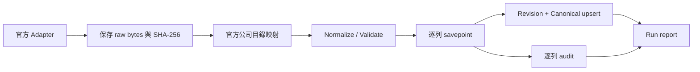

# Phase 1B — Taiwan Stock Market Data Ingestion

## 範圍與來源

實作 TWSE／TPEx 官方日行情、官方公司目錄、raw 保存、正規化、驗證、冪等匯入、run tracking 與手動 CLI。沿用既有 Modular Monolith、SQLAlchemy Repository Ports 與 PostgreSQL 17；沒有排程、WebSocket、股票查詢 API、K 線 UI 或技術指標。

四個正式 endpoint、欄位、資料日期、單位、授權、更新頻率與限制的查證見 [官方來源紀錄](phase-1b-sources.md)。兩個日行情端點未確認歷史日期參數；本階段**沒有完成任意遠端歷史下載**。

上述為原 Phase 1B 的最新快照契約。另經使用者授權新增的 `history` 命令，使用另外查證的官方日期匯出端點與持久化工作；其十年範圍、歷史身分限制及進度語意見[歷史回補規格](taiwan-history-backfill.md)，不改變原有 archive-only `backfill` 的行為。



## 分層與檔案

- `domain/ingestion.py`：provider、store、transaction ports、raw document 與逐列結果；不依賴 HTTP／ORM。
- `infrastructure/providers.py`：async `TwseAdapter`／`TpexAdapter`，符合既有 async DataSource fetch 介面；只接受 quotes/catalog identifier，不接受任意 URL 或日期 query。
- `application/normalization.py`：純函式的格式、日期、代碼及數值標準化。
- `application/ingestion.py`：`DailyBarImportService` 經 domain ports 組裝流程；不 import infrastructure。
- `infrastructure/ingestion_models.py`／`ingestion_store.py`：SQLAlchemy audit、交易與鎖。
- `stockapp/cli.py`：CLI composition root，注入實際 Adapter／Store。
- `0002_ingestion_audit`：顯式 migration；API 啟動不自動變更 schema。

同步 DB 工作目前僅由手動 CLI 使用，不在 FastAPI async request handler 執行。HTTP client、資料庫 engine 與 advisory lock 皆有明確生命週期。

## Raw／audit schema

新增三表，既有 canonical／revision 表保留 Phase 1A 實作：

| Table | 用途與主要欄位 |
| --- | --- |
| ingestion_requests | run_id PK/FK、market_id、mode(sync/replay)、requested_date、replay_of_run_id |
| raw_market_payloads | id、run_id、resource、endpoint、body BYTEA、content_type、status_code、fetched_at、Last-Modified、SHA-256、quote trade_date |
| ingestion_items | run_id、raw_id、row_index、symbol、instrument_id、trade_date、disposition、reason、raw_row JSONB |

- 原始 body 在解析前獨立 commit；保留 HTTP client 解開 Content-Encoding 後的 JSON／CSV bytes（包括 BOM／換行／欄位文字），不是壓縮傳輸封包。JSONB 只是逐列查閱用途，Decimal 在 JSONB 中以精確字串呈現。
- 最終 HTTP 錯誤回應也可保存；若超過大小限制，只保存受限診斷 prefix 並標記 run 失敗，不解析或回補這個 prefix。
- 每個 run 每種 resource 一筆最終回應；中間 retry 的每一次 HTTP 交換不另外保存。
- `(raw_id,run_id)` composite FK 防止逐列 audit 串到其他 run 的回應。所有關聯採 RESTRICT，不能連帶刪除歷史。
- raw quote 的 trade_date 只在成功解析後填入；catalog 的出表日期保留在原始 body，不能當成行情交易日。
- `0002` 降版先鎖定及檢查三張表；有資料預設拒絕降版，保留 Phase 1A 與 audit。明確接受資料損失時才可使用既有 `-x allow_data_loss=true` 操作。

Raw 與 audit 目前保存在 PostgreSQL，尚未加入自動清理、壓縮／外部 object storage。重複執行會新增 run 與 raw/audit，canonical 的唯一性與 revision fingerprint 仍確保行情不重複。

## 正規化與股票身分

- 以官方公司目錄作為普通股／公司股票的範圍；不把全市場回應內的權證、ETF／ETN 全標為 stock，也不單靠四位數代碼猜種類。
- `(market_id,symbol)` 查找或建立 instrument，保留代碼前導零。新進目錄且已掛牌的股票可新增；未出現在當期公司目錄的證券標為 out_of_scope，保留 raw/audit，不猜測公司身分。
- company catalog 尚未更新時不能保證涵蓋剛上市股票；缺列、名稱變更、退市與代碼重用不會被自動推斷為狀態變更。掛牌日期晚於 quote 交易日者不匯入。
- ROC `1151104`／`115/11/04` 與 Gregorian `20261104`／`2026-11-04` 轉成 market-local date，驗證真實日期。snapshot 必須只有一個有效交易日；不從執行日或 UTC 日期補造。
- 兩個市場的資料日可能不同；`sync latest` 表示來源此刻提供的最新快照，不保證就是今天。拒絕晚於 fetched_at 台北當地日期的 quote 日期。
- TWSE English JSON／中文 CSV 與 TPEx JSON 均支援；UTF-8 BOM、帶逗號數字及小數經嚴格解析，不接受錯誤的千分位格式。
- 所有 OHLC／turnover 為 Decimal；價格與計數沿用 Phase 1A 約束。已核實的兩個 endpoint 均以**股**提供成交量，正式匯入不乘 1000。
- Normalizer 的額外 lots 分支只有明確提供 lot_size 才可轉換；精確產生非整數股時拒絕，不捨入或猜測張數定義。
- optional turnover／trade_count 的 NULL 與 0 不相同；缺 volume 不能當 0。

| 來源情境 | 處理 |
| --- | --- |
| 完整、合法 OHLCV | accepted，upsert canonical/revision |
| 全部 OHLC 缺值且 volume=0、其他統計為0或缺失 | skipped，原因 no_price_no_volume；不自動斷言停牌 |
| 缺 OHLC 但有成交量 | rejected，不能補零或前收價 |
| 明確數字0價格 | rejected，與缺值不同 |
| 部分 OHLC 缺失、錯誤數字、負量、OHLC關係錯誤 | rejected，保留原因 |
| 同一 snapshot 重複 symbol | 預先識別，該 symbol 的所有列都拒絕，避免列順序決定價格 |
| catalog 有但 quote 沒有 | missing audit，不造 bar，也不自行判斷為休市或退市 |
| JSON 單列非 object／CSV 列寬錯誤 | 個別拒絕並保存；整個 envelope 無法解析才整批失敗 |

## 交易、狀態與重送

先保存 running run、request 與 raw，再以一個 work transaction 處理股票；每列使用 savepoint，單檔資料異常不使其餘有效資料消失。canonical 與 revision 仍使用 Phase 1A 原子 upsert，來源及交易日不變，較舊觀察不能覆蓋較新觀察。

- `accepted` 表示合法觀察已交給 Repository；replay 的舊觀察可能只增加 revision，不取代較新的 canonical。
- stats 含 received、accepted、skipped、rejected、out_of_scope、missing、new_instruments、canonical_inserted／updated／unchanged。
- 至少一筆 accepted、沒有 rejected／missing 時才標 succeeded。只有無交易 skipped 的批次不冒稱已匯入行情。
- 有 rejected／missing 時標 **failed + Partial coverage**，但保留已成功匯入的有效股票。這是刻意保守的完整性訊號，不代表所有資料回滾。
- 外部 API、catalog、格式或日期失敗，不會先刪除或清空既有 bar。致命 work commit 失敗則回滾 work，報告清除未提交的計數並記 rolled_back。
- 若 work 已 commit、但鎖釋放等後續步驟失敗，報告保留實際已提交計數，並顯示 failed；不冒稱資料已回滾。
- 正常中斷會嘗試記 failed；強制 kill／主機斷電仍可能留下 running，需由操作者核對後處理，本階段沒有自動 reaper。

錯誤摘要僅使用固定 reason code、計數或 exception 類別，不複製 DB 連線字串與 upstream HTML。原始官方資料仍在 raw body 中可稽核。

## Timeout、retry、rate limiting

預設 HTTP connect/write/pool timeout 10秒、read timeout 30秒；max_attempts=3；重試 timeout／transport error、429、500/502/503/504。一般400/403、schema或資料驗證錯誤不重試。退避加有限 jitter，遵守 Retry-After 秒數或 HTTP date；要求等待超過60秒時停止本次操作，不提前重試。

預設每 host 至少5秒間距，20MB body上限。Host limiter 在單一程序／event loop 共用；PostgreSQL advisory lock 防止本專案在同一 DB schema 對相同市場同時跑多個 sync/replay；隨機測試 schema 的鎖不影響本機正式工作。這不宣稱是官方配額，也不保證其他程序／同IP程式的總 QPS。環境變數：

```dotenv
INGESTION_MIN_INTERVAL_SECONDS=5
INGESTION_MAX_ATTEMPTS=3
INGESTION_MAX_RESPONSE_BYTES=20000000
```

## CLI 與退出碼

從 repository 根目錄：

```bash
docker compose up --build --wait --wait-timeout 300
docker compose run --rm backend alembic upgrade head
docker compose run --rm backend alembic check

# 官方當前快照；每個市場各抓 quotes/catalog，不送日期 query
docker compose run --rm backend stockapp sync latest --market all
# 或分別執行
docker compose run --rm backend stockapp sync latest --market twse
docker compose run --rm backend stockapp sync latest --market tpex

# 查詢 run、原始來源／時間／hash、計數與個別問題
docker compose run --rm backend stockapp runs --limit 5
docker compose run --rm backend stockapp runs --id <RUN_UUID>

# 只重新處理資料庫中已有的官方 raw archive；日期依實際保存內容指定
docker compose run --rm backend stockapp backfill --market twse --date 2026-11-03
docker compose run --rm backend stockapp backfill --market tpex --date 2026-11-04
```

backfill 可重複 `--date`，同次最多366個不同日期；只接受明確指定日期，不猜測週末或交易日。若當天沒有 archive，記錄 failed run：`archive_unavailable_remote_history_unsupported`，不發起遠端歷史請求。

本機使用已安裝的 `stockapp`，或 `python -m stockapp.cli`，命令參數相同；支援從 monorepo 根目錄載入 `.env`，從 `apps/api` 則沿用既有設定。沒有自動執行 Migration。

退出碼：0=全部 succeeded／查詢成功；2=partial、資料失敗、找不到指定run；1=設定或DB等操作錯誤；130=使用者中斷。因此看到退出2時，應查看報告 accepted 數與問題，而非認為沒有資料被保存。

`runs` 最多列100個run，單run最多顯示100項問題且優先 rejected／missing／skipped，並標示 issues_truncated；完整逐列紀錄仍在資料庫。失敗run也可查看raw端點、SHA、HTTP status、fetched_at與quote交易日。

## 測試分類

```bash
# 不接觸官方網路或外部DB的固定fixture測試
docker compose run --rm backend python -m pytest -m 'not integration and not network'
# PostgreSQL/Redis整合，所有資料僅在獨立測試schema
docker compose run --rm -e RUN_INTEGRATION=1 backend python -m pytest -m 'not network' -p no:cacheprovider
# 顯式官方網路測試，不寫DB，預設與CI分開
docker compose run --rm -e RUN_NETWORK=1 backend python -m pytest -m network
```

固定 fixtures 明確標示 synthetic，不作正式行情；正式驗收只能使用實際官方 Adapter。CI 執行離線與DB測試，避免對官方 API 做每次push的網路輪詢。

## 未完成或後續決策

- 任意遠端歷史查詢能力未確認、未實作；只對已有 raw 的日期提供回補。
- 未保證當前公司目錄涵蓋所有歷史股票、代碼變更或剛掛牌股票。
- 不由缺價推斷停牌；缺價但有量的記錄需另行確認交易範圍／其他價格來源。
- Raw 長期保存／清理政策、來源修訂優先序、正規化版本識別、強制中斷的 running run 清理尚待後續決策。
- Archive replay 不強制覆寫相同或更新觀察時間的既有 canonical；用新正規化規則修正相同時間的舊值，須另定明確的修訂政策。
- 不進入 Phase 1C，不建立排程或新增 UI。

## 真實資料驗收（2026-11-04，Asia/Taipei）

透過正式 Adapter 直接存取官方端點，未使用 fixture、第三方網站或手工價格作為正式資料。

| 市場 | 來源交易日 | accepted | rejected | skipped | catalog missing | out_of_scope |
| --- | --- | ---: | ---: | ---: | ---: | ---: |
| TWSE | 2026-11-03 | 1092 | 6 | 0 | 1 | 292 |
| TPEX | 2026-11-04 | 881 | 7 | 5 | 4 | 12733 |

兩市場均因 rejected／missing 保留 failed + Partial coverage 狀態；有效資料已成功 commit。這不是全市場資料完整的宣稱，未知／缺價股票沒有補造 OHLC。

資料庫核對：canonical **1973** 筆、normalized revisions **1973** 筆、raw responses **12** 筆；重複 `(instrument_id,trade_date)` 數量 **0**。第二次官方同步兩市場的 canonical_inserted 都為0；兩次 archive replay 的 inserted／updated 都為0，全部既有有效 bar 保持不變。

| 市場 | 第一次官方同步 run | 第二次同步 run | Archive replay run |
| --- | --- | --- | --- |
| TWSE | `166d02b2-42ac-49b0-b4c3-9fc9a73ef6ce` | `6c0a79db-1e4d-43d3-b69a-09a5b2654b63` | `340e3d33-1d90-4e45-893b-c55e2d000546` |
| TPEX | `3a8e6051-bacf-4180-8810-38b3de2ee47e` | `3bc52fd2-0924-4332-a5a4-d3b0a55816fc` | `a5d3cd7f-d1ef-48fa-8786-d222844e911f` |

目前 canonical 所對應的第二次 quote 回應：

| 市場 | fetched_at (UTC) | 原始 body SHA-256 |
| --- | --- | --- |
| TWSE | 2026-11-04T09:14:16.686252+00:00 | `73a0c6adeaa9ddd2e284a7251508d8fd9d6d7d98dd6feaf811d18e325c60a82c` |
| TPEX | 2026-11-04T09:14:40.189149+00:00 | `a1b835e5f6c1669f22e4455f5d9592b34eeaf0dbe457e6bfb0e68b22ef4cb47c` |

已使用 `stockapp runs --limit 6` 核對六次作業的狀態、計數、原始端點、HTTP 200、SHA、日期與 replay_of_run_id；每次均保存 quotes/catalog 兩份原始回應。

抽查正式資料：TWSE 2330／2026-11-03、TPEx 6488／2026-11-04 皆有 NUMERIC 價格、股數及對應官方 source_id。完整資料保留在本機 PostgreSQL，沒有將真實 raw body 提交到 repository。

### 最終測試結果

| 驗證 | 實際結果 |
| --- | --- |
| 最終 Docker image：RUN_INTEGRATION=1，pytest -m 'not network' | **384 passed，2 deselected**（外網測試另跑） |
| 官方網路 pytest，RUN_NETWORK=1 | **2 passed**，不寫入DB |
| Vitest | **7 passed** |
| TypeScript／Next.js production build | 通過 |
| Alembic | 0002_ingestion_audit (head)，check 無差異；測試涵蓋安全升降版 |
| Compose／健康檢查 | 四服務 healthy；/health、/health/ready、首頁皆 HTTP 200 |
| 正式第二次同步 | TWSE、TPEx 各0筆 canonical_inserted，筆數維持1092／881 |
| 正式 archive 回補 | 兩市場 inserted／updated 皆0；保留原 fetched_at |
| Git diff 格式檢查 | 通過；沒有 commit 或 push |

第一次外網測試曾在外層150秒期限停止；後來 TPEx 單獨測試通過，最終兩項一起執行亦通過（57.85秒）。沒有因此降低驗證標準、改用fixture或未確認備援來源。

仍有既有 Starlette/httpx TestClient deprecation warning 1項；遠端 GitHub Actions 尚未執行。本階段停止於 Phase 1B。
