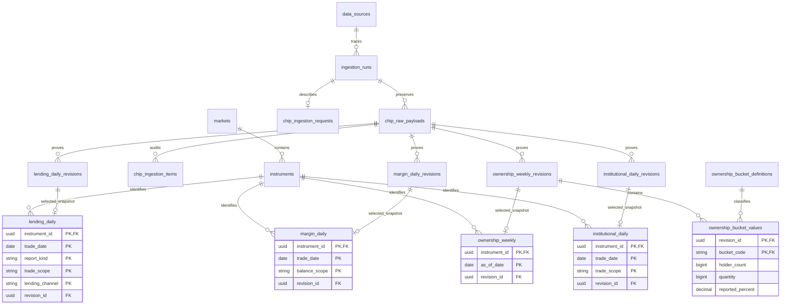
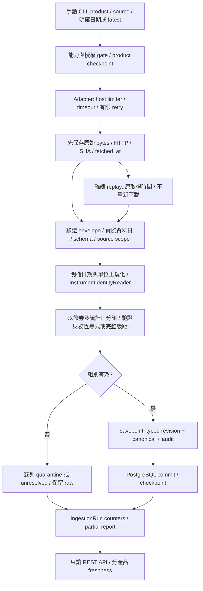

# Phase 2 — 籌碼領域與資料庫設計草案

狀態：**Phase 2A 設計，尚未實作**。設計日期：2026-11-07，Asia/Taipei。沒有新增 Python 模組、資料表、migration 或正式籌碼資料。來源能力以[來源查證](phase-2a-data-sources.md)為準；API 與實作順序見[API 草案](phase-2-api-contract.md)、[roadmap](phase-2-roadmap.md)。

後續補註（2026-11-10）：以上是 Phase 2A 當時的設計狀態，不代表今日執行庫現況；各階段實作以專屬 Spec 為準。模組表依最新任務分開 margin 與 lending；2E-1 僅建立 lending 純 Domain，下方 lending Schema 仍是未套用草案。

## 1. 與既有架構的接點

已閱讀 AGENTS、README、foundation、Phase 1A／1B／1E、十年回補規格，以及 `market_data`、`technical`、`health` 與 migrations `0001`–`0004`。目前依賴如下：

| 現有資產                                                   | Phase 2 決策                                                                                                          |
| ---------------------------------------------------------- | --------------------------------------------------------------------------------------------------------------------- |
| `markets`、`instruments`、`data_sources`、`ingestion_runs` | 重用 UUID 與既有 lifecycle，不複製證券主檔；由 market_data 公開 application facade／Domain Port 存取                  |
| `market_data/domain/ingestion.py`                          | 重用 raw-first、逐列紀錄與交易隔離的原則；其 `DailyBar`、`trade_date` 與 catalog 語意不能直接當通用籌碼介面           |
| `raw_market_payloads`                                      | resource CHECK 僅接受 quotes/catalog/fund_catalog/currency_catalog，且每 run/resource 唯一；不把法人資料偽裝為 quotes |
| `ingestion_items`                                          | accepted 必須有 trade_date；不把集保統計日冒充交易日，新增 Phase 2 專用 audit 表的設計                                |
| `history_jobs/history_days`                                | 目前是 twse/tpex 日行情工作；集保週資料不能塞入既有 daily checkpoint。後續另做 product-aware checkpoint               |
| `technical`                                                | 沿用純 Domain、參數／算法版本、Decimal 策略；籌碼公式集中於 chip_analysis，不能複製進 API／UI                         |
| `daily_bars` revision 排序                                 | 保留原規則。Phase 2 自訂、版本化 promotion policy，不偷偷改 Phase 1 或重算原行情                                      |

資料庫仍為 PostgreSQL 17；一個 FastAPI Modular Monolith + 手動 Data Workers。Redis 僅供後續快取／鎖協調，不是唯一進度儲存。API 不在請求期間下載供應商資料。同步 SQLAlchemy Repository 由 threadpool／同步 use case 使用，不能直接阻塞 async request loop。

## 2. 模組邊界與 Domain Models

每模組未來均採 `api/ → application/ → domain/`，`infrastructure/` 實作 Protocol；下表是預定路徑，不代表目前已存在。

| 模組            | 純 Domain 模型／責任                                                                                                   | 公開讀取 Port                                 |
| --------------- | ---------------------------------------------------------------------------------------------------------------------- | --------------------------------------------- |
| `institutional` | `InstitutionalDailyReport`、`InvestorComponent`、`TradeScope`；每日各法人買／賣／淨額及來源總計對帳                    | `InstitutionalHistoryReader`                  |
| `ownership`     | `OwnershipWeeklyReport`、`BucketScheme`、`HoldingBucket`；統計日的完整級距快照，區分一般級距／調整／合計               | `OwnershipHistoryReader`                      |
| `margin`        | `MarginDailyReport`、融資與融券雙 Ledger（2D已實作） | `MarginHistoryReader` |
| `lending`       | `LendingDailyReport`、雙Ledger、Quota、Channel／Partition；2E-2新增專用Persistence／Ingestion／API，實作及來源限制見[規格](phase-2e-lending-api.md) | `LendingHistoryReader` |
| `chip_analysis` | `ChipMetricEngine`、`MetricDefinition`、`MetricPoint`、`InputLineage`；只有跨來源衍生公式，沒有供應商 SDK 或私有表查詢 | `ChipAnalysisService`                         |

共用值物件：`InstrumentRef(UUID)`、`AsOfDate(date)`、`Quantity(int, shares|units)`、`SourceTiming`、`FactLineage`、`Coverage`。金額另外帶 ISO currency；不能由「台股」一律推論 TWD。Domain 不 import SQLAlchemy、FastAPI、httpx 或外部 SDK。

`SourceTiming`：

- `as_of_date: date`：市場本地交易日或 TDCC 原始統計日，依 product 明確命名；不是 UTC timestamp 截日，也不是下載日。
- `source_published_on: date | None`、`source_published_at: aware datetime | None`：來源明示的發布日／時刻；只知日期時不補午夜。兩者皆有時，必須以來源時區驗證一致。
- `first_seen_at`：本平台第一次保存該觀察內容的時間；`last_seen_at`：最近一次看到相同內容；`ingested_at`：這次資料庫寫入時間。
- HTTP Last-Modified／檔名中的時間只保留為 transport evidence，除非來源文件明定，不能當成發布時刻。公開頁面的「每日約幾點」也不是每筆資料的實際發布時間。

`FactLineage`：`source_id/run_id/raw_id/source_row_locator`、`source_contract_version`、`parser_version`、`payload_hash`、`promotion_policy_version`。row locator 可表示一個來源列產生多個法人 component；每個 canonical 必須能追到真正的原始 bytes。

證券身分解析使用 market_data 公開 `InstrumentIdentityReader.resolve(market, source_symbol, as_of_date)`，回傳 verified／unresolved 及已知有效期間。現有 `(market_id,symbol)` 唯一性仍保留；目前名錄不足以證明所有歷史身分。無法確認的已下市、代碼重用、市場轉換列只進 raw／audit，不猜測 UUID，也不自行建立「普通股」。TDCC 未附市場時不得僅用 symbol 命中第一個 instrument。

## 3. 金融語意與 Data Quality Rules

### 3.1 法人：組成不重複相加

Component：`foreign_ex_dealers`、`foreign_dealers`、`foreign_inclusive`、`investment_trust`、`dealer_proprietary`、`dealer_hedging`、`dealer_total`、`three_major_total`、`foreign_unspecified`（legacy、supplemental且mapping_status=unverified）。每項有 `buy_quantity/sell_quantity/net_quantity`，來源只提供淨額的 subtotal，其買／賣維持 null。2016舊外資欄位先記 `foreign_unspecified` 與 mapping_status=unverified，直到分類生效界線核實；不能靜默改標 modern foreign_ex，也不能用它產生需要現代分類的衍生指標。

- 明確提供買／賣時：`net = buy - sell`，買賣非負、net 可為負；來源 net 不合即隔離該證券／日整組，不能修正成想要的數字後宣稱來源一致。
- `dealer_total_net = dealer_proprietary_net + dealer_hedging_net`。總計不能再加一次 dealer_total；外資自營商是單獨揭示的補充分類，不能不經來源定義再加入三大法人總計。
- 現行**已核實契約**的 T86／TPEx 三大法人對帳式為 `foreign_ex_dealers + investment_trust + dealer_proprietary + dealer_hedging` 的 net，不能直接套用未確認的歷史分類。TPEx foreign_inclusive = foreign_ex_dealers + foreign_dealers，是補充 subtotal，不再疊加三大總計。
- `trade_scope` 必須保存是否含鉅額、來源選項／排除範圍，以及原始成交／是否依錯帳更帳調整的統計基礎。未確認的 scope 標 `unspecified` 且禁止跨 scope 相加；交易範圍或統計基礎不同是不同序列，不能只靠較晚下載時間互相覆蓋。
- 每個 instrument/date/scope 是原子報表；不能讓三個 component 來自新版本、另一個來自舊版本。其餘證券的有效報表可獨立提交。

### 3.2 集保：週快照與級距

- 統計日是來源的每週最後一個營業日，不能硬編碼週五、不能把發布日當統計日，也不能向後補值成每日實際持股。
- 級距採 source code + versioned bounds，保存 `lower_inclusive/upper_inclusive`；最後一個開放級距上限為 null。數量依來源的股／受益單位核定，不一律乘 1,000。
- `bucket_kind=regular|adjustment|total`。合計列與差異調整列不能當成一般持股級距再次加總。一般級距人數／股數非負；調整值可有正負或來源未提供的人數，須依契約另外驗證。
- 原始比例是「占集保庫存數比例」，不是占全部已發行股本；保留來源 `reported_percent`，另算 derived percent 時須註明分母。
- 完整報表先驗證級距集合、唯一性與 total，再以整個 instrument/as_of_date 快照升級。缺一個級距不可拿上週該級距補上，也不能以新報表缺列刪掉舊有效快照。
- 股數與比例對帳依來源 total、adjustment 及顯示精度進行。保存 `adjustment_value_convention=shortfall_magnitude|signed_delta|unverified`；CSV的正差額與HTML的signed調整不能一律做加法。只有已核實表示法的對帳式仍矛盾才 quarantine；口徑未確認列 not_verified 並限制依賴該口徑的衍生。未知捨入規則不設定任意「精確相等」門檻；比例殘差列 warning。來源 total 人數不由加總推測修正，adjustment人數即使非0也不加入一般持有人合計。
- 大戶比例變動只能描述匿名歸戶後的級距分布；不能識別特定個人的買賣、不能斷言「主力進場」。

### 3.3 融資融券與借券

`MarginLeg` 保存前日餘額、買進／賣出、現金／現券償還、今日餘額、限額，以及來源有提供的調整項；融資和融券欄位各自定義，不交換買賣方向。只有 source contract 已核實的公式才能硬驗證。

- 餘額是 stock，買進／賣出／還券是 flow；不能加總每日餘額作期間成交量。
- 融券餘額、借券成交／借券餘額、借券賣出／借券賣出餘額是不同概念。分 `report_kind`，不互相代填。
- 來源若為張：保存 raw 數值、raw unit 與經核實的 conversion factor；普通股常見的 1,000 股／張不是所有證券的通則。無可確認換算率則拒絕 canonical，不先乘 1,000 再猜。
- 空值、`--`、不適用、無資料、真的 0 分開；前日餘額缺失時不能從前一個已保存日期當成前一交易日。
- 發布後可能因結算再更新。同日較早的版本保留 revision，不能把不同發布輪次的欄位拼成一筆。
- D+1報表的「前日餘額」是D+1來源對前日的assertion，可能因更帳異於D最初的今日餘額。保留兩者原始日期／lineage，只有經審查的修訂政策才能用該assertion更新D；不能直接當成資料損壞或靜默覆寫。
- 限額／備註可能適用次一營業日：保存 `limit_effective_on/status_effective_on` 與 `effective_relation=same_day|next_business_day|unspecified`。若無已核實日曆，日期保持null並保留next_business_day關係，不能自行加一天。
- 借券系統另用 `lending_channel=combined|slb|nlb|other_verified`；初版M4僅啟用SLBNLB=combined。若未來同時保存子系列，channel必須進natural key／API，與是否含鉅額的trade_scope分開。

### 3.4 精度、異常與缺失

數量與人數用 Python int／PostgreSQL BIGINT；金額用 Decimal／NUMERIC(32,8)，比例用 Decimal／NUMERIC(20,12)。驗證有限值、scale、BIGINT 範圍；不使用 float 解析或持久化。需要計算的除法採 local Decimal context precision=50、輸出 scale=12、ROUND_HALF_EVEN，與 technical 一致；來源超精度原值不靜默四捨五入。

共通 quarantine：錯日／未確認日期、重複 natural key、缺必要欄、schema 漂移、無法確認單位／身分、欄位相互矛盾、同一 payload 兩個名稱正規化後撞 key。保留 BOM／原始標題於 raw；只對已知欄位做明確 BOM／空白正規化。不得用「缺整批」當成所有證券都是 0。

## 4. Database Schema 草案

**下列名稱與 constraints 是未來 migration 的審查輸入，目前沒有建立。** 各產品用自己的 typed canonical／revision 表，避免把所有籌碼塞入無型別 JSONB 或價格表。

### 4.1 共用匯入 audit（新增草案）

| 表                        | PK／主要欄位                                                                                                                                                                                          | Constraints／Index                                                                                                                                                                                                                                                 |
| ------------------------- | ----------------------------------------------------------------------------------------------------------------------------------------------------------------------------------------------------- | ------------------------------------------------------------------------------------------------------------------------------------------------------------------------------------------------------------------------------------------------------------------ |
| `chip_ingestion_requests` | `run_id UUID FK ingestion_runs` PK；product、market_id nullable、requested_as_of_date、mode、replay_of_run_id、contract_version                                                                       | mode=sync/history/replay；replay 必須有原 run；product/scope 驗證；index(product,market_id,requested_as_of_date)。TDCC 全市場 run 的 market_id 可 null，不建立虛構的 TDCC 交易所                                                                                   |
| `chip_raw_payloads`       | id UUID PK、run_id FK、resource、part_key、request_method、sanitized_endpoint/parameters、body BYTEA、content_type、status_code、sha256、fetched_at、Last-Modified/ETag、reported_as_of_date nullable | UNIQUE(run_id,resource,part_key)、UNIQUE(id,run_id)；HTTP 100–599、SHA256格式；參數不得含憑證。part_key 保存實際分頁／檔案，不偽造每日 raw                                                                                                                         |
| `chip_ingestion_items`    | id UUID PK；run_id/raw_id、row_index、source_row_key、instrument_id nullable、as_of_date nullable、disposition、reason、raw_row JSONB                                                                 | 複合 FK(raw_id,run_id)→raw；UNIQUE(run_id,raw_id,row_index)；row_index為單份raw內全表的唯一扁平序號，source_row_key另保留原table_index/row_index；index(run_id,disposition)、(instrument_id,as_of_date)。一列來源衍生多 component 時，以一個 row item 記錄整組結果 |

沿用 `ingestion_runs` running/succeeded/failed；partial 用 failed + 安全摘要與 counters，**不新增未相容的 partial enum**。stats 仍是非負整數 map；product、日期、版本、license 等文字放 request／manifest，不塞進 counters。rejected／unresolved 保存在 audit；不建立帶假數字的 canonical。

### 4.2 Canonical 與 revisions（新增草案）

每組 canonical 均帶 `source_id`、`revision_id`、`run_id/raw_id/source_row_locator`、`payload_hash`、契約／parser／promotion 版本、上述 SourceTiming；FK 全採 RESTRICT。每張 `*_revisions` 是同構 typed snapshot，加 `id UUID` PK，UNIQUE(natural key,source_id,contract_version,payload_hash)，不混入未驗證 raw。

| 表族／natural key                                                                                                | typed financial columns 與特有約束                                                                                                                                                                                                                                                            |
| ---------------------------------------------------------------------------------------------------------------- | --------------------------------------------------------------------------------------------------------------------------------------------------------------------------------------------------------------------------------------------------------------------------------------------- |
| `institutional_daily`／`institutional_daily_revisions`：`(instrument_id,trade_date,trade_scope)`                 | 對每個已定義 component 保存 buy/sell/net BIGINT 欄組；buy/sell 可因來源不揭示而 null，net 必填的 component 依 contract 決定；buy/sell≥0、net 可負、已知兩值時 CHECK net=buy−sell；base quantity_unit；必要 leaf 與 total 必須整組存在                                                         |
| `ownership_weekly`／`ownership_weekly_revisions`：`(instrument_id,as_of_date)`                                   | report header、bucket_scheme_version、source_total_holders/quantity、整組 completeness；一個 revision 對應一套完整級距，不跨版本補列                                                                                                                                                          |
| `ownership_bucket_values`：`(revision_id,bucket_code)`                                                           | FK ownership revision、bucket_scheme_version/code 複合 FK；holder_count BIGINT nullable、quantity BIGINT、reported_percent NUMERIC(20,12) nullable；regular/total非負且percent有限、0..100，adjustment獨立signed CHECK；canonical 由 header.revision_id 讀取該組 typed rows，無需再複製一套列 |
| `margin_daily`／`margin_daily_revisions`：`(instrument_id,trade_date,balance_scope)`                             | financing 與 short_margin 各有 previous_balance/buy/sell/cash_or_stock_repayment/balance/limit/adjustment；數量 BIGINT，來源真的以金額提供的值另用 amount + currency，不能混在 quantity；餘額與買賣非負、調整可負，未提供為 null                                                              |
| `lending_daily`／`lending_daily_revisions`：`(instrument_id,trade_date,report_kind,trade_scope,lending_channel)` | kind=borrowed_positions 或 lending_short_sales；previous_balance/increase/decrease/adjustment/balance、short_sale_quantity、short_sale_amount/currency 等欄依 kind 明確列出允許矩陣；不適用為 null；來源只給成交量時不推造存量；限額及狀態另有effectivity欄                                   |
| `ownership_bucket_definitions`：`(scheme_version,bucket_code)`                                                   | kind、label、lower/upper_inclusive（抽象基礎數量邊界，實際shares/units放report）；regular bounds 不重疊／不能含 total；NULL upper 只允許最後開放級距。定義來源與有效日期有版本                                                                                                                |

Canonical natural key 同時是 PK；各 revision UUID 與 canonical.revision_id 互相可檢查 key 一致，未來 migration 以 composite FK／UNIQUE 保護，不能只靠有一個合法 UUID。index：(instrument_id,date) 的 PK 前綴、(date,instrument_id)、source_id、run_id；ownership buckets 以 revision_id/code 讀整組。不能只以 symbol 為 PK。

ERD 省略共通 lineage 欄位與 mirrored financial columns；所有未來表均為草案：



### 4.3 Revision 與 promotion policy

1. 驗證通過才保存 typed revision；hash 包含 natural key、完整金融內容、單位、scope、contract version，排除下載／入庫時間。raw SHA 與 normalized hash 分開。
2. 相同內容重試不增加 revision，但保留新的 run/raw/item，canonical 的 last_seen_at 更新。A→B→A 時仍能由 raw sightings 重建觀察順序，不能只看 revision 首次時間。
3. 每個 product/scope 指定單一 primary source。相同 as_of_date 的不同官方表示法仍各有 source_id；未對帳前不自動混用，其他來源先為對照 revision。
4. 已核實的來源 revision number／發布時間優先；無此資訊時，使用**原始 fetched_at** 的觀察順序，並標 `observed_order_not_provider_revision`。同時間內容衝突 quarantine；晚下載不證明供應商發布了新修訂。
5. replay 沿用原始觀察時間與來源，不能因重播舊 raw 搶覆新 snapshot。revision、canonical、整組子列／audit accepted 在同交易內；單組失敗用 savepoint，其他證券保留。
6. 發布時刻未知的資料不能宣稱 point-in-time 回測可用；first_seen_at 只能證明平台何時首次看到。Phase 2 不提供歷史 vintage backtest 保證。

未來 migration 必須明確執行、空資料庫 upgrade/安全 downgrade，非空時拒絕資料損失；不在啟動時 create_all。Phase 2A 不提供可執行 DDL，亦不指定尚未審查的下一個 migration revision 名稱。

## 5. Adapter／Repository Ports 草案

```python
# 設計示意，未加入 runtime；domain 只依賴標準庫與自身值物件。
class DatasetAdapter(Protocol):
    capabilities: SourceCapabilities
    async def fetch(self, request: SourceRequest) -> RawDocument: ...

class ReportDecoder(Protocol):
    def decode(self, document: RawDocument, contract: SourceContract) -> DecodedBatch: ...

class InstitutionalRepository(Protocol):
    def upsert(self, report: InstitutionalDailyReport) -> UpsertResult: ...
    def list(self, query: InstitutionalQuery) -> ReportPage: ...

class OwnershipRepository(Protocol):
    def upsert_snapshot(self, report: OwnershipWeeklyReport) -> UpsertResult: ...
    def list_snapshots(self, query: OwnershipQuery) -> ReportPage: ...

class ChipMetricEngine(Protocol):
    def compute(self, inputs: ChipInputs, definition: MetricDefinition) -> MetricResult: ...
```

margin/lending 各自有 typed repository，不接受任意 JSON dict。Repository 不隱式 commit，交易由 UoW 控制。`SourceRequest` 含 product、market scope、requested_as_of_date 或 latest、明確 source filters；`SourceCapabilities` 含 latest/date_query/archive/manual、advertised_from、earliest_successfully_probed_date、approved_enabled_range、retention、unit、發布規則、license狀態與 evidence URL。官方宣告起點、實測最早日與核准範圍分開，不能由一次最早日成功推論中間完整。latest-only source 拒絕帶任意日期，不能悄悄忽略參數回最新資料。

API 的 dependencies/composition root 組裝各模組公開 service；chip_analysis 經上述 reader ports 取得 typed DTO，不 import 其他模組的 `infrastructure/models.py`、Session 或私有 Repository。shared ingestion 僅共用 audit／transport 值物件，不能成為互相依賴的業務巨型模組。

## 6. Ingestion Data Flow



每 host 使用既有保守 5 秒間距、timeout、有限 retry；此數字是平台設定，**不是官方 quota**。Phase 2 與行情 worker 共用 host 的作業必須序列化或共用協調器；既有 limiter 只在 process/event loop 共享，不能聲稱跨容器已限流。429 尊重 Retry-After；403/CAPTCHA/登入限制立即停止，不換 IP、不破解、不無限跨日重試。作業以 product+source+市場+日期加鎖，總流量另由 host 限制。

checkpoint 區分成功、部分、明示 no_data、下載失敗、未發布、無權存取、歷史不支援；未發布與失敗可有限重試，partial 依具體原因處理，不能用重跑宣稱補齊已到期身分。日曆未驗證時 no_data 不等於休市；每週也不能假設每隔七天必有一份。

## 7. 衍生公式與測試契約

所有公式登記 `metric_id/algorithm_version/parameters/input_product_versions/availability_policy`：

Phase2F-1實作為[`chip-analysis-engine-1.0.0`](phase-2f-chip-engine.md)，單產品計算委派既有公開Calculator，統一時間可用性、來源／分母相容性、12位HALF_EVEN輸出與Revision追蹤。法人累計只支援正式Domain的5／10／20／60session；沒有新增表、SQL reader、API或UI，不把這裡的草案當成已提供HTTP功能。

| 指標草案                              | 公式與必要輸入                                                           | 缺失／邊界規則                                                                                                                                           |
| ------------------------------------- | ------------------------------------------------------------------------ | -------------------------------------------------------------------------------------------------------------------------------------------------------- |
| `institutional_net_sum` v1            | N 個已確認交易 session 的指定 leaf net 之和；dealer 合計只取一次         | 未驗證 session 日曆或缺一日則 not_verified/incomplete，不以週末／空列補0                                                                                 |
| `ownership_large_holder_percent` v1   | 100 × quantity≥threshold之 regular 級距股數 / 同份報表 source total 股數 | threshold必須是regular級距下界，如400001／1000001，不能接受400000／1000000後套整桶；不能切割級距估算；total=0/null 回 null；排除 adjustment/total 再加總 |
| `ownership_large_holder_change_pp` v1 | 本週上式 − 前一個已核實週報上式，單位 percentage_points                  | 必須同 scheme/unit/denominator；缺週或不相鄰無法確認時回 null，不把幾週變動標成單週；不是個人淨買賣                                                      |
| `margin_balance_change` v1            | 今日來源餘額 − 來源前日餘額                                              | 依融資／融券分開；缺前日來源值回 null，不以前一天曆日猜測                                                                                                |
| `lending_short_sale_ratio` v1         | 100 × 同日同範圍借券賣出數量 / 可比較的成交數量                          | 分子分母市場、證券、unit、交易範圍未核對則 null；分母0回 null；不宣稱是借券總餘額比                                                                      |

測試需有固定數值、正負net、全零、null、不足資料、級距邊界、percent與percentage-points差別、除零、極大整數、重送／revision／舊raw回放、整組atomic rollback。跨頻率 join 以當時**已發布或已觀察到**的最近週報做明確 as-of join，必須保留該週報的日期與 age；不能把未來發布的週報回填到過去日資料。
