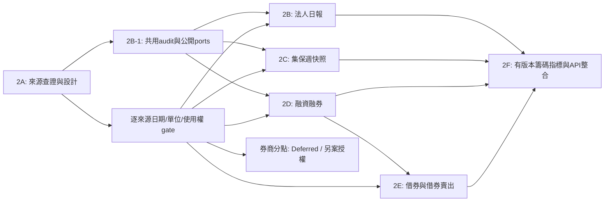

# Phase 2 — 開發依賴、工作與驗收

狀態更新：2026-11-11，Asia/Taipei。後續已依獨立任務完成 [2B-1 Domain](phase-2b-institutional-domain.md)、[2B-2 Persistence](phase-2b-persistence.md)、[2B-3 Adapters](phase-2b-adapters.md) 與 [2B-4 手動CLI／Ingestion](phase-2b-ingestion.md)。本機0006已依授權套用；[2B-5 法人 REST API](phase-2b-api.md) 已加入 canonical query、Domain metrics 與 source status。[2B-6驗收](phase-2b-validation.md)的軟體全流程／回歸已通過；TWSE使用權與TPEx口徑／dated identity仍阻擋真實canonical正式驗收。[2C-1集保管線／Persistence](phase-2c-ownership-ingestion.md)已完成並升級0007，實際canonical為2330／2026-11-06一週；[2C-2集保API](phase-2c-ownership-api.md)已完成canonical查詢、大戶比例與百分點差；正式週差仍受缺週／未核實schedule限制。[2D 融資融券](phase-2d-margin-api.md)與[2E 借券管線／API](phase-2e-lending-api.md)已在核准來源範圍完成，本機目前為0009；各自僅有已核實單日／單檔的正式資料驗收，不宣稱全市場完整。[2F-1純分析引擎](phase-2f-chip-engine.md)已完成公開Calculator委派、時間門檻與相容性契約；2F-2查詢整合及法人UI尚未開始。法人來源與verified calendar限制仍保留。以下保留2A原工作分解，範圍以各次明確任務為準；不因Phase編號自動開工，券商分點仍Deferred。

本計畫依據[來源稽核](phase-2a-data-sources.md)、[Domain／Schema草案](phase-2-domain-model.md)、[API草案](phase-2-api-contract.md)。目前已確認「來源存在」與「小樣本可讀」，不等於所有歷史、完整分類與自動利用權皆已完成。

## 1. 依賴順序



建議正常順序2B→2C→2D→2E→2F；若法人網站使用權尚未釐清，2B的純Domain／共用audit完成後，**可另行授權**先做O1集保或已確認OpenAPI，不必以未核准的網站路徑硬湊完整2B。各產品獨立標示enabled/capability，不因其他產品有資料就宣稱全部籌碼功能完成。

## 2. 共通 Definition of Done

- 來源具已核實的endpoint、method、request範圍、日期、單位、schema version、來源／授權顯名；未核實能力拒絕，latest-only不接收任意歷史日期。
- raw先落地；正規化／驗證／typed revision／canonical／逐列audit可追溯；來源錯誤不破壞原資料；異常列有原因與統計，不默默丟失整批。
- Domain不依賴ORM／HTTP框架，跨模組走公開ports；保留Phase1主檔與行情UUID、現有health／API／指標行為。
- Migration明確執行；空庫upgrade、允許情境downgrade、非空安全拒絕；真實PostgreSQL17隔離schema測試，不使用public測試seed或SQLite替代。
- 固定資料測試數值正確，network smoke與離線測試分離；不把synthetic fixture匯入正式資料庫。新增route有Pydantic及OpenAPI snapshot。
- 單位／null／0／負淨額／歷史身分／修訂／部分資料均有契約；報告實際下載與成功寫入範圍，不能用測試通過或run成功推論十年完整。
- 執行AGENTS要求的適用檢查、更新README／spec，回報限制；不自行commit／push／部署／開始下一Phase。

## 3. Phase 2B — 共用匯入基礎與法人日報

子階段範圍更新：使用者將 **Phase 2B-1 限定為純 Domain**、**2B-2 限定為 Persistence**、**2B-3 限定為 Source Adapters／Normalizer／離線契約測試**，依各實作規格為準。以下 2B-0～2B-3 是原先草案；Adapter 已在後續 2B-3 任務實作；手動 CLI 在2B-4、法人API在2B-5完成。下載仍受來源使用權與能力限制。

### 2B-0：來源契約與使用權收斂

工作：核實I1與I3的自動利用／保存／網站公開展示條件，或確認官方授權交付方案；記錄含鉅額與原始成交統計範圍、分類生效日期。OpenAPI I2缺少完整自行／避險欄位，不能當作完整替代。未取得授權前只做離線Domain／fixture，不啟動該source自動下載。

**AC**：每source有來源證據URL、核准用途、使用限制、capabilities與版本；無權來源預設disabled；不能以HTTP200或其他資料集OGDL作其授權。2016舊外資類別尚無語意證據時明示unsupported/unverified，不映射成現代foreign_ex。

### 2B-1：可加法擴充的audit與模組介面

工作：在既有monolith增加institutional模組；新增Phase2專用audit request/raw/item與typed法人canonical/revision的審查migration；重用DataSource／IngestionRun；建立market_data公開InstrumentIdentityReader／run註冊facade。支援product+source+date鎖與跨worker host限流協調。

**AC**：Phase1四版migration可連續升級；Phase2空表可安全回退，非空拒絕資料損失；既有worker／health／query無退化；raw多表locator不碰撞、source/run/raw關聯一致；Domain無infra imports。新來源不需放寬Phase1 quotes enum或更動DailyBar。

### 2B-2：Adapter、Normalize、Validation與手動CLI

工作：只對已核准來源增加TWSE／TPEx Adapter；版本化16／19／24欄與I2不完整20key；解析完整多層表頭、日期、股數、foreign／dealer hierarchy。CLI提供明確latest、可支援的指定日期、離線replay與status；下載重試有限，checkpoint持久化。

**AC**：

- fixed fixtures驗證每組buy−sell=net、dealer self+hedge、foreign inclusive及三大總計；foreign_dealers不重複加總；缺欄回null＋原因。
- TPEx表格位置改變／空表／重複欄名／columnNum不一致／leading-space key有明確處理；陌生schema拒絕，不憑position繼續。
- 來源錯日、缺欄、重複證券、負buy／sell、未知單位、unknown instrument被隔離；一檔壞資料不丟整批其他有效報表。
- 同日重送只有一個canonical；內容改變保留revision；整個instrument/day/scope原子更新；舊raw replay不覆蓋較新觀察；HTTP timeout/429/403符合政策。
- 若網路／權限已核可，兩市場各至少一個真實交易日驗證寫入與原始來源數字；若未核可，明確回報「離線實作完成、正式來源匯入未完成」，不能通過完整雙市場驗收。

### 2B-3：法人查詢API及狀態

工作：實作本提案institutional/history/latest、chip-data/status；範圍／分頁／safe errors／來源metadata；不做前端。

**AC**：404／422／空200／503符合草案；金融值無float；發布時間未知為null，daily日期不改為下載日；GET不對外發HTTP；OpenAPI export --check通過；PostgreSQL整合與Phase1回歸通過。只用目前已核准scope，不以含鉅額與不含鉅額兩序列互相覆蓋。

## 4. Phase 2C — TDCC 集保週資料

### 2C-1：目前CSV與完整快照儲存

工作：O1為primary，O2僅獨立對照／fallback，先核對日期與表示法；versioned bucket definitions、整組ownership report及revision；手動latest/archive replay/status。保留原始CSV，從現在開始累積真實週報，不宣稱已取得十年。

**AC**：完整parse六欄；BOM key alias／尾端空白／前導0／未知市場安全；1–15 regular、16 adjustment、17 total分開；quantity/count/percent精確。不同CSV／HTML調整正負與人數表達有固定fixture；百分比99.94之類不被自動縮放；missing／duplicate bucket不與上一版拼湊。重送去重、修訂可追溯、原子整組更新。

### 2C-2：歷史能力與週查詢API

工作：ownership/history/latest與status；先只查本平台已保存週報。O3的一年HTML歷史需另核實穩定契約／自動利用權，較早授權歷史維持Deferred；不建立每日holdings假資料。

**AC**：保留真正週統計日及nullable發布時間；跨年／非週五／缺週／空資料／週報整份分頁通過。CSV較新、JSON較舊時不誤覆蓋；明示depository_inventory分母與報表unit；最高bucket不能稱>=1,000,000。若未核可歷史來源，歷史下載命令拒絕而不是改日期；最新真實CSV最少一份可追溯寫入，network與fixture分開。

## 5. Phase 2D — 融資融券

### 2D-1：雙 Ledger Domain、單位、日期與來源契約

狀態：純 Domain／Ports／Calculator／版本化 Manifest 已完成，見[2D-1 規格](phase-2d-margin-domain.md)。依最新任務，雙 Ledger 與固定公式測試提前納入本階段；不新增資料表或 I/O。優先規劃 M5 已帶日期的TPEx OpenAPI，普通股／其他證券的張股換算須具身分與適用期間證據。TWSE M1沒有日期，須有可信日期證據或改採已授權dated來源M2；不能使用執行日期。M2歷史與TPEx融資歷史另有權限／endpoint gate。

**AC**：雙 Ledger balance identity、signed adjustment 版本、missing／not_applicable／zero 與數值精度固定測試；每列有可核實trade_date、raw unit／multiplier及版本；缺multiplier不猜；固定測試103張→103000股只於適用契約；未核實來源disabled。市場summary仟元不進個股quantity；官方ShortConvering拼字與實際買進還券語意正確；狀態／限額次一營業日的effectivity獨立保存。此階段所有下載仍關閉。

### 2D-2：雙leg存量／流量與API

狀態：Persistence／手動 Ingestion／REST API 已實作，見 [2D-2 規格與驗證](phase-2d-margin-api.md)。實際來源驗收受 M1 日期、M2 使用權及商品／日期換算證據 gate 限制，不宣稱完整歷史；停止於本階段。

工作：重用 2D-1 financing／short_margin Domain 與唯一 Calculator，建立 typed persistence／repos／migration、來源 Adapter／Normalizer、CLI／margin API；前日餘額、買賣／償還、限額與註記分開。須另獲任務授權才開始。

**AC**：融資與融券兩種balance identity固定數值驗證；不適用空欄維持null；D+1更帳的前日assertion不自動消滅D原始current；日曆未確認不拿前曆日當前交易日；重複與修訂、整組rollback、來源故障保留資料。只在已確認來源範圍內宣告真實資料驗收，不宣稱完整十年。

## 6. Phase 2E — 借券與借券賣出

### 2E-1：ledger與source/channel分離

狀態：純 lending Domain／Ports／Calculator／版本化 Source Manifest 已完成，見 [2E-1規格](phase-2e-lending-domain.md)。依本次任務不建立正式資料表或I/O；所有來源下載關閉。M4只描述SLBNLB來源契約，使用權與子系列partition仍未核可。

工作：M6的借券賣出、M4的借券未還、M3/M7的信用管制量分開；先只接已核可資料源。consolidated SLBNLB與其SLB/NLB子系列不重複加總，若同時保存則channel進natural key／API。

**AC**：借券未還current=previous+borrow−return；借券賣出current=previous+sold−returned+adjustment，各有fixture；源頭只提供quota時不能冒充borrowed或sold。M4兩市場正確對映既有Instrument。M8張數／金額未確認前不啟用，TWT96U僅額度且body未核實，不作實際量值替代。

### 2E-2：晚間修訂、資料完整度與API

狀態：Persistence／核准來源Adapter／手動Ingestion／REST API已實作，並以M6的6488／2026-11-09完成Raw→Canonical→HTTP與再次Replay冪等驗收，見[2E-2規格與驗證](phase-2e-lending-api.md)。M6保留unknown Channel／scope，其餘932筆未核實身分不晉升；M4借券未還及其他未核可來源維持Blocked，不宣稱全市場或完整歷史，停止於本階段。

本階段工作：重用2E-1雙Ledger與唯一Calculator，建立Persistence／Migration、Adapter／Normalizer、CLI／API與status，記錄報表kind、scope、channel、次日限額effectivity、原始發布輪次與跨Raw快照綁定證據。已於本次授權範圍完成，不自動進入下一階段。

**AC**：20:30／22:30觀察不同內容保留revision，不混欄；source說明允許的sold>一般limit案例不被錯誤拒絕；不能合計每日balance當期間volume；錯日／signed adjustment／未知單位／跨市場／舊raw replay／retry／去重測試及真實PG整合通過。精確公開API刷新時刻仍未知時不宣稱SLA。

## 7. Phase 2F — 共用籌碼指標與API整合

### 2F-1：版本化純Domain Engine

狀態：已完成，見[2F-1引擎與固定數值驗證](phase-2f-chip-engine.md)。

本階段工作：實作領域文件列的法人N-session淨額與連續次數、集保大戶比例及pp變化、margin balance change、lending餘額／日變化／flow及可比較範圍內的lending-short ratio。單產品公式重用既有公開Calculator；跨來源新公式只存在chip_analysis engine。來源不足的指標回unavailable，不產生「主力分數」替代。

**AC**：精確數值／參數／Decimal50位中間精度、輸出12位HALF_EVEN驗證；net正負／0/null、暖機／不足觀察、N-session完整度、分母0、跨年／缺週、>=門檻只接受級距下界；輸出版本、參數、分母、單位、input revision refs。資料不足不能只測可執行就當數值正確。

### 2F-2：跨頻率可用時間與查詢

工作：chip-metrics API、明確daily/weekly frequency、保守availability policy；透過institutional/ownership/margin公開reader ports取資料。建立明確as-of join，不寫入假每日集保持股列。

**AC**：週統計尚未發布／首次觀察前不得用於更早日；published_at未知不能宣稱vintage回測保證；每點標原週報日期／age／source／revision，不混合不同as_of_date形成單一「今天籌碼」。GET不抓供應商，單次snapshot、page/row/range上限、OpenAPI與完整回歸通過。

Phase2F不自動包含前端開發；若需要籌碼圖表另寫明UI範圍、設計與驗收。沒有策略回測、交易訊號承諾、AI分析或真實下單。

## 8. Deferred／仍需決策

| 項目            | 需確認的具體內容                                                     | 不影響的工作                                          |
| --------------- | -------------------------------------------------------------------- | ----------------------------------------------------- |
| I1/I3及網站歷史 | 自動利用、保存與對外服務範圍；是否採官方付費遞送；舊外資分類有效區間 | 2B Domain、固定fixtures、共用ports／審查migration設計 |
| TDCC超過一年    | 官方授權歷史來源、真實遞送interface、range、費用／轉載條件           | 2C當前O1快照與本平台持續歸檔                          |
| TWSE margin日期 | M1可信report-date來源或已授權M2；不能用另一個不同資料集日期單獨推定  | TPEx M5已知範圍與純Domain                             |
| 分點            | 合法訂閱、內外用權利、budget、delivery/auth、券商歷史識別            | 2B–2F不依賴分點；繼續Deferred                         |
| 全歷史身分      | 下市、代碼重用、轉市場與證券交易單位生效期                           | 已確認Instrument期間內的資料，unresolved完整保留      |
| quota／clock    | 官方數值限流與API發布SLA；TDCCmetadata頻率矛盾                       | 保守timeout/retry與明示not_verified freshness         |

以上是具體查證／契約gate，**不是要求本次先購買或授權下一階段**；Phase2A文件完成即可停止。

## 9. 建議的下一次 Phase 2B Implementation Plan

1. 先以本次證據凍結source manifest：能力、交易範圍、歷史schema、日期／股數與授權；決定允許啟用的來源。
2. 建立institutional純Domain及單組原子snapshot規則，先用明示合成fixtures驗證分類／算式／缺值；2016未核實分類維持unverified。
3. 審查並實作最小的共用audit與法人typed schema migration，不一次建立ownership/margin/lending所有表；加入public identity/run ports。
4. 實作已批准Adapter、raw-first import service、有限retry／host協調、手動latest／history-capability拒絕／replay／status CLI與PG整合。
5. 加入institutional query/latest與chip-data/status、Pydantic／OpenAPI；跑Phase1回歸並在有權限時做兩市場真實單日核對。
6. 更新README並回報新增檔案、schema、migration命令、實測與未解決項。到2B結束停止，不自行進入2C。

本次Phase2A只交付四份spec；沒有執行上述implementation plan。

## 10. Phase 2A 實際驗證

以下為2026-11-07本次執行，並非直接沿用Phase1先前結果：

```bash
.tools/api-venv/bin/python -m pytest apps/api/tests -m 'not integration and not network' -q
PATH="$PWD/.tools/node/bin:$PATH" npm test
PATH="$PWD/.tools/node/bin:$PATH" npm run typecheck
PATH="$PWD/.tools/node/bin:$PATH" NEXT_TELEMETRY_DISABLED=1 npm run build
.tools/api-venv/bin/python apps/api/scripts/export_openapi.py --check
git diff --check
```

- 後端：**683 passed，208 deselected**（integration／network），1項既有Starlette/httpx deprecation warning。
- 前端Vitest：**244 passed，15 files**；Typecheck、Production Build通過。
- Build第一次在受限環境因無法解析TypeScript子程序輸出失敗；在允許子程序的執行環境重跑同一指令成功，沒有改程式或依賴。Build自動產生的next-env檔已恢復，最終只新增四份spec。
- 現有OpenAPI snapshot檢查通過，沒有新增路由或手改snapshot。
- Markdown格式、相對連結、table欄數、code fence及JSON範例檢查；Mermaid圖以語法／節點靜態審閱，不宣稱已做瀏覽器渲染驗收。
- 官方來源的少量HTTP／資料schema／日期／單位查證另記於來源文件；未執行pytest network suite，也未把來源樣本寫入正式資料。
- 本次無schema、Compose、UI或runtime變更，未執行DB migration、PostgreSQL／Redis整合測試、Docker重建／部署或瀏覽器UI驗收；沒有停止／重啟原歷史worker。以上未執行項不列為通過。
