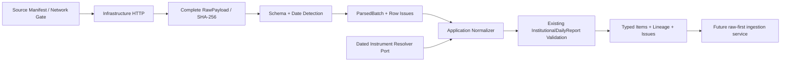

# Phase 2B-3 — Institutional Source Adapters

日期：2026-11-08，Asia/Taipei。本次建立 Adapter、版本化 manifest、Parser、Normalizer 與離線契約測試；不建立匯入 CLI、API、前端、排程或新資料表，不執行正式資料庫寫入、Migration 或 Docker 操作。

依據：[2A 來源稽核](phase-2a-data-sources.md)、[2B-1 Domain](phase-2b-institutional-domain.md)、[2B-2 Persistence](phase-2b-persistence.md)。資料表、`InstitutionalCalculator`、日行情與歷史回補 Worker 維持既有規則。

## 1. 已確認的限制與決策

| 問題                                                    | 本次處理                                                                                                                                           |
| ------------------------------------------------------- | -------------------------------------------------------------------------------------------------------------------------------------------------- |
| TWSE 不同年份 schema／外資分類界線未確認                | 只接受 2A 已實測的 2016-11-07 legacy16 與 2026-11-06 modern19；這是兩個離散日期，不是 2016–2026 已驗證區間。不根據欄數或「看起來較新」推測生效日。 |
| TWSE T86 自動利用權未確認                               | 網路預設 disabled；`network_enabled=True` 仍會拒絕 pending 來源。啟用需要新的授權證據與受審查的 manifest 版本，不靠任意環境布林值解除。            |
| TPEx OpenAPI 缺完整 self／hedge 欄位                    | 保存已知 dealer subtotal 與 hedge sell；不反推缺欄、不以 0 補齊，不能產生完整法人報表的宣稱。                                                      |
| TPEx I2 與日期匯出 I3 的 universe／交易範圍不能直接等同 | I2 scope flags／basis 維持未知；不借 I3 AL 的說明替 I2 認證。結果為 not_verified，並保留 missing core categories。                                 |
| 目前主檔缺歷史有效日期                                  | Normalizer 必須接收有日期證據的既有 Instrument UUID；只有今日同碼 registry match 不足，無證據回 unresolved，不自動建立證券。                       |
| 2A 原工作分解含其他來源／CLI                            | 本次只做 I1、I2；I3 完整 TPEx 日期匯出仍 deferred，沒有擴張使用權或開始 CLI／匯入服務。                                                            |

2026-11-08 只重新讀取官方說明／metadata，沒有透過 Adapter 下載真實法人報表。TWSE [T86 說明頁](https://www.twse.com.tw/zh/trading/foreign/t86.html)當次回安全限制文字，未重試其他網域或繞過限制；欄位證據沿用 2A 的 2026-11-07 稽核。TPEx [資料集11856](https://data.gov.tw/dataset/11856)仍列每日、免費、OGDL 第1版，並引用[官方 Swagger](https://www.tpex.org.tw/openapi/swagger.json)。此證據不延伸為 I3 AL 日期匯出的使用權。

## 2. 檔案與分層

```text
apps/api/src/stockapp/modules/institutional/
  domain/sources.py                 Source Port、parsed facts、dated identity、結果契約
  application/normalization.py      typed report、lineage、身分、整份 Domain validation
  infrastructure/
    source_manifest.py             frozen、versioned capabilities／rights／schemas
    providers.py                   TWSE／TPEx Adapter，權限與歷史能力 gate
    parsing.py                     strict JSON、日期、整數、重複欄辨識
    twse_parser.py                 16／19 欄已知契約
    tpex_parser.py                 20 欄 latest-only 契約
    transport.py                   httpx、timeout、retry、host limiter
apps/api/tests/
  test_institutional_sources.py
  test_institutional_normalization.py
  test_institutional_twse_parser.py
  test_institutional_tpex_parser.py
  test_institutional_transport.py
  fixtures/institutional/           三份手工 synthetic JSON 與 provenance README
```

Domain 僅 import 標準庫與自身契約；Application 不 import Infrastructure。來源解碼細節、HTTP 與重試全部放 Infrastructure。沒有新的 Provider SDK 或相依套件；不直接引用 market_data 的私有 Infrastructure。

## 3. Versioned Source Manifest

`source_manifest.py` 提供不可變 dataclasses 與唯讀 `MANIFESTS`，總版本 `institutional-sources-1.0.0`。每個來源明列 audit ID、endpoint／method／parameters、capability、authorization／license、evidence URLs、單位與 factor、frequency、timezone、發布時間、官方 quota、download default、已知缺口及各 parser contract。

| 來源／endpoint                                                        | Request／capability                                                     | Parser／已驗證日期                                                       | 網路開關                                                                                      |
| --------------------------------------------------------------------- | ----------------------------------------------------------------------- | ------------------------------------------------------------------------ | --------------------------------------------------------------------------------------------- |
| I1 `GET https://www.twse.com.tw/fund/T86`                             | date=YYYYMMDD、selectType=ALLBUT0999、response=json；audited_dates_only | `twse-t86-legacy-16-v1`：2016-11-07；`twse-t86-modern-19-v1`：2026-11-06 | 預設 false，pending 權限目前不能執行下載。                                                    |
| I2 `GET https://www.tpex.org.tw/openapi/v1/tpex_3insti_daily_trading` | 無參數；latest_only，不接受 trade_date                                  | `tpex-openapi-20-v1`；不宣稱任意歷史日期已驗證                           | 預設 false；因 OGDL dataset 文件已確認，可在後續合法使用情境明示 opt-in。此次只用 Mock HTTP。 |

每個 ParserContract 保存完整欄名、parser version、scope、離散的 verified_historical_dates，以及按排序／trim 後完整欄名計算的 `schema_sha256`。欄位重排不變更 schema 身分；未知／缺少欄位仍拒絕，不靠 hash 自動允許新的契約。

兩來源的來源單位目前均為股，`unit_factor=1`，不是張。精確發布時間與官方數值限流均為 None，不拿工程設定當成交易所配額或 SLA。TWSE `ALL` 尚未核實，不隱式以 ALLBUT0999 取代。

## 4. Schema Detection 與 Parser

共同解碼先核對預期 endpoint、GET、HTTP200 與 JSON content type，使用嚴格 UTF-8／可接受 UTF-8 BOM 的 JSON 解碼。重複 JSON object key 在形成 dict 前拒絕；NaN／Infinity 常值、HTML／驗證頁、非法 bytes 或超長 JSON 整數回安全錯誤，不包含機密連線資訊。

欄名只允許明確的前後空白 normalization。先檢查重複／alias collision，再與完整已知欄名集合比對。TWSE 只有在 header 完整確認後，才把該列 values 對回 header；TPEx 依 key mapping，兩者均不以固定位置猜未知 schema。

### 4.1 TWSE

- Envelope 必須是 stat=OK；回傳 date、selectType 與 raw request parameters 必須一致。若 caller 另給 requested_date，也必須一致。
- Header 決定候選 16 或19欄契約，再驗證該契約允許的日期；2016 的 modern19 或 2026 的 legacy16 都不會自動通過。
- 若有 total，必須是嚴格整數且等於 data rows；空回應不當作休市證據。
- 現行19欄保存 foreign_ex、foreign_dealers、trust、self、hedge、dealer subtotal 與 three-major subtotal。foreign_dealers 是 supplemental，不能再加進三大總計。
- legacy16 外資映射為 `FOREIGN_UNSPECIFIED / UNVERIFIED`，不映射為現代 foreign_ex；其 scope 也不宣稱已驗證。
- 已核實現行 scope 包含一般、零股、盤後及鉅額，basis=original，code 含 ALLBUT0999；不是「僅普通股」或付費不含鉅額序列。

### 4.2 TPEx

- 只解析最新 JSON array，Date 為民國 yyyMMdd。每列 schema 和日期先在全批核對，混合日期或缺 Date 整批拒絕；不以 fetched_at 補日期。
- 保留20個官方原始 keys，包括前導空白、`ForeignDealers-Difference`、`Foreign Dealers-TotalSell` 等拼字。
- `Dealers -TotalSell` 僅對應 hedge sell；hedge buy／net 為 None，self component 不存在。dealer subtotal 不能反推出這些缺值。
- foreign inclusive 是重疊 subtotal，與 foreign_ex／foreign_dealers 做 Domain 對帳，但不加入三大總計第二次。
- scope code=`tpex_openapi_scope_unverified`，flags=None、basis=unspecified；沒有借用 I3 的全 AL 範圍或 block-trade 證據。

Schema／日期／envelope 問題為 batch-level error；已知 schema 內的個別錯量、錯身分文字或單組 net mismatch 變成 `RowIssue(row_index, locator, code, symbol, raw_row)`，保留其他有效列。不默默跳過失敗股票。

## 5. Normalization 與 Validation

資料流：



這次不執行最後一個 future ingestion 節點，也不呼叫 Repository upsert。Adapter 回完整 RawPayload；未來服務可以經 `on_response` callback 在每次 HTTP 回應後先歸檔，再進行解析。

### 5.1 數值、日期與單位

- 來源量接受嚴格 int／整數字串，允許正負號與正確三位逗號，拒絕 float、bool、Decimal 小數、科學記號、不合法逗號、超過 BIGINT 範圍或超長數字字串。
- None、空白、`--` 保留 None；`0` 保留真正整數0；其他未知符號拒絕，不能一律轉零。
- 原始欄位與解析後值均保留；buy−sell=net、dealer self＋hedge、three-major、foreign inclusive 的算式只由既有 `InvestorFlow`／`InstitutionalDailyReport` 驗證，沒有第二套 Calculator。
- `parse_date` 必須指定 gregorian_compact／roc_compact／gregorian_slash／roc_slash，不猜年份曆法；驗證真實日期、閏年與民國正年份。資料日期不得晚於 raw.fetched_at 的台北日期。
- 本次支援的兩個契約已經是股，不做乘1,000。張數／未知證券單位的轉換不在已核實能力內；與 instrument dated binding 不同的單位回 instrument_unit_mismatch，不能冒充已完成 ETF 或權證的單位認證。

### 5.2 Instrument 身分

`InstitutionalInstrumentResolver` 是純 Domain Port，回 `InstrumentBinding` 或 None。Binding 引用既有 Instrument UUID，附 market／symbol／unit、明確有效起訖日期及 evidence_version，不建立另一套證券主檔。Normalizer 核對 market、symbol、日期區間及 base unit。

目前 `market_data.public` 的歷史查詢會明示 historical_unresolved；不能直接包裝今日 registry match 為有歷史證據的 Binding。此階段不提供生產用歷史身分資料源，測試 resolver 僅使用明示 synthetic 證據。未知證券／無有效日期證據產生 issue，不生成假 Instrument UUID。

### 5.3 Lineage、重複與原子報表

ParsedBatch 綁定 raw ID 及 SHA-256；Normalizer 拒絕配到另一份 raw／不同 bytes，避免來源誤標。每個 accepted item 保存原 row_index／locator／raw_row 及 identity_evidence_version。

輸出使用既有 `InstitutionalDailyReport`，保留 source UUID、source_contract_version、parser version、run／raw UUID、normalized fingerprint、scope／unit 與時間。發布日期／時間保持 None，不從 HTTP headers 推測。`promotion_policy_version=not_applied`，尚未產生資料庫 canonical；revision UUID 是待寫入身分，後續 2B-2 Repository 可重用相同內容的既有 revision UUID。

同批相同 symbol 的有效列全部拒絕，不選最後一列；重複 row_index 為 batch error。每份報表建立時執行完整 Domain validation，因此不會輸出半份自營商 revision。跨次解析相同內容會得到相同 normalized fingerprint，但本次 Normalizer 不寫入資料庫；正式冪等／revision promotion 仍由 2B-2 Repository 負責。

## 6. HTTP、Retry、Rate Limit

`InstitutionalHttpTransport` 使用 httpx AsyncClient，僅 GET／HTTPS、參數獨立保存，不跟隨 redirect。Adapter 在 transport 之前檢查 manifest 權限、network opt-in、UUID 與 historical capability。Import／建立 Adapter 不發請求。

| 情況                         | 行為                                                                                 |
| ---------------------------- | ------------------------------------------------------------------------------------ |
| Timeout／transport failure   | 最多3次，耗盡回安全 timeout／transport_error；不洩漏 request exceptions 的敏感文字。 |
| 401／403、3xx、其他非重試4xx | 立即停止，不更換網域／proxy／IP 迴避限制。                                           |
| 429／5xx                     | 最多3次；依 Retry-After 秒數或 HTTP-date 延後；超過等待預算立即停止，不提前重試。    |
| JSON／schema／日期錯誤       | Parser 失敗；不以 HTTP 重試掩蓋契約錯誤。                                            |
| Body 過大                    | 解壓後上限20,000,000 bytes；拒絕，不把截斷前綴當完整 RawPayload。                    |
| 歸檔 callback 失敗           | 原樣中止，不繼續 HTTP retry；此次沒有配置資料庫 callback。                           |

預設 connect／write／pool timeout 各10秒，read timeout30秒，皆為有限正數；這是 HTTP 操作 timeout，不是整條 ingestion 的 SLA。預設最多3次、Retry-After 等待預算60秒；可設定範圍有檢查。

HostRateLimiter 預設每host至少5秒，在同程序／event loop 共享，並可把 Retry-After penalty 套用至同 host 後續呼叫。它**不協調不同 Worker，也不與 Phase 1 另一個程序的 limiter 共用狀態**；未來啟用多 Worker 前必須注入跨程序協調器。沒有以本次實作宣稱已完成全平台流量協調。

每個完整 HTTP response 有獨立 raw UUID、part_key=`attempt-N`、bytes／SHA-256、request parameters、fetched_at、status、content type、ETag／Last-Modified。可選 async `on_response` 逐次接收，確保重試前的回應可由後續服務另行歸檔；同一次 fetch 的多個 attempt 不覆寫相同 archive slot。重新執行一次 fetch 應使用新的 IngestionRun，不在舊 run 改寫已歸檔 slot。

## 7. 離線測試與結果

Fixtures 均為作者手工 synthetic，沒有下載或複製真實報表的數值，詳見 [Fixture provenance](../../apps/api/tests/fixtures/institutional/README.md)。固定數值包括 TWSE 三大淨額750、自營商−50，以及 TPEx reported total1300／foreign inclusive990；不把這些值寫進畫面、正式資料庫或 seed。

從 repository 根目錄執行：

```bash
.tools/api-venv/bin/python -m pytest \
  apps/api/tests/test_institutional_sources.py \
  apps/api/tests/test_institutional_normalization.py \
  apps/api/tests/test_institutional_twse_parser.py \
  apps/api/tests/test_institutional_tpex_parser.py \
  apps/api/tests/test_institutional_transport.py -q
RUN_INTEGRATION=0 RUN_NETWORK=0 .tools/api-venv/bin/python -m pytest apps/api/tests -m 'not integration' -q
PATH="$PWD/.tools/node/bin:$PATH" npm test
PATH="$PWD/.tools/node/bin:$PATH" npm run typecheck
PATH="$PWD/.tools/node/bin:$PATH" NEXT_TELEMETRY_DISABLED=1 npm run build
.tools/api-venv/bin/python apps/api/scripts/export_openapi.py --check
git diff --check
```

| 檢查                                          | 本次結果                                                                                               |
| --------------------------------------------- | ------------------------------------------------------------------------------------------------------ |
| 新增離線來源／Normalizer／Transport 契約測試  | **232 passed**：TWSE35、TPEx61、HTTP70、共通來源與Normalizer66。                                       |
| 全部後端非整合回歸                            | **1,138 passed、2 skipped、271 deselected**；2 skipped 是停用的外部network smoke，271 為 integration。 |
| 前端 Vitest                                   | **244 passed，15 files**。                                                                             |
| Typecheck／Production Build／OpenAPI snapshot | 均通過；沒有新 route 或 API contract 變更；build 產生的 next-env.d.ts 變更已還原，前端無 source diff。 |

測試覆蓋 schema reorder／unknown／missing／duplicate／alias collision、民國日期／錯日／混日、完整與 partial／unverified、null與0、單位不符、unknown／dated identity、重複列、raw lineage、Domain aggregate、超長數字單列隔離、HTTP timeout／401／403／429／5xx／redirect、Retry-After、response size、client lifecycle 及 host limiter。

所有 HTTP 錯誤與重試測試均使用 MockTransport，不向官方 endpoint 發請求；沒有執行 PostgreSQL／Redis integration、來源 live smoke、Docker、Migration、CLI 或瀏覽器 E2E。保留既有 Starlette／httpx deprecation warning，不為消警告變更相依套件。

## 8. 後續依賴

1. TWSE 自動利用／保存／對外服務權與歷史分類生效日期，確認後新增 manifest 契約，不放寬未知日期。
2. 核實 TPEx OpenAPI 的完整交易範圍；若要完整 self／hedge，需要另行審查 I3 的使用權及多層欄位契約。
3. 可信的 dated Instrument／unit evidence 與跨 Worker host limiter，不能以今日主檔或程序內鎖代替。
4. 另行建立 raw-first ingestion Application、run tracking／逐列 audit、rollback／重試與 CLI；本次沒有接入正式 Persistence 或執行這些工作。

本階段完成後停止，不自行啟用下載、匯入正式資料或開始下一個子階段。
