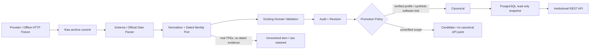

# Phase 2B-6 — Institutional End-to-End Validation

驗收日期：2026-11-08，Asia/Taipei。範圍為 Phase 2B-1～2B-5；不新增法人 UI、來源、Schema 或 Phase 2C 功能。

**結論：軟體全流程與回歸通過；真實來源的 canonical → API 正式驗收仍為 Blocked。** TWSE T86 使用權未核實，沒有下載；已核准 TPEx 最新資料成功匯入隔離環境的 raw／audit，但缺 dated identity evidence，且現有交易口徑未核實，不能晉升 canonical。沒有拿 synthetic 測試取代正式資料驗收。

依據：[Source Audit](phase-2a-data-sources.md)、[Domain](phase-2b-institutional-domain.md)、[Persistence](phase-2b-persistence.md)、[Adapters](phase-2b-adapters.md)、[Ingestion](phase-2b-ingestion.md)、[API](phase-2b-api.md)。

## 1. Test Results

| 項目 | 實際結果 |
| --- | --- |
| 全部後端／PostgreSQL／Redis／Migration 回歸 | **1594 passed，4 deselected**，150.62秒；`pytest tests -m 'not network' -q --tb=short` |
| 獨立 Unit suite | **1258 passed，340 deselected**，3.11秒；`RUN_INTEGRATION=0 RUN_NETWORK=0 pytest apps/api/tests -m 'not integration and not network' -q --tb=short` |
| PostgreSQL Integration／Migration | 上列全套中的**336個 integration案例**通過；包含空DB upgrade、metadata parity、FK／CHECK、並發、冪等、promotion、rollback、空資料安全downgrade與非空downgrade拒絕 |
| 新增完整軟體 E2E | **5 passed**；Provider Fixture／真實Adapter＋MockTransport → Raw → Parser → Normalizer → Domain → Audit／Revision／Canonical → PostgreSQL → HTTP API |
| 新增 query／index 驗證 | **2 passed**；instrument／scope／date／LIMIT、其他證券隔離、EXPLAIN、有限資料載入 |
| TPEx 真實來源驗收測試 | **1 passed**，91.04秒；驗證已允許的raw／audit、兩次下載、replay、來源數值與空canonical API。**不表示真實canonical驗收通過** |
| 版本化安全測試runner | 新repo runner執行上述7個新離線案例：**7 passed**，9.16秒；live模式的reference snapshot／隔離DB／collection／cleanup也實際通過，沒有額外下載 |
| Vitest | **244 passed，15 files** |
| Typecheck | `npm run typecheck` 通過 |
| Production Build | `NEXT_TELEMETRY_DISABLED=1 npm run build` 通過；build產生的next-env檔已還原 |
| OpenAPI Snapshot | host及執行中Backend的 `scripts/export_openapi.py --check` 均通過 |
| Docker Compose | config正常；backend／frontend／postgres／redis均healthy；`/health`、`/health/ready`皆200 |
| 現有網站及行情 | 首頁、2330頁、Phase 1 latest API皆200；Playwright桌面日／週／月圖、手機搜尋／尺寸調整：**2 passed** |
| Git diff | `git diff --check` 通過；沒有commit／push |

完整回歸在新建 `stockapp_p2b6_test_<random>` DB 執行，DB fixture再逐例建立UUID schema；執行後刪除臨時DB。Phase 1 market data及technical指標測試均包含在全套回歸，沒有另用簡化版計算公式。4個network案例由完整回歸明確排除；本次另只執行新的已核准TPEx live案例，沒有執行其他來源network測試。

Pytest保留1個既有Starlette/httpx TestClient deprecation warning，沒有為消除warning變更依賴。首次新增live驗收的數值對照漏處理官方欄名前導空白，修正**驗收程式**後重跑通過；原Parser已正確處理，沒有改Manifest或放寬未知Schema。

### 可重複執行的指令

從repo根目錄，使用已安裝專案依賴的Python 3.12 venv（本環境為`.tools/api-venv`）：

```bash
# 不連外的Unit
RUN_INTEGRATION=0 RUN_NETWORK=0 .tools/api-venv/bin/python -m pytest \
  apps/api/tests -m 'not integration and not network' -q

# 新增runner：建立獨立臨時DB，逐例私有Schema，結束只刪除該臨時DB
.tools/api-venv/bin/python apps/api/scripts/run_institutional_validation.py

# 只重跑新增的軟體E2E／index測試
.tools/api-venv/bin/python apps/api/scripts/run_institutional_validation.py -- \
  tests/test_institutional_end_to_end.py tests/test_institutional_query_performance.py -q

# 明確允許TPEx latest官方連線；不啟用TWSE，不生成dated identity evidence
.tools/api-venv/bin/python apps/api/scripts/run_institutional_validation.py --live-tpex

.tools/api-venv/bin/python apps/api/scripts/export_openapi.py --check
PATH="$PWD/.tools/node/bin:$PATH" npm test
PATH="$PWD/.tools/node/bin:$PATH" npm run typecheck
PATH="$PWD/.tools/node/bin:$PATH" NEXT_TELEMETRY_DISABLED=1 npm run build
docker compose config --quiet
docker compose exec backend alembic current
docker compose exec backend alembic heads
docker compose exec backend alembic check
curl --fail http://localhost:8000/health/ready
```

Runner需要目前DB角色具有建立獨立測試DB的權限及maintenance `postgres`連線能力；不在configured application DB執行Migration。預設只跑離線測試。`--live-tpex`會從目前主檔**唯讀複製**一筆既有TPEx股票metadata到隔離schema（預設6488，可用`--symbol`選擇已有的股票），不推測其歷史有效日期。沒有現有真實主檔時明確失敗，不能以synthetic補齊。禁止將手工測試證據套入正式來源。

Live測試若遇來源403／429／timeout等限制會保存audit摘要並skip，必須在驗收中列Blocked，不能把skip當成功。最新輸出在`.tools/validation/phase-2b6/`（gitignored）；`--output-dir`可變更。此處的測試DB及schema會清除，舊run/raw UUID不能再用正式API查詢。這些指令不啟動長期同步或history-worker。

## 2. Database Schema Version

| 項目 | 實測 |
| --- | --- |
| PostgreSQL | **17.11** |
| Application schema | `stockapp/public` |
| Alembic current | `0006_institutional_jobs` |
| Alembic head | `0006_institutional_jobs` |
| Alembic check | `No new upgrade operations detected.` |
| 正式Migration | 已在head，**本次沒有執行upgrade／downgrade** |
| Institutional schema約束 | 6個PK、9個UNIQUE、16個FK、94個CHECK（6張institutional表） |

實際讀取pg_constraint及pg_indexes核對既有Schema。Behavior tests在隔離Schema驗證buy−sell=net、dealer／grand reconciliation、raw SHA-256、複合lineage FK、instrument/date/scope唯一性、不可變revision／raw／job、原子更新及失敗rollback。非空報表／checkpoint的downgrade會拒絕，沒有對正式資料嘗試回退。

### Full Data Flow



5個新E2E案例核對完整lineage、來源buy/sell/net、API Decimal字串、source總計與derived總計不重複加總、重複下載只保留一份canonical／同內容revision、較新修訂晉升、舊raw replay不覆蓋新版、報表／counter／checkpoint一起rollback、resume原子完成，以及一檔異常不默默丟棄其他檔。測試中的canonical有明示synthetic身分，不計真實覆蓋率。

## 3. Source Capability Matrix

官方來源及授權於本次重新核對；保留現有`institutional-sources-1.0.0` Manifest。

| Source | Endpoint／method | 日期／頻率／單位 | 授權與啟用 | 正式驗收狀態 |
| --- | --- | --- | --- | --- |
| TWSE T86／I1 | `GET https://www.twse.com.tw/fund/T86`；date、selectType=ALLBUT0999、response=json | 日／股；現有Parser只稽核2016-11-07 legacy16、2026-11-06 modern19，不代表連續歷史 | pending，預設disabled，本次未下載 | **Blocked：自動下載使用權未核實** |
| TPEx OpenAPI／I2 | `GET https://www.tpex.org.tw/openapi/v1/tpex_3insti_daily_trading`；無日期參數 | latest-only，日／股，20欄；Date民國yyyMMdd | OGDL-1.0 dataset documented，手動明示opt-in；自動同步仍關閉 | Raw／schema／數值／audit通過；**真實canonical→API Blocked** |
| TPEx日期匯出／I3 | 既有Audit候選，未啟用新的Endpoint／Parser | 不由I2推論歷史或完整dealer能力 | 未核准此交付路徑 | Deferred，不下載 |

[TPEx官方資料集11856](https://data.gov.tw/dataset/11856)仍標示每日、免費與OGDL第1版；[OGDL條款](https://data.gov.tw/license)要求來源顯名，不將該授權延伸到其他網站匯出。[TWSE使用條款](https://www.twse.com.tw/zh/terms/use.html)對未核准自動下載及特別開放資料有不同規定，維持T86 pending。Dataset metadata雖列完整dealer欄，**不能取代實際20欄body契約**。

一般Web工具讀取TPEx OpenAPI首頁／Swagger得到403，沒有繞過；本機既有、已核准Adapter對上述確切I2 endpoint實際得到HTTP200。此差異不允許更換proxy／繞過來源限制。HTTP仍沿用timeout、有上限retry、host至少5秒；官方數值quota及精確發布時間未公告確認，不把工程設定當官方SLA。

TPEx目前scope三個flags=null、basis=unspecified；缺dealer_proprietary及hedging buy/net，不能從dealer subtotal反推。即使有合法dated identity而能存revision，也只能保留candidate，不能冒充完整canonical。對真實來源沒有覆寫scope／authorization，TWSE保持停用，TPEx未知口徑的promotion保持停用。

## 4. Real Data Coverage

### 正式 application DB：驗收前後相同

| 類型 | 筆數／範圍 |
| --- | --- |
| Institutional canonical reports | **0**；來源／交易日起訖均無 |
| Institutional revisions／candidate／partial | **0／0／0** |
| Institutional raw／ingestion items | **0／0**；真實驗收只寫隔離DB |
| Historical DailyBars | **9,712,317**；保存端點2007-07-27～2026-11-05 |
| DailyBar revisions | **9,739,041** |
| TWSE DailyBars | **6,141,776**，上述日期端點 |
| TPEx DailyBars | **3,570,541**，上述日期端點 |

這些日期僅是保存端點，不宣稱全部證券或期間內每個交易日完整。前後read-only snapshot比對總數、市場範圍、2330在2016-11-07與2026-11-05的全部DailyBar欄位（含來源及ingested_at）均一致；沒有做全表逐列checksum。E2E另保存一筆synthetic DailyBar／revision sentinel，法人匯入及GET後逐欄一致。所有寫入／DDL只在臨時DB／UUID schema，沒有修改正式Historical DailyBars或history-worker。

### 已核准TPEx的隔離真實驗收

- 官方交易日：**2026-11-06**，原始Date=`1151106`。
- 官方回應每次**923列**，不宣稱923筆canonical或全市場覆蓋。
- 兩次實際sync及一次離線replay：各received=processed=unresolved=923、source_failures=0、rejected=accepted=promoted=0；沒有虛構dated identity。
- 隔離DB最後：raw=3、item audits=2769、revisions=0、canonical=0。2769是觀察／audit次數，**不是獨特真實報表數**；獨特官方交易日只有1個。
- Run結果為failed／`all_rows_unavailable`，真實Parser及下載成功不會讓CLI假報ingestion succeeded。6488明確為`historical_identity_unresolved`；其他未複製主檔的列保留相應unknown identity原因。
- `partial` counter及typed partial revision均為0，因資料在identity gate即停止；不能把有欄位缺口的923個ParsedRows算成已保存partial reports。
- 重複sync／replay沒有產生canonical；因canonical始終被gate阻擋，**這不是非空真實canonical冪等性的正式證據**。非空冪等及revision policy由synthetic全流程與PostgreSQL測試驗證；真實正式部分仍Blocked。
- 驗證後臨時DB已清除，沒有把這批資料計入正式網站覆蓋率。

## 5. Validation Samples

來源：[TPEx官方法人OpenAPI](https://www.tpex.org.tw/openapi/v1/tpex_3insti_daily_trading)，證券6488／環球晶，2026-11-06，單位**股**。以下為本次真實回應，非Fixture。

| 分類 | 買進 | 賣出 | 淨買賣超 |
| --- | ---: | ---: | ---: |
| 外資（不含外資自營商） | 6,608,694 | 5,553,824 | 1,054,870 |
| 投信 | 45,570 | 1,835,000 | -1,789,430 |
| 自營商合計（來源subtotal） | 599,653 | 631,938 | -32,285 |

逐組以Decimal對照原字串，確認buy−sell=net，並與Parser輸出的精確整數一致；DB raw SHA、selected row原始JSON及unresolved audit與來源一致。未推算缺少的自行／避險分類，也未將這些數值冒充canonical API輸出。

追溯樣本（均為已清除的隔離驗收DB）：

| 項目 | 值 |
| --- | --- |
| 首次成功驗收run | `aba48aa0-760b-4e52-8b88-0f0b055e7779` |
| 首次raw | `1e6be031-da8e-44a5-8054-421f9054ce49` |
| fetched_at | `2026-11-08T06:42:45.744487+00:00` |
| 再次sync run | `259bddec-809f-4583-8b6d-5271c19d2c98` |
| replay run | `b24d34fe-4aec-4122-b977-d5b3917c0038` |
| 兩次回應SHA-256 | `e9513fb04de64ca82c8460ba73473b0309b9be8d922145cb21ef9a20b96dce6f` |
| Parser／contract | `1.0.0`／`tpex-openapi-20-v1` |
| source publication timestamp | 未提供，保留null，不以fetched_at代替 |

隔離API結果：History200且count=0，Latest200且point=null，Metrics200且calendar.verified=false／value=null／status=not_verified；Status200，latest_reported_as_of_date=2026-11-06、latest_canonical_date=null、latest_run.counts.unresolved=923。這正確反映DB的0 canonical，不是已完成真實金融值DB→API比對。正式網站API也確認空結果，沒有讀隔離DB。

## 6. Performance & Data Quality

實際history query具備instrument UUID、**完整JSON scope**、inclusive日期、order、keyset anchor及LIMIT；不載入全市場金融報表。每頁最多1000，metrics最多1000份輸入、日期最多3660日。Source status的全來源count是metadata aggregation，不把全市場金融列載入Python。

正式空canonical表的read-only `EXPLAIN (ANALYZE, BUFFERS, FORMAT JSON)`：

- 使用`ix_inst_report_date_instrument` Index Scan，date＋instrument為Index Cond、scope為Filter，上層Limit250。
- Actual Rows=0、Execution Time約0.019ms、2 shared hit blocks。**空表結果不是正式資料量效能保證**。
- 同時核對`uq_inst_report_natural_key(instrument_id, trade_date, scope)`、`ix_inst_report_source`、`ix_inst_report_revision`及PK均存在。

隔離121筆synthetic canonical（60目標、60其他證券、1其他scope）的自然計畫可合理選Seq Scan／Sort／Limit，約0.030ms；`SET LOCAL enable_seqscan=off`的局部探測證明日期／證券索引可用，不能把強制探測宣稱為自然正式索引使用。Repository實際只重建指定scope／日期的2筆，9個SELECT，不讀raw。現況為`1 + 4N`的有限重建查詢：有上限，但大page仍有N+1往返成本，列為後續批次讀取優化，尚未做大型正式資料負載驗收。

GET無provider I/O的證據包含：讀取路徑不組裝來源Adapter，monkeypatch使外部HTTP／RuntimeProvider.fetch一旦被呼叫即失敗，SQL listener確認無raw讀取及INSERT／UPDATE／DELETE；canonical API仍成功。既有測試也驗證同一request為`REPEATABLE READ READ ONLY`，修訂在另一交易提交不混合本次snapshot。

## 7. Known Gaps / Deferred Features

| 項目 | 狀態／解除條件 |
| --- | --- |
| TWSE真實下載及canonical→API | **Blocked**：須核實T86合法自動利用／保存／展示權；歷史分類生效範圍另行驗證 |
| TPEx真實canonical→API／非空真實冪等 | **Blocked**：核實交易範圍、dated Instrument／unit證據；完整self／hedge需另核准來源／契約，不能補0或反推 |
| 真實金融值DB→API對照 | **Blocked**：目前無可合法晉升的真實canonical；本次只驗證原始欄、Parser與Audit及正確空API |
| 正式N-session／streak數值 | **Blocked**：需要來源／版本／涵蓋區間明確的verified交易日曆，不能由weekdays或報表日期推算 |
| 發布時間／freshness SLA | 未核實，保留null／not_verified；不虛構within-window或stale判定 |
| 大型正式資料效能 | Deferred：待合法canonical可用後benchmark；目前bounded N+1可再優化 |
| 全歷史法人資料 | Deferred：TPEx I2無日期參數；TWSE離散樣本不能宣稱十年完整 |
| 法人UI、排程、自動交易、綜合主力分數 | 本階段未實作 |

本次沒有修改Domain公式、Source Manifest、promotion規則、API契約、正式Schema或Ingestion Worker。新增三個驗收測試檔、安全隔離runner及本文件／README／roadmap狀態；沒有為了讓驗收變綠而放寬金融規則。

## 8. Phase 2C Readiness

**工程基礎可重用，但Phase 2B正式資料驗收未全數通過；Phase 2C尚未開始。** 可重用public Instrument／Source／Run邊界、raw-first、audit／revision、snapshot與隔離測試方式，不把法人daily日期語意直接套到集保weekly。

另行授權2C後的前置檢查：

1. 重新核對[TDCC資料集11452](https://data.gov.tw/dataset/11452)的OGDL與實際最新CSV契約；metadata仍有每月頻率描述，[TDCC官方查詢說明](https://www.tdcc.com.tw/portal/zh/smWeb/qryStock)描述每週最後營業日餘額與一年歷史保存，須保留並釐清差異，不假設固定發布時間或十年歷史。
2. 驗證級距方案、股／單位、holder count、Decimal percent、adjustment正負語意、來源總計對帳及跨市場dated identity。
3. 分開統計日、發布日、first_seen及版本；CSV／JSON不同統計日不能union成假完整週報。整份級距報表原子保存。
4. 集保大戶比例變化不能解讀為可識別個人的交易，也不與法人日資料直接混頻加總。
5. 新Schema／Adapter／API需獨立Spec與驗收，不自動從本文件開始實作。

本階段在此停止，沒有commit、push、部署或開始Phase 2C。
