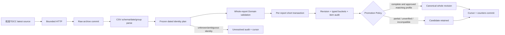

# Phase 2C-1 — TDCC Ownership Pipeline & Persistence

狀態：2026-11-08，Asia/Taipei。已實作ownership Domain／Application／Infrastructure、版本化級距、SQLAlchemy／Alembic、官方CSV Adapter與手動CLI。正式Schema已安全升至`0007_ownership`，完成真實來源匯入及重送核對。**目前canonical涵蓋1週、1檔（2330），統計日2026-11-06；沒有取得十年完整集保歷史。**

沿用[Phase 2A來源](phase-2a-data-sources.md)、[領域／Schema草案](phase-2-domain-model.md)、[既有法人匯入模式](phase-2b-ingestion.md)。沒有新增ownership REST API／前端、排程或Phase 2C-2功能。

## 1. 官方來源與可用範圍

| 項目 | 已核實內容 |
| --- | --- |
| 來源 | 臺灣集中保管結算所：集保戶股權分散表，資料集11452／O1 |
| Request | `GET https://opendata.tdcc.com.tw/getOD.ashx?id=1-5`；archive分開保存base endpoint與`id=1-5`參數 |
| Response | 六欄CSV：資料日期、證券代號、持股分級、人數、股數、占集保庫存數比例% |
| 已觀察資料 | 統計日20261106，2,395,996 bytes、69,955列、4,115組證券週報 |
| 日期／頻率 | 西元YYYYMMDD，週統計日；不將下載日當統計日，不硬編碼週五 |
| 授權 | [官方資料集11452](https://data.gov.tw/dataset/11452)標示[OGDL 1.0](https://data.gov.tw/license)，保留TDCC來源顯名 |
| 歷史 | latest-only；無已核實任意日期參數，replay只處理本平台已保存raw |
| 限流／發布 | 官方數值quota及精確發布時刻未知；工程間隔至少5秒、最多3次HTTP嘗試，不宣稱官方SLA |
| 版本 | Manifest=`tdcc-ownership-sources-1.0.0`、contract=`tdcc-csv-6-v1`、parser=`1.0.0`、scheme=`tdcc-holding-17-v1` |

[TDCC官方說明](https://www.tdcc.com.tw/portal/zh/smWeb/qryStock)描述每週最後營業日餘額；資料集metadata仍寫每月，保留差異，不把週資料改成月資料。HTML查詢的一年保存能力不等於本次合法批次歷史來源；O2 JSON可能落後CSV，不自動合併或當成歷史。未啟用HTML／JSON、第三方備份或未確認端點。

已驗證六欄CSV契約接受header重排、明確BOM alias、UTF-8／UTF-8 BOM；Big5／cp950等只在Content-Type明確宣告且相同六欄Schema時解碼，不猜fallback encoding。不同scheme／contract可由版本化Domain與promotion policy保存、隔離；**目前只有已核實CSV v1啟用**。未知欄位、bucket code或其他官方格式版本明確拒絕並保留raw，不假裝支援未驗證歷史格式。

## 2. 模組與邊界

```text
apps/api/src/stockapp/modules/ownership/
  domain/models.py       OwnershipWeeklyReport、HoldingBucket、BucketScheme、Completeness、Lineage
  domain/contracts.py    Raw／ParsedBatch／Binding／Resolver DTO與Ports
  domain/persistence.py  Repository Port、PromotionPolicy、WriteResult
  domain/ingestion.py    SourceSpec／Job／ImportItem、Ingestion Store／Provider Ports、frozen resolver
  application/normalization.py  整份週報正規化與既有UUID/date binding核對
  application/ingestion.py      手動sync／replay／resume及持久checkpoint
  infrastructure/models.py     九張SQLAlchemy表
  infrastructure/repositories.py  raw／audit、typed revisions／buckets及canonical
  infrastructure/ingestion_store.py  短交易、來源／job鎖、cursor／counters
  infrastructure/identity.py    reviewed evidence與public identity reader
  infrastructure/tdcc_parser.py／providers.py／transport.py／source_manifest.py
  infrastructure/operations.py CLI composition
```

Domain／Application沒有FastAPI、SQLAlchemy、httpx、Redis或供應商SDK依賴。Infrastructure只經`market_data.public`重用既有Instrument UUID、DataSource及IngestionRun，不存取其私有表；新增公開`ensure_source()`讓TDCC全市場run無須建立假的TDCC交易所。`find_by_symbol()`回傳所有目前候選，不默默取第一個市場。

原先Phase 2B-6未提交的README／roadmap／驗收測試與文件予以保留。本次新增／修改檔案包含上述ownership模組、`cli.py`、market_data公開identity/runtime實作、`0007_ownership.py`／Alembic env、五個ownership測試檔及fixtures、本規格、README／roadmap；既有PostgreSQL fixture的預期表集合增加九張表。

## 3. Domain 與數值規則

- `OwnershipWeeklyReport`引用既有instrument／market UUID，保留as_of_date、quantity_unit、denominator、scheme、全部buckets及source lineage。
- `OwnershipSourceLineage`保存source／run／raw／revision UUID、source contract、parser、identity evidence與promotion版本、source row locator及normalized hash。統計日、source_published_on／at、first_seen、last_seen、ingested分開；發布時間未知為null，HTTP Last-Modified不自動變成發布時間。
- Quantity／holder count用精確BIGINT整數；百分比用Decimal／`NUMERIC(20,12)`，不接受float、NaN、Infinity或超精度值。精確計算／fingerprint不依賴呼叫端Decimal context。
- regular、adjustment、total分開，不將調整人數加到來源合計人數。一般／合計數量及人數非負，百分比0..100；adjustment獨立signed規則及NUMERIC範圍。
- 分母固定語意為`depository_inventory`，保留來源percent，沒有拿發行股數或其他分母重新換算。
- 缺bucket／quantity／一般級距必要欄位為partial；未知調整表示法為not_verified，不補0或補其他週的bucket。重複bucket或已驗證表示法對帳失敗拒絕該證券整組，其他有效證券繼續處理。

### 級距定義

| Code | Kind | 基礎數量範圍 |
| --- | --- | --- |
| 1 | regular | 1–999 |
| 2 | regular | 1,000–5,000 |
| 3 | regular | 5,001–10,000 |
| 4 | regular | 10,001–15,000 |
| 5 | regular | 15,001–20,000 |
| 6 | regular | 20,001–30,000 |
| 7 | regular | 30,001–40,000 |
| 8 | regular | 40,001–50,000 |
| 9 | regular | 50,001–100,000 |
| 10 | regular | 100,001–200,000 |
| 11 | regular | 200,001–400,000 |
| 12 | regular | 400,001–600,000 |
| 13 | regular | 600,001–800,000 |
| 14 | regular | 800,001–1,000,000 |
| 15 | regular | 1,000,001以上 |
| 16 | adjustment | 來源差異數，沒有一般級距上下界 |
| 17 | total | 來源合計，沒有一般級距上下界 |

股或受益單位由經核實的Instrument binding決定，不乘1000。級距定義及界線有版本，不能把1,000,001以上當成精確的「至少1,000,000」。

已核實CSV使用`shortfall_magnitude`：`source_total_quantity = sum(regular.quantity) - adjustment.quantity`；holders=`sum(regular.holder_count)`。Domain亦明確建模`signed_delta`的加法與`unverified`，不把HTML的負調整套用CSV正差額公式。來源比例殘差只標warning，不猜捨入門檻、不重縮放99.94成100。

## 4. Database／Migration

| Table | 用途／主要key |
| --- | --- |
| ownership_source_audits | PK run_id；FK既有run/source，immutable manifest／config／reviewed evidence與replay lineage；無虛構market |
| ownership_raw_payloads | PK raw UUID；FK同run/source audit，SHA-256與原bytes一致，保存完整HTTP回應及replay指向 |
| ownership_bucket_schemes | PK version；source contract、調整慣例、分母、定義hash與expected count |
| ownership_bucket_definitions | PK scheme_version／bucket_code；kind、label及inclusive bounds，版本不可變 |
| ownership_weekly_revisions | UUID revision；instrument／market／as_of_date、source profile、completeness、來源total與normalized hash；內容唯一性 |
| ownership_bucket_values | PK revision_id／bucket_code；複合FK綁同scheme／kind，typed quantity／holders／percent |
| ownership_ingestion_items | 每raw／group唯一audit，source row locator／raw_rows、拒絕原因、revision／observation／發布時間與身分證據 |
| ownership_weekly | PK instrument_id／as_of_date；指向同profile的整份revision及observation，不複製／拼接級距 |
| ownership_ingestion_jobs | PK run_id；phase、selected raw、frozen plan／hash、next_report_index及時間 |

Indexes涵蓋instrument/date、date/instrument、source、run/raw、revision、checkpoint phase；Foreign Keys重用既有市場與證券。資料庫保護raw hash、nonnegative／numeric finite／scope、typed composite lineage與whole-report一致性。Revision先插header與buckets再seal；deferred constraints在commit時驗證完整度、級距集合及已核實total公式，之後不可追加或改寫舊bucket。Canonical不得指向未seal／partial／未核實identity的快照。

Migration `0007_ownership`從`0006_institutional_jobs`新增九張表及ownership專用triggers，沒有刪除／改寫DailyBar或法人表。Downgrade僅允許ownership資料為空，會取得表鎖後檢查；非空明確拒絕，不隱式丟棄週報或raw。

```bash
# 先檢查；本機已在0007，不必重複升級
docker compose exec backend alembic current
docker compose exec backend alembic heads
# 其他尚未升級環境，審查後執行
docker compose exec backend alembic upgrade head
docker compose exec backend alembic check
```

本機實際在同一transaction以lock_timeout=2秒、statement_timeout=30秒完成0006→0007；正式回退未執行。空DBupgrade、metadata parity、非空downgrade拒絕及並發／FK／CHECK在隔離Schema驗證。

## 5. Pipeline、原子性與版本晉升



- HTTP每個完整回應先歸檔，包括重試前429／5xx；403／redirect不繞過，timeout與response size有上限。Archive失敗就停止，不繼續下載無法追溯的資料。
- 每份報表的revision、17級距、canonical指標、item audit、cursor與run counters同一transaction；失敗全部rollback，已辨識拒絕另記audit。未預期程序中斷保留running checkpoint，`replay --resume`使用frozen plan續跑。
- Job／host使用PostgreSQL session advisory locks；同instrument/date使用transaction advisory lock，空canonical key首次寫入也跨Worker安全，不依賴記憶體鎖。
- 相同內容重用revision，較新相同觀察更新last_seen；較新合法修訂才晉升，較舊raw只留stale修訂／audit，不覆蓋更新canonical。同時同觀察時間不同內容為conflict。
- Source、contract、scheme、quantity unit、denominator與policy是profile。已有canonical不自動切換profile；不同版本保存獨立revision／candidate，需明確審查policy。未知／缺bucket不從其他週補列。
- Raw parsing／replay需要完整bytes；逐組audit只讀raw metadata，避免對4,115組重讀2.4MB。逐組checkpoint只投影必要plan欄位，不重載全市場identity map。
- CSV source_rows是header後資料列的0-based索引；checkpoint row_index是整份證券週報group序號，兩者分開，locator及raw_rows可追回原CSV。

## 6. CLI 與身分證據

沿用`stockapp`架構，JSON輸出；help不讀Settings／DB或發HTTP。由repo根目錄執行，host可用`.tools/api-venv/bin/stockapp`或安裝後的`stockapp`：

```bash
stockapp ownership sync latest
stockapp ownership sync latest --identity-evidence /path/to/reviewed-evidence.json
stockapp ownership replay --raw <RAW_UUID>
stockapp ownership replay --raw <RAW_UUID> --identity-evidence /path/to/reviewed-evidence.json
stockapp ownership replay --resume <RUN_UUID>
stockapp ownership status --limit 20
stockapp ownership status --id <RUN_UUID>
```

Docker版本在更新Backend與套用Migration後使用：

```bash
docker compose run --rm backend stockapp ownership sync latest
docker compose run --rm backend stockapp ownership status --limit 20
# host的evidence檔需明確read-only掛載到容器；檔案包含真實UUID/證據，不提交synthetic
# docker compose run --rm -v /absolute/reviewed-evidence.json:/evidence.json:ro backend \
#   stockapp ownership sync latest --identity-evidence /evidence.json
```

退出碼0表示成功或status查詢正常；2表示partial／failed／unsupported／查無指定job；1表示基礎設施錯誤；130中斷。每run的received是週報group數，source_rows是CSV列數，processed/accepted/complete/partial/unresolved/rejected/promoted等分開。全部未知identity不能回succeeded。Status包含實際統計日、raw hash、source／license、cursor及最多100筆issues，完整audit保存在DB。

沒有`sync date`或任意歷史selector。`--resume`不能帶新identity檔，使用原frozen版本；新證據需另建raw replay，保留舊拒絕紀錄。

### Dated identity evidence

TDCC只給symbol，無市場，不能用目前主檔猜任意歷史UUID。找不到／多市場碰撞／沒有日期證據／unit不符均保留unresolved，不新建「普通股」。人工核實檔格式：

```json
{
  "version": "ownership-identity-evidence-v1",
  "synthetic": false,
  "entries": [{
    "instrument_id": "<existing UUID>",
    "market_id": "<verified market UUID>",
    "symbol": "<exact source symbol>",
    "quantity_unit": "shares",
    "valid_from": "<verified YYYY-MM-DD>",
    "valid_through": "<verified YYYY-MM-DD>",
    "evidence_version": "<traceable reviewed version>",
    "source_reference": "<official endpoint/date/hash and review basis>"
  }]
}
```

source_reference可選；Binding七個必要欄位嚴格驗證，拒絕重複JSON key、synthetic檔、重複symbol、無效日期／unit／UUID及超大小。原證據凍結於audit，plan保存當次核對結果，不因主檔後續更新重解釋舊run。

本次2330證據來自已核准[官方TWSE帶日期行情](https://openapi.twse.com.tw/v1/exchangeReport/STOCK_DAY_ALL)：Date=1151106、Code=2330、Name=台積電，與既有TWSE UUID及shares一致；**只核准2026-11-06這一天**，不從公司上市日或created_at外推歷史期間。證據版本`twse-dated-20261106-2330-6626f67d9b71`，回應SHA256=`6626f67d9b71529fe443e027c5028719687c3f85edd7e2e66647fc579f19248a`。其他4,114組沒有補造證據。

## 7. Tests 與實際結果

```bash
.tools/api-venv/bin/python -m pytest apps/api/tests/test_ownership_domain.py \
  apps/api/tests/test_ownership_sources.py apps/api/tests/test_ownership_cli.py -q
# 重用專案的隔離DB runner；名稱雖含institutional，會執行目前完整後端suite
.tools/api-venv/bin/python apps/api/scripts/run_institutional_validation.py -- \
  tests -m 'not network' -q --tb=short
.tools/api-venv/bin/python apps/api/scripts/export_openapi.py --check
PATH="$PWD/.tools/node/bin:$PATH" npm test
PATH="$PWD/.tools/node/bin:$PATH" npm run typecheck
PATH="$PWD/.tools/node/bin:$PATH" NEXT_TELEMETRY_DISABLED=1 npm run build
```

| 驗證 | 實際結果 |
| --- | --- |
| 全部Backend／PostgreSQL／Migration／Phase1／Institutional回歸 | **1782 passed，4 network deselected**，203.45秒；獨立臨時DB＋逐例UUID schema，結束清除 |
| Ownership數值／parser／HTTP／CLI | Domain53、Source60、CLI44案例通過，包含Decimal精度、固定合計／調整、missing／duplicate、BOM／encoding、retry／403／429／timeout、identity |
| Ownership persistence／完整pipeline | 已含於全套通過；emptyupgrade、constraints、sealed revision、FK、whole-report rollback、跨Worker並發、重送、profile、oldraw、partial、resume與獨立market隔離 |
| Frontend | **244 Vitest passed**；Typecheck及Production Build通過，沒有前端source變更 |
| OpenAPI | snapshot --check通過；本階段沒有新增REST route |
| Docker／Schema | Backend build成功，只替換Backend；current=head=`0007_ownership`，alembic check通過，readiness正常 |
| 瀏覽器／既有API | Playwright桌面真實日／週／月圖及手機查詢：**2 passed**；首頁、個股頁、Phase1／法人API及readiness皆200 |
| Import實測 | 下節兩次真實CLI匯入與Repository逐bucket核對通過；非network Fixture冒充 |

所有固定測試資料標示synthetic並只寫隔離DB，不計真實覆蓋率。保留既有Starlette/httpx deprecation warning，沒有無關依賴升級。程式邊界AST檢查確認Domain／Application純層，ownership未直接import其他模組私有Infrastructure或Institutional。

## 8. 真實匯入範圍與數值核對

**本機正式canonical：1週、1檔2330、1份report、1份revision、17個bucket values；日期起訖均為2026-11-06。** Raw保存完整4,115組來源資料，不代表其他證券已建立canonical。

| 指標 | 第一次sync | 第二次sync |
| --- | ---: | ---: |
| source_rows／received groups | 69,955／4,115 | 69,955／4,115 |
| processed | 4,115 | 4,115 |
| accepted／complete | 1／1 | 1／1 |
| unresolved | 4,114 | 4,114 |
| rejected／source_failures | 0／0 | 0／0 |
| canonical promotions | 1 | 0 |
| unchanged | 0 | 1 |
| revisions_created | 1 | 0 |
| outcome／CLI exit | partial／2 | partial／2 |

Run的partial是**整批覆蓋不足**，2330個別report仍complete；typed partial report count=0。第二次仍只有同一canonical／revision，更新last_seen，不增加17級距。總共2個raw、8,230個group audit、2個job；8,230是觀察次數，不是獨特週報或歷史週數。

官方CSV兩次hash相同：`5332a48c7b9c68f01c4912f57fe767fb23fb9a8718d0b92b3ae1bbeda5cd18c9`。

來源2330與已存Canonical逐bucket完全一致：

| 欄位 | 精確數值／語意 |
| --- | --- |
| source total holders | **3,259,221** |
| regular quantity sum | **25,932,390,067 股** |
| adjustment quantity／holders | **20,000 股／3**，獨立保存 |
| source total quantity | **25,932,370,067 股**＝regular−adjustment |
| regular reported percent sum | **99.94%**，保留來源精度及residual warning |
| source total reported percent | **100.00%**，DB精確NUMERIC值100.000000000000 |
| source_published_at | null，未使用HTTP或下載時間代替 |

首次run=`f7efe3bd-f3fe-472f-8c14-c819bc6ed093`，raw=`cb717f2d-bd47-4e0e-a73f-ca48e00694ee`；再次run=`03459a25-0e08-41f6-a09a-340d0d42247a`，raw=`874e1980-84dd-40c0-b0ce-0cab38431abb`。兩次共用revision=`a341fb98-0c54-4322-bd3f-3868ec5617bb`。

first_seen=`2026-11-08T11:46:04.329931+00:00`，last_seen=`2026-11-08T12:31:21.926877+00:00`；保留原source rows及raw lineage。Canonical實際由`SqlAlchemyOwnershipRepository.latest(instrument_uuid)`在唯讀snapshot讀回驗證，沒有直接拿raw冒充canonical。本階段尚無公開ownership查詢API。

本機核對證據在gitignored `.tools/validation/phase-2c1/`：identity-evidence、官方dated quotes／basic metadata、首次CLI JSON、Repository verification及前後行情資料清單；真實TDCC完整bytes也保存於正式ownership_raw_payloads。沒有提交真實資料檔作為Fixture。

### 既有資料保護

正式匯入前後的唯讀snapshot顯示：DailyBars **9,712,317**筆、DailyBar revisions **9,739,041**筆、兩市場保存端點及2330抽查內容完全一致；既有法人canonical／revision／raw／audit仍為0且未改動。這是總數／範圍／抽查比對，未做全表逐列checksum。history-worker原先為exited，沒有重啟。

## 9. 限制與停止點

- 不宣稱十年完整集保歷史；只取得1個最新統計週，其他週必須有真正已取得且獲准的archive／來源。
- 完整CSV有4,115組，但canonical僅核准2330。要增加證券覆蓋，需更多可追溯的market／date／unit證據，不能以symbol長度猜市場或把今日名錄當歷史。
- 只啟用已核實六欄CSV版本；未知版本／HTML調整符號／JSON日期落後須另審查，不從subtotal反推缺值或拼接級距。
- TDCC資料是集保歸戶分布，變動可能是級距移動／股務事件／保管移轉，不能視為可識別個人的交易。
- 沒有新增排程、ownership REST API、UI或大戶衍生指標；Phase 2C-2未開始。
- 沒有commit、push或公開部署；保留既有行情與法人資料、未變更history-worker。
