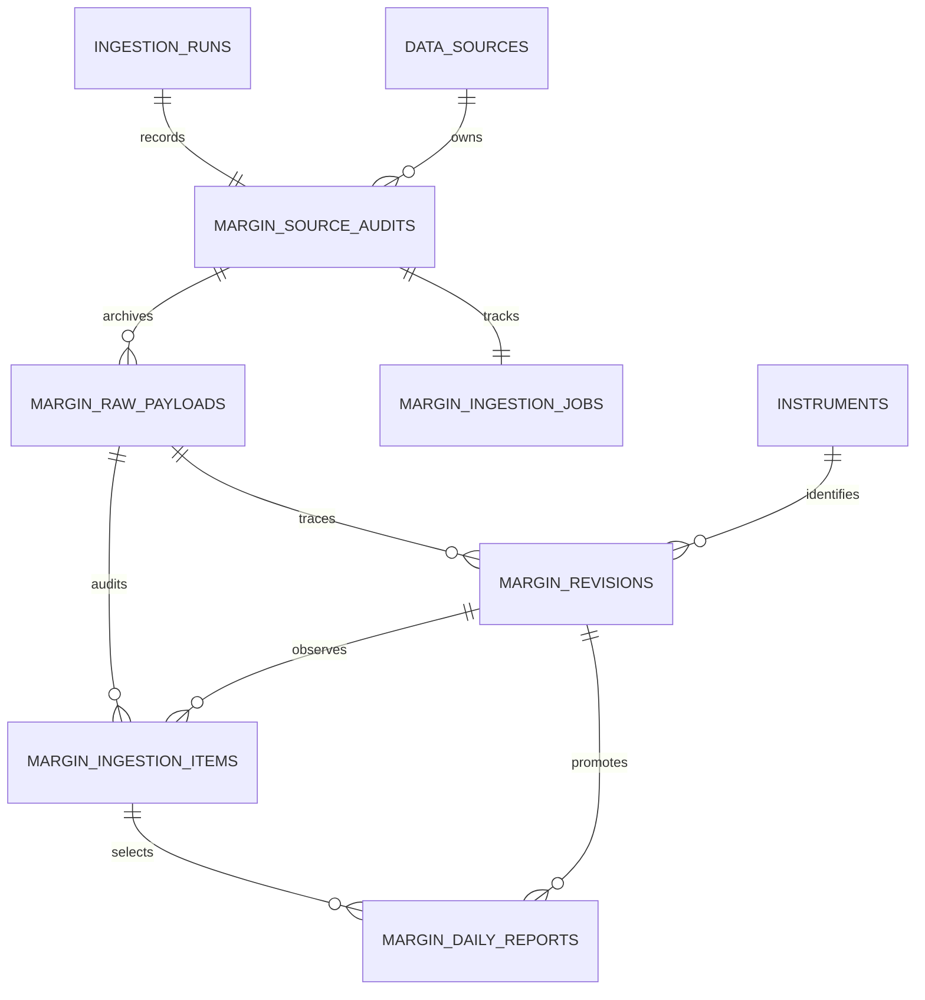

# Phase 2D-2 — Margin Persistence, Ingestion & REST API

驗證日期：2026-11-09，Asia/Taipei。沿用 [2D-1 Domain](phase-2d-margin-domain.md)、[Phase 2A 來源](phase-2a-data-sources.md#5-c--融資融券與借券)與[API 契約](phase-2-api-contract.md)，不改既有行情／法人／集保計算或歷史回補 Worker。本階段新增 PostgreSQL Persistence、手動匯入／重播及唯讀 REST API；沒有新增前端、排程或借券產品。

## 架構與流程

```mermaid
flowchart LR
    P[Approved official source] --> H[Bounded HTTP and rate limit]
    H --> R[Immutable Raw archive]
    R --> S[Named schema and official date validation]
    S --> N[Reviewed identity and unit evidence]
    N --> D[Shared MarginCalculator]
    D --> A[Per-row audit and immutable revision]
    A --> C[Atomic canonical promotion and checkpoint]
    C --> Q[Read-only transaction snapshot]
    Q --> API[Margin REST API]
    R --> Replay[Offline replay]
    Replay --> S
```



API → Application → Domain；Infrastructure 實作 Domain Ports。Domain 不 import SQLAlchemy、FastAPI、Redis、HTTP client 或供應商 SDK。Adapter 負責來源欄位／Schema，Application Normalizer 輸出既有 typed Domain，唯一 Calculator 計算所有 balance identity、每日變化、換算及額度。跨模組僅透過 `market_data.public` 讀證券 UUID、建立 DataSource 與 IngestionRun，不複製主檔。

## Persistence

Migration `0008_margin`，前版 `0007_ownership`。新增六張表：

| 表 | 用途與保護 |
| --- | --- |
| margin_source_audits | FK 既有 run/source；保存同步／重播模式、請求日期、版本化 Manifest、reviewed evidence；不可變 |
| margin_raw_payloads | 原始 bytes、URL／參數、HTTP status、SHA256、擷取時間、contract version、replay lineage；每次有回應的 retry 分別保存；不可變 |
| margin_revisions | Typed BIGINT 雙 Ledger、每欄 availability、Canonical unit、完整版本化 snapshot、profile/content hash、首份 Raw FK；不可變 |
| margin_ingestion_items | 每個 Raw row 唯一 audit；接受／拒絕／unresolved／skipped、原因、原始列、revision 及 observation；不可變 |
| margin_daily_reports | PK instrument_id／trade_date／scope；指向完整 revision＋observation，不逐欄更新 |
| margin_ingestion_jobs | 選定 Raw、plan、row count、持久 checkpoint／phase，與 run/audit 連結 |



數量嚴格 int／BIGINT，不存 float；正負調整以外數量非負。每欄 reported 必須有數值，missing／not_applicable 必須 null。Canonical／Revision 單位只接受 shares／units，Raw 保留 lots，完整 `ConversionEvidence` 在 snapshot／lineage 保存 factor、證券／市場、適用期間及版本，API 同樣輸出。

FK 使用 RESTRICT，核對 Instrument＋Market、Raw＋Run＋Source、Canonical＋Revision＋Observation 的整組關係。CHECK／Trigger 驗證 Raw SHA256、Typed 欄位與 snapshot、整份報表單位／日期／來源，以及 complete 才可晉升；拒絕缺 adjustment applicability 冒充完整公式。資料表及索引透過 Alembic 明確建立，啟動時沒有隱式 DDL。

### Transaction、冪等與 Promotion

- 一份 instrument/date/scope 報表、audit、canonical 指標、counters 與 checkpoint 同一個 transaction 提交；失敗 rollback，不留下半份 Ledger。
- PostgreSQL advisory transaction lock 以 instrument/date/scope 協調跨 Worker，並鎖定 canonical row；工作與來源 host 另用 session advisory lock，沒有依賴記憶體鎖保證一致性。
- 相同內容／profile 重複同步重用 revision，保留新的 observation／Raw，canonical 不重複；同一 Raw row 重送亦冪等。
- profile 包含來源、契約／Schema／Parser／Identity／公式／Promotion 版本、scope、單位與 conversion evidence。不同 profile 不任意覆蓋；不同 scope 隔離。
- 修訂保留先前版本；同 profile 的新觀察才依 publication／observation 順序晉升。舊 Raw replay 保留原 fetched_at，不能以 replay 執行時間壓過新版本。同時刻不同內容列 conflict。
- Partial 可以保存 revision／audit，缺值不補零；不晉升成完整 canonical，也不覆蓋既有完整快照。查詢只讀 canonical，候選數量可由 status/audit 得知。
- Raw／revision／observation／source audit 不允許改寫或刪除。非空 margin 表時 downgrade 拒絕；不以 CASCADE 刪正式資料。空表可回到 0007。
- 確認為錯誤／未解析的 row 保留原因，不使其他有效 row 默默消失。不能表示為 JSONB 的異常列仍可從不可變 bytes 追溯；錯誤列日期不污染有效報表 checkpoint。

### Migration 指令

```bash
docker compose build backend
docker compose run --rm backend alembic current
docker compose run --rm backend alembic heads
docker compose run --rm backend alembic upgrade head
docker compose up -d --no-deps --wait backend

# 僅在獨立測試資料庫／Schema，確認 margin 六張表為空時測試回退
# alembic downgrade 0007_ownership
```

正式環境不執行 downgrade、不刪除舊資料。Backend 更新不重啟 history-worker。

## 官方來源、能力與 Adapter

Manifest `margin-sources-1.1.0` 更新 2D-1 的能力描述；來源契約版本維持原值。所有 Adapter 預設 network_enabled=false，只有明確執行已核准來源的手動 CLI 才 opt in。來源授權與 canonical 資料可用性分開驗證。

| Source | Endpoint／Method | 日期與單位 | 正式能力與限制 |
| --- | --- | --- | --- |
| M1 TWSE OpenAPI | GET `https://openapi.twse.com.tw/v1/exchangeReport/MI_MARGN`；無參數 | 16 欄、無官方 Date；quantity lots | 平台 OGDL 證據；可以 archive 最新 Raw。沒有同份 payload 綁定的可信日期證據時，禁止 canonical；不能拿下載日或其他資料集日期填入 |
| M2 TWSE dated | GET `https://www.twse.com.tw/rwd/zh/marginTrading/MI_MARGN`；候選 date／selectType／response | 網站群組表格、官方日期 | 使用權 pending、literal grouped Schema 未核實；沒有啟用下載或 Parser，不能宣稱已支援歷史 |
| M5 TPEx OpenAPI | GET `https://www.tpex.org.tw/openapi/v1/tpex_mainboard_margin_balance`；無參數 | 21 欄，官方 Date 民國 yyyMMdd；quantity lots、usage % | Dataset 11387 OGDL1／每日／免費；latest-only，所有指定日期請求拒絕，不宣稱歷史 API |

按精確欄名解析、允許欄位重排，未知／缺少／重複欄、重複代碼、混合來源日期與非預期 envelope 記錄拒絕；不是用欄位位置猜 Schema。BOM 可接受。數字逗號、真正 0、空字串／null／--、明示 N/A 分別處理。官方 `ShortConvering` 保留原拼字並映射買進還券；Offsetting 不再次加進任一 balance identity。

HTTP 使用有限 timeout、最大 3 次嘗試與 20MB 上限；403 不重試、429／5xx 有上限。Retry-After 超過 60 秒預算即停止，不提前重送。每個 host 保守間隔至少 5 秒，並持 PostgreSQL host lock；這是本平台策略，**不是官方公布的 Rate Limit 或 SLA**。精確發布／刷新時刻未核實時維持 null，不從 HTTP header 猜測。

來源依據：[TPEx Dataset 11387](https://data.gov.tw/dataset/11387)、[TPEx Swagger](https://www.tpex.org.tw/openapi/swagger.json)、[TWSE Swagger](https://openapi.twse.com.tw/v1/swagger.json)、[OGDL](https://data.gov.tw/license)。TPEx dataset 說明包括當日餘額與次一營業日狀況，限額 effectivity 不自動認定同日。

## 手動 CLI 與 Reviewed Evidence

```bash
# 第一次可以不帶 evidence：保存官方 Raw／逐列 audit，身分／乘數未核實則 unresolved
docker compose run --rm backend stockapp margin sync latest --market tpex
docker compose run --rm backend stockapp margin sync latest --market twse

# 使用已審查、適用於來源官方日期的身分及 multiplier 證據
docker compose run --rm -v /absolute/reviewed-margin.json:/evidence.json:ro backend \
  stockapp margin sync latest --market tpex --evidence /evidence.json

# 目前 M1／M5 都拒絕指定日期；M2 仍被使用權／Schema gate 阻擋
docker compose run --rm backend stockapp margin sync date --market tpex --date 2026-11-06
docker compose run --rm backend stockapp margin sync date --market twse --source dated --date 2016-11-07

docker compose run --rm backend stockapp margin status --limit 20
docker compose run --rm backend stockapp margin status --id <RUN_UUID>
docker compose run --rm backend stockapp margin replay --raw <RAW_UUID>
docker compose run --rm backend stockapp margin replay --resume <RUN_UUID>
# 新 replay 可以使用重新審查的 evidence；resume 必須使用原 audit 中凍結的 evidence
docker compose run --rm -v /absolute/reviewed-margin.json:/evidence.json:ro backend \
  stockapp margin replay --raw <RAW_UUID> --evidence /evidence.json
```

Host 版以 `.tools/api-venv/bin/stockapp margin ...` 使用相同語法。Exit 0 表示 sync succeeded 或 status 查詢成功；Partial／failed／找不到特定 run 回 2；意外依賴錯誤回 1，訊息不含 DSN／SQL／密碼。

Evidence 格式 `margin-evidence-v1`，頂層 `synthetic=false`、entries。每個 entry 必須明確帶 symbol、市場、既有 instrument／market UUID、canonical quantity_unit、有效日期、evidence_version、官方 HTTPS source_reference，並有 conversion 子物件（lots → shares/units、**Decimal 字串 factor**、有效日期、版本及官方參照）。Loader 拒絕重複 JSON key、重疊身分區間、非官方證據 URL、未知欄位、float factor 或未審查標記；不自動產生 1,000 倍數。

TWSE 無 Date 時，另需可核對的 date_evidence：payload_sha256、trade_date、evidence_version、source_reference。必須綁定實際 bytes，不接受只有執行日期的檔案。此功能沒有宣稱已解決真實 M1 日期來源。

工作保存完整 evidence／來源 config／處理 plan 與 cursor。Replay 不抓網路；Resume 僅處理尚未提交的 row，不能套用修改後的 evidence 檔。Interrupted fetch 已有成功 archive 時可復原選定 Raw；沒有成功 Raw 時明確失敗。

## REST API 與金融語意

| Method／路由 | 用途 |
| --- | --- |
| GET /api/v1/stocks/{id}/margin | Daily History；from／to、balance_scope、limit／cursor／order |
| GET /api/v1/stocks/{id}/margin/latest | 最新保存的完整 canonical，沒有資料時 point=null |
| GET /api/v1/margin/status | 來源能力、同步狀態、canonical／candidate／partial／拒絕資料數量 |
| GET /api/v1/chip-data/status?product=margin_daily | 共用籌碼資料狀態入口，保留既有 institutional／ownership 預設行為 |

Financing Balance、Short Margin Balance 及每日 flows 位於同一原子 report 的兩個 Ledger 中，不拆成會混版本的獨立欄位查詢。每個 Quantity 回傳 `{value: "精確整數" | null, unit, availability}`；Decimal 計算值／factor 也以 JSON 字串輸出。

- financing：previous_balance、purchase、sale、cash_repayment、balance、signed_adjustment。
- short_margin：previous_balance、short_sell、short_cover、stock_repayment、balance、signed_adjustment。
- 每個 Ledger 明示 balance_semantics=stock、flow_semantics=daily_flow，並帶 formula policy、identity、daily_change、quota_limit、available_quota。
- `daily_change = reported_balance − official_reported_previous_balance`，共用 Calculator `margin-calculator-1.0.0`；缺任一欄回 null，沒有以日曆 D−1 或另一份初版餘額代替。
- 原始 source_quantity_unit、Canonical unit、conversion evidence、revision／run／raw UUID、hash、Schema／Parser／Identity／公式／Promotion 版本全可追溯。
- 官方統計日、發布日期／時刻、first_seen、last_seen、ingested_at 分開；未知發布時刻維持 null。
- quality=verified 只表示兩個 Ledger 的 balance identity 完整且符合公式；額度的 basis／effectivity 另外回 not_verified。coverage／freshness 沒有 verified 交易日曆時維持 not_verified，並非宣稱歷史完整或即時報價。
- 查詢只讀 canonical，不把候選／Raw 當正式行情。已保存部分候選但沒有 canonical 時，History=empty、Latest point=null，狀態 API 仍顯示候選／partial 數量。

預設近 366 個日曆日，最大含首尾 3,660 日、limit ≤1,000；History 使用日期 keyset cursor，限制單次傳回與 SQL 載入筆數。每個 GET 在一個 REPEATABLE READ READ ONLY transaction 內取得一致 snapshot，設有限 statement／lock timeout，不下載或寫資料。數據／來源 profile 在各 point 保留，不做跨來源期間加總。

錯誤：404 股票不存在／市場不支援，422 日期／區間／參數／cursor 無效，503 依賴或已保存資料不可用；既有股票尚無資料為 200 empty。錯誤訊息經過濾，不洩漏 SQL、DSN 或金鑰。OpenAPI snapshot 位於 `apps/api/openapi.json`。

```bash
curl 'http://localhost:8000/api/v1/stocks/<INSTRUMENT_UUID>/margin/latest'
curl 'http://localhost:8000/api/v1/stocks/<INSTRUMENT_UUID>/margin?from=2026-01-01&to=2026-11-09&limit=100&order=asc'
curl 'http://localhost:8000/api/v1/margin/status?market=TPEX'
curl 'http://localhost:8000/api/v1/chip-data/status?product=margin_daily'
```

## 測試與實際驗證紀錄

所有固定數值 Fixture 明確標為 SYNTHETIC，只放隔離測試資料庫／Schema，不用來聲稱真實覆蓋。真實來源驗證與不連網測試分開。

2026-11-09 最終驗證結果：

| 檢查 | 實際結果 |
| --- | --- |
| 全後端離線＋隔離 PostgreSQL／Migration／HTTP／既有回歸 | **2,327 passed、4 network deselected**，256.83 秒；臨時 DB 已清除 |
| 新 Margin Persistence 專項 | **24 PostgreSQL tests passed**；含官方來源防繞過與非空 downgrade 保護 |
| Margin Query／HTTP 專項 | **36 Unit、9 PostgreSQL HTTP tests passed** |
| 完整 Adapter→Raw→Canonical→HTTP 管線 | 7 個隔離 PostgreSQL 案例納入最終全套；包含錯誤列日期隔離與 Partial candidate |
| Adapter Fixture／HTTP 重試 | **69 Unit tests passed** |
| Vitest／Typecheck／Production Build | **244 tests、15 files 通過**；Typecheck、Build 通過 |
| OpenAPI | Host 與更新後 Docker Backend 的 snapshot check，以及真實 HTTP /openapi.json 對照均通過 |
| Compose | config 通過；backend／frontend／postgres／redis healthy；history-worker 原為 exited，沒有啟動或重啟 |
| Alembic／PostgreSQL | 本機 **0007_ownership → 0008_margin** 已安全升級；Current=Head；PostgreSQL **17.11** |
| Domain import／diff | Fresh Python process 不載入 DB／HTTP／Framework；git diff --check 通過 |

開發中修正 Migration SQL literal 綁定問題、已知官方契約 Fixture 誤用 synthetic endpoint，以及 rejected future-date 污染 checkpoint；上述均在最終完整回歸前解決。測試沒有跳過失敗項，4 個 opt-in network tests 明確排除，另以以下獨立官方實測驗證。既有 Starlette TestClient deprecation warning 未導致失敗，沒有為此升級依賴。

```bash
# 全部非網路測試：腳本建立獨立臨時 DB，各 PG fixture 再用唯一 Schema，結束只刪臨時 DB
cd apps/api
../../.tools/api-venv/bin/python scripts/run_institutional_validation.py \
  --output-dir ../../.tools/validation/phase-2d2/full-tests -- tests -m 'not network' -q --tb=short
cd ../..

# 不需要 Docker／資料庫的單元測試
RUN_INTEGRATION=0 RUN_NETWORK=0 .tools/api-venv/bin/python -m pytest \
  apps/api/tests -m 'not integration and not network' -q
.tools/api-venv/bin/python apps/api/scripts/export_openapi.py --check
PATH="$PWD/.tools/node/bin:$PATH" npm test
PATH="$PWD/.tools/node/bin:$PATH" npm run typecheck
PATH="$PWD/.tools/node/bin:$PATH" NEXT_TELEMETRY_DISABLED=1 npm run build
docker compose config --quiet
docker compose ps
```

實際資料驗證必須逐一核對來源日期、原始 lots、適用 factor、Canonical shares、DB／API 數值、Raw lineage、重複匯入與 revision。只有已審查身分／單位的證券可宣稱成功；其他 row 的 unresolved／rejected 不算已匯入。

### 真實官方資料與單日證據

實際成功 Canonical 僅 **TPEx 環球晶 6488、2026-11-06 一個交易日、一檔證券**。UUID `fe53c1d3-e0ca-4475-8ab6-d2c274252e25`。這是 M5 回應的官方 Date=`1151106`，沒有以 2026-11-09 擷取日期替代，也沒有宣稱已保存其他歷史日期。

證券／單位證據：

1. [TPEx 6488 普通股掛牌公告](https://www.tpex.org.tw/storage/eb_data/10409/10400270322.htm)核對證券種類、代號與公司名稱；官方最新 M5 同一代號／名稱／日期與既有 market_data 公開 UUID reader 一致。
2. [TPEx 交易單位規則](https://www.tpex.org.tw/zh-tw/mainboard/trading/rules/system.html)核對普通股適用的 1,000 股規則，明確保留公司債、第二上櫃外國股票與加掛 ETF 例外。
3. 另依已核准 [Dataset 11632](https://data.gov.tw/dataset/11632) 的 M6 `https://www.tpex.org.tw/openapi/v1/tpex_margin_sbl`，**僅唯讀核對同日融券第一組股數**。M5／M6 Date 均為1151106；前券餘額、券賣、券買、現券償還、當日券餘額五欄分別精確相差1,000倍，提供該商品／日期的交叉證據。未使用借券賣出欄代填融券，也未建立 M6 Adapter、借券資料表或 Phase 2E 功能。

Reviewed evidence 的 valid_from=valid_through=2026-11-06，未延伸到其他股票／ETF 或任意歷史期間。證據檔與 raw/hash/API 比對紀錄位於 gitignored `.tools/validation/phase-2d2/`，其中 `reviewed-6488-evidence.json` 只能用於該證券／日期，不是整市場通用設定。

| 官方欄位語意 | M5 原始張數 | PostgreSQL／API 股數 |
| --- | ---: | ---: |
| 融資前日餘額 | 11,413 | 11,413,000 |
| 融資買進 | 782 | 782,000 |
| 融資賣出 | 1,840 | 1,840,000 |
| 現金償還 | 70 | 70,000 |
| 融資餘額 | **10,285** | **10,285,000** |
| 融資每日變化 | −1,128 | **−1,128,000** |
| 融券前日餘額 | 198 | 198,000 |
| 融券賣出 | 144 | 144,000 |
| 買進還券 | 23 | 23,000 |
| 現券償還 | 2 | 2,000 |
| 融券餘額 | **317** | **317,000** |
| 融券每日變化 | 119 | **119,000** |

兩個 Domain balance identity 回 complete，API Quantity／Decimal 均為字串。官方發布日期／時刻未知，回 null；quota basis／effectivity 不明，可用額度回 null/not_verified；coverage 維持 not_verified。

### 真實 Pipeline／冪等結果

| 實際操作 | 結果 |
| --- | --- |
| M5 初次同步、沒有審查證據 | HTTP200 Raw保存；919列全unresolved，Canonical=0 |
| 對已保存 Raw 加入 6488 單日證據後 replay | 1列 complete／promoted；918列 unresolved，整批結果 partial |
| M5 再次真實同步相同日資料 | 1列 unchanged、0 revisions_created；仍只有1份Canonical、1個Revision |
| M1 真實最新同步 | HTTP200 Raw保存、1,306列 unresolved；因無可信交易日，trade_date=null，Canonical=0 |
| M2 指定日期命令 | source_authorization_pending；保留 failed source audit，**沒有 HTTP 下載或 Raw／Canonical** |
| 真實 GET | Latest、History、margin/status、shared status 均200；數值逐欄與官方Raw／typedDB相同；不存在UUID404、反向日期422 |

正式資料最終統計：**5 source audits／jobs、4 Raw records（含1次replay clone）、4,063 item audits、1 Revision、1 Canonical**。M5全市場尚未核實的918筆不計為已匯入；單一週期／商品證據不能當完整覆蓋率。partial 的CLI退出碼2在此表示其餘證券仍未解決，不是已保存6488報表失效。

既有資料升級／驗證前後筆數完全相同：

| 既有資料 | 前／後 |
| --- | ---: |
| daily_bars | **9,712,317** |
| daily_bar_revisions | **9,739,041** |
| institutional_reports | **0** |
| ownership_weekly | **1** |

查詢範例（本機已可用）：

```bash
curl 'http://localhost:8000/api/v1/stocks/fe53c1d3-e0ca-4475-8ab6-d2c274252e25/margin/latest'
curl 'http://localhost:8000/api/v1/stocks/fe53c1d3-e0ca-4475-8ab6-d2c274252e25/margin?from=2026-11-06&to=2026-11-06'
```

## 限制與停止點

- M1 沒有可信官方交易日，正式 TWSE canonical 驗收仍 blocked，不能借用 M5 日期。
- M2 使用權／群組 Schema 未核實，維持 disabled；TPEx M5 latest-only，沒有取得十年融資融券資料。
- 不預設所有商品一張 1,000 股。實際驗證證據只在審查的證券及日期有效，不延伸到其他 ETF／外國證券／歷史日期。
- 官方限額 basis／次日 effectivity 未核實，不宣稱 derived available quota 精確可用；不計算未確認比例。
- 沒有借券未還／借券賣出、前端、排程、自動交易或 Phase 2E 功能。本次完成後停止，不 commit／push／部署。
