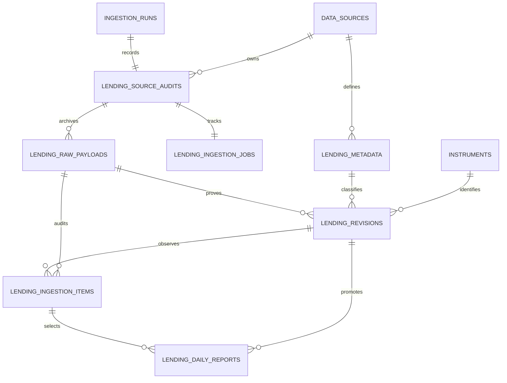

# Phase 2E-2 — Securities Lending Ingestion & REST API

驗證日期：2026-11-10，Asia/Taipei。沿用 [2E-1 Domain](phase-2e-lending-domain.md)、[Phase 2A 來源](phase-2a-data-sources.md#5-c--融資融券與借券)與[Phase 2 API 契約](phase-2-api-contract.md)。本階段實作 Lending Persistence、核准來源 Adapter、手動 CLI 及唯讀查詢 API；不新增前端、排程、交易功能或 Phase 2F 指標。

## 架構與流程

```mermaid
flowchart LR
    S[Approved official source] --> H[Bounded HTTP and host rate limit]
    H --> R[Immutable Raw archive]
    R --> P[Schema and official-date validation]
    P --> N[Reviewed instrument identity]
    N --> D[Typed Lending Domain and Calculator]
    D --> A[Row audit and whole-report revision]
    A --> C[Atomic canonical pointer and checkpoint]
    C --> Q[Read-only transaction snapshot]
    Q --> API[Lending REST API]
    R --> Replay[Offline replay]
    Replay --> P
```



API → Application → Domain，Infrastructure 實作 Ports。Source callbacks 在解析前保存每次 HTTP 回應，包括403／429／5xx。Normalizer 只輸出既有 LendingDailyReport，所有 balance identity 直接使用 LendingCalculator，沒有重寫 margin／institutional 公式。

Public `LendingSourceAdapter` 實作為 audited fetch／parse Provider Protocol，讓 Raw-first callback 成為正式介面。2E-1 的 Request／Snapshot DTO 保留作 metadata 契約，不維護另一個未使用的 runtime Source 介面。Domain 沒有資料庫／HTTP／Framework import。

## PostgreSQL Schema

Migration `0009_lending`，前版 `0008_margin`，新增七張表：

| 表 | 用途 |
| --- | --- |
| lending_source_audits | run/source FK、同步／replay模式、請求日期、版本化 Manifest、凍結的 reviewed evidence |
| lending_raw_payloads | 不可變原始bytes、SHA256、endpoint／參數、status、contract、擷取時間與replay lineage |
| lending_metadata | 不可變Source／Channel／Report Kind／scope／unit及版本snapshot，metadata hash與source FK |
| lending_revisions | Typed BIGINT、每欄availability、完整typed snapshot、profile/content hash、原Raw FK |
| lending_ingestion_items | 每Raw row唯一audit，接受／拒絕／unresolved／skipped、原因、完整revision observation |
| lending_daily_reports | Canonical指標，指向同一份完整revision與observation |
| lending_ingestion_jobs | 持久phase／selectedRaw／plan／cursor／row count，與run/source audit連結 |



Canonical PK＝**instrument_id／trade_date／report_kind／scope／channel_family／channel_code**。借券未還與借券賣出、Combined與各子系列分開保存；不能用同一個模糊short_balance欄替代，也不由哪一個channel比較新來選另一序列。

數量採嚴格 int／BIGINT，只有 signed_adjustment 可負；reported須有值，missing／not_applicable須null。兩種kind不適用的financial欄有明確N/A矩陣。Source金額／lots未核實時不轉成shares或borrowed balance。Channel coverage以排序array編碼／hash，避免frozenset字串或跨Worker順序造成不一致。

FK RESTRICT核對Instrument＋Market、Raw＋Run＋Source、metadata、Revision及Canonical observation。CHECK／Trigger核對SHA256、typed columns與snapshot、kind／channel／unit／lineage及完整公式。source audit、raw、metadata、revision、item不可改寫／刪除；舊資料及其他模組規則不變。

### Transaction 與 Revision Policy

- 整份報表、item audit、canonical pointer、counters及checkpoint同一transaction提交；錯誤rollback，不留下半份報表。
- PostgreSQL advisory transaction lock按完整natural key協調跨Worker，並鎖canonical row；另有job／host session locks，不以記憶體鎖作唯一保護。
- 相同內容／profile重送重用revision，保留新Raw／observation；同一raw row重送亦冪等。
- 不同source、contract／schema／parser／taxonomy／identity／formula／promotion版本、unit／scope／channel定義不可任意覆蓋。Profile不同保留candidate。
- Partial可保存revision／audit，不補0，不晉升成完整canonical或覆蓋既有完整值。M6未知channel／scope仍可保存數值完整的來源事實，但metadata及API明確維持unverified。
- 舊Raw Replay保留原fetched_at。已知較舊revision內容重新下載，不得僅憑新下載時間復活成canonical；無可證明的新publication時保留candidate／stale。若官方有真實較新publication，同數值但新publication形成可追溯的新revision。
- publication on／at未知保持null，已知時優先核對其順序；不能混合不同發布輪次的欄位。
- 錯誤row逐筆audit，不使其他有效證券默默消失。Rejected錯日不污染有效report的checkpoint日期。不能表示為JSONB的異常row仍由原始bytes追溯。
- 非空任何Lending表時downgrade拒絕，不用CASCADE刪正式資料；只有空表可回0008。

已知M6的Persistence與SQL防護另外核對：官方endpoint／contract／schema、TPEX市場、scope=unspecified、原ChannelDefinition、SHARES、官方Date、SIGNED公式與taxonomy版本。不能直接呼叫Repository繞過Normalizer，將M6標為borrowed_positions、combined、已核實scope或其他市場。

## 官方來源與 Adapter 啟用狀態

Manifest `lending-sources-1.1.0`。Adapter預設network_enabled=false，只有明確手動命令才能opt in；目前唯一可下載的Balance來源為 **M6 TPEx**。

| Source | Endpoint／Method／日期參數 | 可用性與限制 |
| --- | --- | --- |
| M6 TPEx | GET `https://www.tpex.org.tw/openapi/v1/tpex_margin_sbl`；無參數 | Dataset11632 OGDL1／每日／免費；latest-only；官方Date民國yyyMMdd、quantity為shares，16欄契約 |
| M3 TWSE | 候選GET `https://www.twse.com.tw/rwd/zh/marginTrading/TWT93U`；date=YYYYMMDD、response=json | 網站使用權／literal grouped Schema未核實，保持disabled |
| M4 TWSE借券未還 | 候選GET `https://www.twse.com.tw/rwd/zh/lending/TWT72U`；date／selectType=SLBNLB／response | 使用權／Schema／市場label與Channel partition未核實，保持disabled；不假裝已取得借券未還資料 |
| M7 TPEx dated | 候選GET `https://www.tpex.org.tw/www/zh-tw/margin/sbl`；date=YYYY/MM/DD、response=json | 使用權／grouped Schema／歷史分段未核實，保持disabled |
| M8 TPEx flow | `https://www.tpex.org.tw/openapi/v1/tpex_short_sell` | Flow-only；授權映射／lots multiplier／金額scale未核實，禁止當Balance來源 |
| M9 TWSE quota | `https://openapi.twse.com.tw/v1/SBL/TWT96U` | Quota-only、無Date、body／授權映射未核實，禁止當實際borrow／sell／balance |

M6 `SecuritiesBorrowingBalancePreviousDay／SecuritiesBorrowingSale／SecuritiesBorrowingReturn／SecuritiesBorrowingAdjustment／SecuritiesBorrowingBalanceOfTheMarketDay` 對應借券賣出Ledger；不因英文Borrowing字面而當借券未還。相鄰Sale*融券組保留在Raw，明確排除計算。負值adjustment保留，空白／null／--維持missing，N/A與真正0分開。

M6 system Channel未核實：保存category=`unspecified`、code=`unmapped`、family=`tpex-lending-short-reported`、verified=false、coverage=[]。交易／鉅額口徑同樣用trade_scope=unspecified，不猜成combined或已確認的完整範圍。

Quota獨立保存purpose=available_short_sale、來源quantity及report_date，effective_relation=next_business_day但effective_on=null，basis保持來源未核實標記；不拿配額代替成交、不推算營業日、不通用限制sold≤quota。

HTTP有有限timeout、最多3次attempt、20MB上限；403不重試、429／5xx有上限，Retry-After超過60秒預算停止。平台採至少5秒host spacing與PostgreSQL host lock，這不是官方Rate Limit或SLA。Raw-first保存每次HTTP回應，沒有CAPTCHA／反爬繞過。

官方依據：[Dataset11632](https://data.gov.tw/dataset/11632)、[TPEx Swagger](https://www.tpex.org.tw/openapi/swagger.json)、[OGDL](https://data.gov.tw/license)、[2A來源查證](phase-2a-data-sources.md)。精確公開更新時刻與歷史覆蓋仍未核實，不宣稱20:30／22:30就是每筆publication time。

## 手動 CLI

```bash
docker compose build backend
docker compose run --rm backend alembic current
docker compose run --rm backend alembic upgrade head
docker compose up -d --no-deps --wait backend

# 預設M6；沒有reviewed identity時保留Raw／Audit，各證券維持unresolved
docker compose run --rm backend stockapp lending sync latest
docker compose run --rm backend stockapp lending sync latest --source M6

# 替換成實際經審查、適用於來源官方日期的UUID／市場／unit證據
docker compose run --rm -v /absolute/reviewed-lending.json:/evidence.json:ro backend \
  stockapp lending sync latest --source M6 --evidence /evidence.json

docker compose run --rm backend stockapp lending status --limit 20
docker compose run --rm backend stockapp lending status --id <RUN_UUID>
docker compose run --rm backend stockapp lending replay --raw <RAW_UUID>
docker compose run --rm backend stockapp lending replay --resume <RUN_UUID>

# M6沒有歷史日期能力，必須拒絕；M4網站來源尚未核准，不會下載
docker compose run --rm backend stockapp lending sync date --source M6 --date 2026-11-06
docker compose run --rm backend stockapp lending sync date --source M4 --date 2016-11-07
```

Host版以 `.tools/api-venv/bin/stockapp lending ...` 使用相同語法。Evidence格式為 `lending-evidence-v1`、synthetic=false、entries；每個entry包含symbol、market_code、instrument／market UUID、quantity_unit、valid_from／through、evidence_version與官方HTTPS source_reference。M6原單位是shares，不需要或接受未核實的factor欄。

Loader拒絕重複key、重疊日期binding、非官方URL、未知欄及無效unit／UUID。當前Registry只確認UUID，日期有效性必須另有reviewed evidence；不從建立時間推測上市日期。Root composition透過market_data.public讀取reviewed symbols後凍結snapshot，不每個row查全市場。

Raw Replay不下載，原fetched_at不變；Resume只處理未提交row，使用原audit中的凍結Evidence／config／plan，不載入修改後檔案。中斷時已有成功Raw可復原選定Raw；沒有成功Raw明確失敗。

Exit0表示sync succeeded或status查詢成功，partial／failed／特定run不存在回2，意外依賴錯誤回1；訊息過濾SQL／DSN／密碼。Batch partial不表示其中已保存的有效canonical失效，仍可透過status查每個原因與counter。

## REST API

| Method／路由 | 用途 |
| --- | --- |
| GET /api/v1/stocks/{id}/lending | History，report_kind／trade_scope／Channel篩選與複合cursor |
| GET /api/v1/stocks/{id}/lending/latest | 最新單一series；多Channel未篩選時回422 |
| GET /api/v1/lending/status | Source／Channel／Report Kind／授權／同步／覆蓋狀態 |
| GET /api/v1/chip-data/status?product=lending_daily | 共用籌碼狀態入口；保留原有institutional／ownership／margin行為 |

History預設report_kind=lending_short_sales、trade_scope=unspecified。借券未還使用report_kind=borrowed_positions；借券賣出History使用report_kind=lending_short_sales，不另造容易混淆的short_balance API。

- 每個point明示trade_date、report_kind、scope、Channel category／code／family／version／verified／coverage與unit。
- Borrowing Ledger回previous_balance／borrowed_quantity／returned_quantity／signed_adjustment／balance；Lending Short回previous_balance／short_sales／short_returns／signed_adjustment／balance，不適用kind的flow不塞成0。
- Quantity回 `{value:"精確整數"|null,unit,availability}`；Decimal結果同樣為字串。balance_semantics=stock、flow_semantics=daily_flow、quotas獨立附semantics=regulatory_quota_not_actual_volume。
- Balance identity直接重用Domain，附formula／algorithm version；不提供期間balance總和或跨Channel合計，aggregation=none。
- M6數值identity可complete，同時quality.status=not_verified，並明示source_channel_not_verified／trade_scope_not_verified；沒有把未知範圍宣稱為完整驗證。
- Source、Raw／Run／Revision、hash、Schema／Parser／Taxonomy／Identity／Formula／Promotion版本可追溯。官方統計日與source_published_on／at、first_seen／last_seen／ingested_at分開，未知發布時間null。
- coverage／freshness沒有verified日曆與發布SLA時維持not_verified；兩端有資料不表示中間完整，非即時行情。

日期預設近366曆日，最多含首尾3,660日；limit≤1,000。History按date／channel family／code作複合keyset cursor，保持同日不同Channel，不漏掉同日後續點。可用lending_channel（category或code）與channel_family限定series；Latest遇多於一個selected Channel回422 ambiguous_lending_channel，不任意挑較新的別種Channel。初版API只接受已部署的unspecified trade_scope。

GET只讀Canonical，單次使用RR READ ONLY Snapshot並設statement／lock timeout；不讀Raw body作正式資料、不抓供應商或寫資料。404不存在／不支援市場、422無效範圍／cursor／不明確Channel、503依賴或已保存資料異常；存在股票無canonical回200 empty／point=null。Pydantic Response Models及OpenAPI snapshot隨實作更新。

```bash
curl 'http://localhost:8000/api/v1/stocks/<INSTRUMENT_UUID>/lending/latest'
curl 'http://localhost:8000/api/v1/stocks/<INSTRUMENT_UUID>/lending?report_kind=lending_short_sales&from=2026-01-01&to=2026-11-10&limit=100'
curl 'http://localhost:8000/api/v1/stocks/<INSTRUMENT_UUID>/lending?report_kind=borrowed_positions'
curl 'http://localhost:8000/api/v1/lending/status?source_code=tpex_lending_short_openapi'
curl 'http://localhost:8000/api/v1/chip-data/status?product=lending_daily'
```

## 測試與正式驗證紀錄

固定資料全部明確標為SYNTHETIC，只在記憶體或獨立臨時資料庫／Schema使用，不當正式seed或真實覆蓋率。測試使用刻意不符合融券公式的Sale*欄位，證明沒有錯拿相鄰融券組計算借券賣出。

```bash
cd apps/api
../../.tools/api-venv/bin/python scripts/run_institutional_validation.py \
  --output-dir ../../.tools/validation/phase-2e2/full-tests -- tests -m 'not network' -q --tb=short
cd ../..
RUN_INTEGRATION=0 RUN_NETWORK=0 .tools/api-venv/bin/python -m pytest \
  apps/api/tests -m 'not integration and not network' -q
.tools/api-venv/bin/python apps/api/scripts/export_openapi.py --check
PATH="$PWD/.tools/node/bin:$PATH" npm test
PATH="$PWD/.tools/node/bin:$PATH" npm run typecheck
PATH="$PWD/.tools/node/bin:$PATH" NEXT_TELEMETRY_DISABLED=1 npm run build
docker compose config --quiet
docker compose ps --all
```

### 已執行結果（2026-11-10）

| 驗證 | 結果 |
| --- | --- |
| 全後端非網路套件，包含前階段 Regression、隔離 PostgreSQL、Migration、HTTP | **2,756 passed、4 network deselected**；331.28 秒，1 個既有 Starlette warning |
| 新 Lending Persistence PostgreSQL | 27 passed，包含 Constraints、並發、Rollback、Revision、非空 Downgrade 保護 |
| 新 Lending Query／HTTP PostgreSQL | 8 passed |
| 新 Lending 完整匯入管線 PostgreSQL | 7 passed，驗證 Raw→Canonical→HTTP、Replay、Revision、舊內容防覆蓋 |
| 新 Lending Adapter／Source Contract | 85 passed |
| 新 Lending Application／CLI | 37 passed |
| 新 Lending API Unit | 34 passed |
| 既有 Lending Domain 數值回歸 | 231 passed，未改寫公式 |
| Vitest | 244 passed，15 files |
| TypeScript Typecheck／Next Production Build | 通過 |
| OpenAPI Snapshot／git diff whitespace | 通過 |
| Backend Docker Build | 通過；本機 Backend 更新後 healthy |
| 正式本機 Migration | 安全執行 `0008_margin → 0009_lending`，Current／Head 為 `0009_lending` |
| Docker Health | backend、frontend、PostgreSQL、Redis healthy；既有 history-worker 為 exited，未啟動或修改 |

以上 Lending 分項包含於完整後端套件，不額外累加為測試總數。寫入測試使用臨時資料庫與隔離 Schema，測試資料庫已移除；沒有把 Synthetic 資料寫進正式資料庫。

### 官方來源、正式資料庫與 HTTP 端到端驗收

再次核對 [政府開放資料集 11632](https://data.gov.tw/dataset/11632) 的 OGDL-1.0 與免費使用標示後，透過已核准的 M6 Adapter 取得 HTTP 200，保存一份 **2026-11-09／933 筆**的官方快照。官方日期欄為 `1151109`，不是下載日。實際下載時間為 `2026-11-10T11:04:50.745136+00:00`，未知官方發布時間仍為 null。

- Run：`da672a11-400e-4127-8e44-23863a52df92`。
- Raw：`2ae5bc3f-31f2-496a-8225-15ab512aba2c`。
- SHA-256：`a656139bd4d6b3f59eb1185f2e34a72bb8fb783168848444fe96a82c401e96fb`。
- 此次初次同步未提供核實 dated UUID evidence，933 筆均留下 `historical_identity_unresolved` Audit；accepted／promoted／revisions_created 均為 0，工作狀態 failed／all_reports_unavailable。Raw 保存成功不能算成 Canonical 資料覆蓋。

核對 Raw 內環球晶（6488）與公開證券身分 Reader 的 TPEX／UUID／名稱／shares 單位後，建立只適用 **2026-11-09** 的單日證據。此證據不從 Registry 建立時間推測上市日期，不宣稱其他歷史日期有效。透過正式 CLI 重播已保存的官方 Raw，完成 Normalizer→Domain Validation→Audit→Revision→Canonical→PostgreSQL→HTTP API 的完整驗證；以下三層數值逐欄相同：

| M6 官方欄位 | Canonical／API 欄位 | Raw＝DB＝API（股） |
| --- | --- | ---: |
| SecuritiesBorrowingBalancePreviousDay | previous_balance | 12,476,000 |
| SecuritiesBorrowingSale | short_sales | 348,000 |
| SecuritiesBorrowingReturn | short_returns | 360,000 |
| SecuritiesBorrowingAdjustment | signed_adjustment | 0 |
| SecuritiesBorrowingBalanceOfTheMarketDay | balance | 12,464,000 |
| AvailableVolumesForSBLShortSale | quotas（限額，非成交） | 433,851 |

來源恆等式為 `12,476,000 + 348,000 − 360,000 + 0 = 12,464,000`。相鄰的 `Sale*` 是融券，未將其當成借券賣出。沒有乘以 1,000，也沒有將 Quota 加進 Balance。

核實 Replay Run 為 `09c9a203-ebc7-4bae-bb84-3f2be61c4165`，Raw clone 為 `6811613a-198a-43b6-a608-23d1dffa1e42`。結果 accepted=1／complete=1／promoted=1／revisions_created=1／unresolved=932；工作為 **partial**，CLI 退出碼2符合批次部分覆蓋的設計。沒有未經證據就匯入其餘股票。

再以 `lending replay --raw 6811613a-198a-43b6-a608-23d1dffa1e42`，繼承該工作凍結的證據，執行第二次重播：Run=`e500de90-ec4b-4cad-9568-ba6a38a93505`、Raw=`967cdf62-5cb8-4479-8b55-c71eb167ad8a`，結果 accepted=1／unchanged=1／promoted=0／revisions_created=0／unresolved=932。原始 fetched_at／first_seen_at 保留不變，沒有重新下載。

| 正式持久化驗證 | 結果 |
| --- | --- |
| Canonical／Revision／Metadata | 重播前後皆 1／1／1 |
| Revision ID | `cb51d030-ef6b-4381-9787-0e3deec119a9`，重播不變 |
| Content Hash | `091835749c9a165d6348b5315fd235f7ae001c9c1d8edecaf7fdfc51db4d6851`，重播不變 |
| Profile Hash／Canonical Observation | 重播不變 |
| Raw／Source Audit／Ingestion Job | 3／3／3；每次重播留存自己的 lineage |
| Ingestion Item Audit | 2,799＝933×3，包含初次無證據工作及兩次重播，不算真實覆蓋率 |
| 真實 Canonical 覆蓋 | 僅 TPEX 6488、2026-11-09、一個未核實 Channel 的借券賣出報表 |
| Canonical 借券未還 | 0；M4 尚未核准，沒有用借券賣出冒充 |

HTTP 已實際核對 latest、history、Channel filter、來源 status、共用 chip-data status。API 整數／Decimal 均為精確字串，數值 identity=complete／difference="0"，但 overall quality=not_verified、Channel unspecified／unmapped、trade_scope=unspecified。官方發布時間與 Quota effective_on 均保持 null；coverage／freshness 不宣稱 verified 或即時。查無借券未還回200 empty；不存在的證券回404，反向日期／無效日期／超額limit回422。執行中 `/openapi.json` 與 repository snapshot 相同；`/health`、`/health/ready`、既有日行情／融資融券／法人 latest 均回200。

最終唯讀 Snapshot 比對下列既有資料與本階段開始時完全一致：

| 既有資料 | 驗收前＝驗收後 |
| --- | ---: |
| DailyBars | 9,712,317 |
| DailyBar Revisions | 9,739,041 |
| Institutional Reports | 0 |
| Ownership Weekly Canonical | 1 |
| Margin Canonical／Revision | 1／1 |
| Margin Raw／Item Audit | 4／4,063 |

單日證據、審查記錄與實測產物保存在 gitignored `.tools/validation/phase-2e2/`：`reviewed-6488-evidence.json`、`reviewed-6488-evidence-review.json`、`m6-reviewed-replay.json`、`m6-repeat-replay.json`、`before-repeat-validation.json`、`after-repeat-validation.json`。`validate_runtime.py` 為本機唯讀核對工具；固定數值自動化測試仍以 repository 中隔離測試為準。先前核准審查額度造成的執行阻擋已解除，本次正式匯入、API 與重播驗收均已實際執行。

正式工作沒有觀察到可證明的來源修訂，故未捏造 revised report。Revision Promotion、舊 Raw 與已知舊內容不可僅因新的下載時間覆蓋 Canonical，已由隔離 PostgreSQL 固定數值測試驗證；正式修訂仍待官方真實修訂出現。

## 限制與停止點

- Borrowed Positions的M4使用權／Schema／市場mapping尚未核可，正式借券未還匯入Blocked；API可回empty，但不冒充已有資料。
- M6只取得實際可用的最新快照，沒有宣稱十年歷史；Channel／交易口徑／精確publication未知，保留明確狀態。
- M3／M7歷史、M8每日flow金額／單位／使用權、M9quota日期／body／資源映射維持disabled。
- 真實來源沒有產生可證明的新修訂時，不製造假Revision作實測；Revision升級／舊Raw／既知舊內容復活防護以固定數值與真實PostgreSQL驗證。
- 本次停止於2E-2，不commit／push／部署、不啟動長期同步或進入Phase2F。
