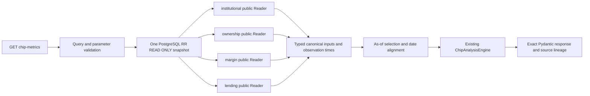

# Phase 2F-2 — Chip Metrics API & Cross-Source Analysis

日期：2026-11-11，Asia/Taipei。沿用 [2F-1 Engine](phase-2f-chip-engine.md) 及 [Phase 2 API Contract](phase-2-api-contract.md)，新增跨產品 Canonical 查詢、時間對齊與版本化 HTTP 回應。本階段沒有前端、排程、供應商下載、分析結果預存或新資料表。

## 架構與資料邊界



API → Application → Domain；`infrastructure.reader.SqlAlchemyChipQueryReader` 只呼叫四個產品的公開 Reader Factory／Port，沒有跨模組私有 ORM、Repository 或 SQL 表相依。既有產品保有自己的 storage mapping／解碼／公式；GET不呼叫Adapter，不讀Raw body當正式資料，不晉升Revision。

新增公開入口：`institutional_reader(session, calendar_reader=...)`、`ownership_reader(session, schedule_reader=...)`、`margin_reader(session)`、`lending_reader(session)`。Import Facade仍可在純標準庫環境使用；SQLAlchemy只在明確組裝Reader時載入。共用Instrument／Error HTTP Schema透過 `market_data.public_api` 匯出。

所有Reader共享Dependency建立的同一Session：`SET TRANSACTION ISOLATION LEVEL REPEATABLE READ READ ONLY`，statement timeout10秒、lock timeout3秒。Reader不自行commit，Canonical與Metadata不會在單一回應中跨snapshot。

法人舊page路徑會逐列重新讀取Canonical／Revision／Observation，本階段改成固定批次：一個JOIN projection加一個grouped first_seen查詢。既有法人回歸會一併驗證，沒有更動計算公式。其餘產品沿用已有批次Reader及source cache；不為每個point呼叫全市場status aggregate。

## API

`GET /api/v1/stocks/{id}/chip-metrics`，`id`是既有Instrument UUID，不是股票代碼。

| Query | 語意 |
| --- | --- |
| metric | 必填，可重複傳入1–10個不同Metric ID，依請求順序輸出 |
| evaluation_frequency | 預設1d；可選1w。1d可對齊週資料，1w只支援原生週指標 |
| parameters | ≤4096字元的嚴格JSON；單metric用其參數物件，多metric用metric_id→參數物件 |
| from／to | inclusive市場本地ISO日期；預設截至query_as_of的最近31曆日，最長3660日 |
| query_as_of | timezone-aware ISO timestamp，預設伺服器read_at；不得在未來 |
| time_basis | as_of_day（預設）或query_as_of（明確歷史重算） |
| availability_policy | observed_revision_v1（預設）或published_and_observed_revision_v1 |
| limit | 每頁評估日期數，1–250，預設100；日期數×metric數≤1000 |
| cursor | 帶query signature及原知識截止時間的opaque date keyset cursor |
| institutional_scope | 法人口徑code；多個scope匹配時回422，不任意選擇 |
| margin_scope | 預設margin_trading |
| lending_scope | 預設unspecified，忠實保留M6目前限制 |
| lending_channel／channel_family | 可指定既有Channel；仍有多序列時回422 |
| report_kind | lending_short_sales（預設）或borrowed_positions |

Metric ID／參數／公式沿用2F-1。法人累計只接受5／10／20／60個確認交易session，未實作任意N。集保門檻以基礎股數／units表示，必須對齊官方Bucket下界。買賣超、週百分點差、Balance、Flow、Quota不互換。

JSON拒絕duplicate keys、NaN／Infinity、浮點參數、bool冒充int、list／null、過深巢狀及未知參數。不能傳SQL、任意公式、Calendar verified旗標、Ratio相容性證據或供應商URL。

### 時間語意

五種時間分開：

1. `evaluation_date`：API的評估日期；不表示新交易或新週報。
2. `input_refs.statistics_date`：來源報表真正統計日。
3. `source_published_at`／`source_published_on`：官方已知發布時刻／日期；未知保持null。
4. `first_seen_at`、`ingested_at`、`last_seen_at`：來源觀察與Canonical observation的實際時間。
5. `query_as_of`：本次查詢知識截止時間，另有伺服器`read_at`。

| time_basis | 逐點知識時鐘與用途 |
| --- | --- |
| as_of_day | `min(query_as_of, evaluation_date當地日終)`。預設保守模式；在那一天尚未觀察或ingest的歷史回補資料不能提早出現 |
| query_as_of | 所有point使用明確的query_as_of。用目前已知Canonical重算歷史統計，不代表當時可交易／可知，也不是PIT回測 |

週指標對齊1d時，先限制statistics_date≤evaluation_date，再選截至逐點知識時鐘真正可用的最新週報；新一週未公布時可以沿用當時已知的前週，仍保留前週日期與age，不建立每日新持股觀察。若沒有任何已知週報，保留受阻Revision及not_yet_available／not_verified；沒有任何Canonical則unavailable。

週變化仍由原Calculator檢查相鄰確認週；不能把最近兩筆觀察誤當相鄰兩週。`evaluation_frequency=1w`只產生已保存的實際統計日期，不猜星期五、缺週不補列。Margin／Lending每日指標只讀當天報表，不把前一個餘額沿用成當天新交易。

Margin／Lending純Domain DTO原本不包含ingested_at。本階段以typed `RevisionObservation` 將public Reader讀出的真實Canonical observation時間注入Engine Snapshot，**在計算前**檢查截止時間，並原樣輸出；不是只在HTTP結果補欄，也不以first_seen_at冒充ingested_at。

只讀現在選定的Canonical。若其修訂在query_as_of之後才可用，不能擅自切回候選或舊Revision來湊出值；daily週報對齊可選其他日期的已知週報，但不可使用同日已不再是Canonical的舊版。Cursor保留截止時間及條件，不宣稱跨HTTP頁面的DB snapshot固定。

`coverage.point_in_time_supported=false`始終明示。未知發布時刻的observed模式標provisional；嚴格publication模式要求精確發布時刻，單有發布日期不足。即使已知發布時間，也沒有憑目前Canonical／部分audit保證完整歷史promotion vintage。

## 回應與精度

Pydantic `extra=forbid`。Result value是固定12位Decimal字串或null；內部50位、HALF_EVEN、Engine／Metric／upstream版本沿用2F-1。`details`／Input Metadata中的所有金融整數與Decimal遞迴輸出精確字串，沒有JSON float；大於JavaScript安全整數的threshold參數也轉字串。小型count／page／period／age metadata保持受限整數。

主要欄位：

- Top：instrument、metrics、evaluation_frequency、from/to、query_as_of/read_at、time_basis、availability_policy、points、count、evaluation_count、next_cursor、precision、coverage、sources、availability。
- Point：evaluation_date、metric、native_frequency、anchor_statistical_date、input_age_days、is_carried_forward、value、unit、status、reasons、missing_dates、is_provisional、completeness、formula、parameters、各版本、reproducibility_key、details、input_refs。
- Input Ref：product、instrument／market／source UUID、statistics_date、Revision／Run／Raw、契約版本、quantity unit、全部可用時間、原Lineage／scope／schema／parser／scheme／channel／formula metadata及Source名稱。
- Availability：每個參與產品的loaded_reports、已載入Canonical的日期範圍、latest publication／observation／ingestion、source IDs、no_data／not_verified及原因；不拿查詢端點日期假裝完整歷史覆蓋。

`completeness=complete_for_requested_inputs`只描述單個可計算指標，不升級成整個來源或全歷史完整。全查詢coverage保守not_verified。沒有已核實發布SLA就不宣稱「最新官方」、「即時」或stale判定。

### 錯誤與限制

- 404：Instrument不存在或市場／數量單位不支援。
- 422：日期、頻率、參數、future cutoff、cursor、scope／Channel歧義或查詢上限錯誤。
- 503：資料庫不可用、已保存Canonical解碼／回應契約異常。SQL、DSN、供應商HTML與密鑰不公開。
- 已存在股票但來源沒有Canonical：200與明確unavailable／missing_data；1w沒有實際週報日期時points空陣列，不製造假週報。

單次Reader每產品最多1000報表，取limit+1辨識超限並拒絕，不默默截斷。法人lookback為366曆日，仍依確認session計算，範圍不足或連續左端截斷由原Calculator回狀態。週報為此Instrument截至頁尾的反向有界索引讀取，包含as-of對齊與前期所需觀察。所有查詢有Instrument條件，沒有無界載入全市場。

借券比例沒有部署經核實的「Channel／scope對成交量」映射，保持unavailable／not_verified；不因DailyBar有volume_shares就當作同範圍分母。`market_traded_quantity` availability明示reviewed mapping unavailable。這是來源能力限制，不是用假分母取代。

## 操作範例

```bash
# 以既有stock UUID查詢，四個產品在同一snapshot中讀取
curl -G 'http://localhost:8000/api/v1/stocks/fe53c1d3-e0ca-4475-8ab6-d2c274252e25/chip-metrics' \
  --data-urlencode 'metric=institutional_net_sum' \
  --data-urlencode 'metric=ownership_large_holder_percent' \
  --data-urlencode 'metric=margin_balance_change' \
  --data-urlencode 'metric=lending_balance' \
  --data-urlencode 'from=2026-11-06' --data-urlencode 'to=2026-11-11' \
  --data-urlencode 'time_basis=query_as_of'

# TDCC以每日可用時間對齊；保留真正週統計日
curl -G 'http://localhost:8000/api/v1/stocks/6afb0bb3-9356-4a59-8122-57fed2b36628/chip-metrics' \
  --data-urlencode 'metric=ownership_large_holder_percent' \
  --data-urlencode 'evaluation_frequency=1d' \
  --data-urlencode 'from=2026-11-06' --data-urlencode 'to=2026-11-11'

# 多metric參數不能混成一個未分組的物件
curl -G 'http://localhost:8000/api/v1/stocks/<INSTRUMENT_UUID>/chip-metrics' \
  --data-urlencode 'metric=institutional_net_sum' \
  --data-urlencode 'metric=margin_balance_change' \
  --data-urlencode 'parameters={"institutional_net_sum":{"period":20},"margin_balance_change":{"ledger":"short_margin"}}'
```

日期／UUID範例取自本機已有資料，不代表其他部署一定存在。可先用既有`GET /api/v1/instruments`搜尋股票以取得UUID。沒有新增CLI、匯入工作或公開POST。

## 測試與驗收

固定資料、Calendar、Schedule與所有DB寫入測試均明確 **SYNTHETIC**，只存在獨立測試資料庫／Schema；正式資料只做唯讀驗證。

```bash
.tools/api-venv/bin/python -m pytest apps/api/tests/test_chip_metrics_api.py \
  apps/api/tests/test_chip_public_readers.py apps/api/tests/test_chip_ledger_readers.py -q

cd apps/api
../../.tools/api-venv/bin/python scripts/run_institutional_validation.py \
  --output-dir ../../.tools/validation/phase-2f2/full -- tests -m 'not network' -q --tb=short
cd ../..
.tools/api-venv/bin/python apps/api/scripts/export_openapi.py --check
PATH="$PWD/.tools/node/bin:$PATH" npm test
PATH="$PWD/.tools/node/bin:$PATH" npm run typecheck
PATH="$PWD/.tools/node/bin:$PATH" NEXT_TELEMETRY_DISABLED=1 npm run build
docker compose config --quiet
git diff --check
```

已驗證：跨頻率對齊、未知publication、實際ingested cutoff、正確Decimal、空歷史、Missing／Partial／Incompatible、目前Revision不可倒退、RR snapshot並發寫入隔離、N+1消除、有界讀取、GET不讀Raw或對外HTTP、錯誤碼與OpenAPI。

### 實際測試結果

| 檢查 | 結果 |
| --- | --- |
| 完整後端含隔離PostgreSQL／Migration及全部前階段Regression | **2,984 passed、4 network deselected**，328.98秒，1個既有Starlette deprecation warning |
| 新Chip Metrics HTTP Unit | 26 passed |
| 新Public Readers | 14 passed，含標準庫匯入、固定批次查詢、時間與來源快取 |
| 新跨產品PostgreSQL HTTP | 8 passed；與既有法人Query整合合計41 passed |
| 前端Vitest | **244 passed／15 files** |
| TypeScript Typecheck／Next Production Build | 通過；next-env.d.ts已還原 |
| OpenAPI snapshot／執行中Backend export --check | 通過 |
| Docker Backend Build／本機服務更新 | 通過；只更新Backend，不重啟PostgreSQL／Redis／Frontend／history-worker |
| Schema | Alembic Current／Head仍為`0009_lending`；不需要新Migration |
| git diff --check | 通過 |

完整套件使用新建臨時資料庫 `stockapp_p2b6_test_740ae1b5a7c44db2`，每個DB測試使用隨機Schema，結束後資料庫已移除。合成測試在初次INSERT提供可重現的ingest時間，不修改已封存的不可變報表或正式資料。

### 正式Canonical唯讀驗收

1. **2330，2026-11-06**：官方TDCC已保存週報、門檻400001股、分母為同份官方集保存量，API比例 **87.009580453709%**。來源、Revision、統計日與時間欄位可追溯；publication未知保持null，provisional=true，不宣稱PIT或連續週差可算。
2. **6488，2026-11-06**：新跨產品API回融資餘額日差 **−1,128,000股**，與同一Canonical Public Reader／Engine一致。其他尚無資料的產品回unavailable／missing_data，不補0。
3. **6488，2026-11-09**：同一HTTP查詢範圍內可讀Margin及Lending Canonical。既有Lending API顯示原始借券賣出餘額12,464,000股；新分析API指向相同Revision，但因Channel／scope未核實回 **not_verified／null**。使用預設as_of_day查該日則因隔日才觀察／ingest而回 **not_yet_available**。
4. **Institutional**：正式Canonical仍為0，新API確實回missing_data，沒有用Synthetic取代。
5. **Ratio**：M6口徑與成交量映射仍未核實，回not_verified或unavailable；沒有從DailyBar猜分母。

實際呼叫HTTP `/chip-metrics`、既有Ownership／Margin／Lending API、health／ready與runtime OpenAPI，比對直接Public Reader／Engine結果。每日TDCC對齊只從已知時間起出值，保留2026-11-06統計日、age及沿用標記，未建立每日持股列。

驗收前後以下正式筆數完全一致：

| 資料 | 前＝後 |
| --- | ---: |
| DailyBars／DailyBar Revisions | 9,712,317／9,739,041 |
| Institutional Canonical | 0 |
| Ownership Weekly Canonical | 1 |
| Margin Canonical／Revision／Raw／Item Audit | 1／1／4／4,063 |
| Lending Canonical／Revision／Raw／Item Audit | 1／1／3／2,799 |

實測與日誌保存於gitignored `.tools/validation/phase-2f2/`：before／after inventory、real-margin-cross-query、real-ownership-cross-query、real-6488-combined、real-daily-ownership、existing Lending／Margin回應及完整測試／Build記錄。這些是本機真正資料的驗證紀錄，不是全市場或十年資料覆蓋宣告。

## 停止點

本次止於Phase2F-2。沒有前端、分析結果表／cache、排程、回測、選股器、AI／主力分數或交易功能。保留法人verified calendar、TDCC verified weekly schedule、來源使用權及Lending口徑／比例分母缺口，不宣稱未取得的歷史完整。不commit／push／部署或進入前端階段。
