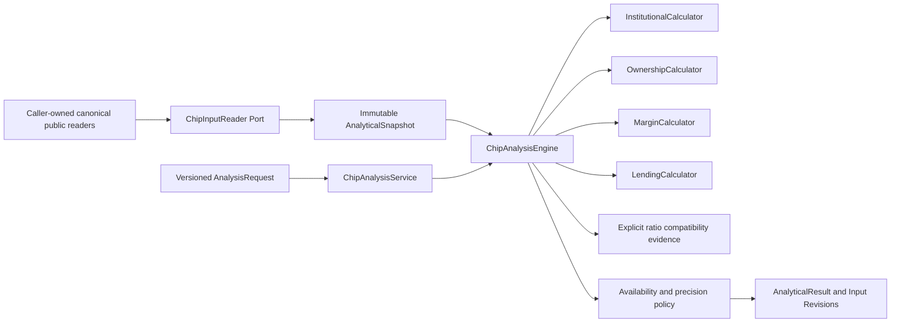

# Phase 2F-1 — Versioned Cross-Source Chip Analysis Engine

日期：2026-11-11，Asia/Taipei。只建立可重用的純分析引擎、公開契約、Application composition 與 Synthetic 固定數值測試。沒有新增 API、UI、Migration、快取或結果資料表，沒有抓取資料、修改 Canonical 或啟動 Worker。

## 設計依據與契約調整

沿用 [2B 法人 Domain](phase-2b-institutional-domain.md)、[2C 集保 API／Calculator](phase-2c-ownership-api.md)、[2D Margin Domain](phase-2d-margin-domain.md)、[2E Lending Domain](phase-2e-lending-domain.md)、[Phase 2 Domain](phase-2-domain-model.md#7-衍生公式與測試契約)及 [API 草案](phase-2-api-contract.md)。

- 法人累計直接重用 `InstitutionalCalculator`，v1 只支援 **5／10／20／60 個確認交易日**。早期 API 草案的任意 N=1–250 尚未實作，已收斂為正式 Domain 白名單；其他 N 需要未來獨立版本，不在本次複製公式放寬。
- 單產品公式繼續由原模組唯一 Calculator 維護。`chip_analysis` 只做參數、版本、時間可用性、輸出與跨來源相容性協調，以及尚未存在的借券日變化／跨來源比例公式。
- 公開 Facade 新增純 Domain exports，不改既有 Query Service Factory。匯入 Facade 不載入 FastAPI、SQLAlchemy、Redis 或 HTTP Client。

## 架構與公開介面



檔案位於 `apps/api/src/stockapp/modules/chip_analysis/`：

- `domain/models.py`：Request、Snapshot、InputRevision、TradedQuantity、RatioCompatibility、Result、狀態及版本。
- `domain/calculations.py`：10 個指標的 registry、白名單參數、唯一 dispatcher 與公開 Calculator 委派。
- `domain/ports.py`：`ChipInputReader`、`ChipCalculationEngine`。
- `application/service.py`：先驗參數，再只呼叫一次 `reader.load(request)`，最後執行 engine。
- `public.py`：上述純契約與 Service 的公開入口。

Engine 不讀資料庫、不經其他模組私有 Infrastructure、不存結果、不呼叫供應商。Snapshot 由呼叫端以既有 Canonical／公開 Readers 組裝，包含一份法人 History、已選定 Revision 的週報序列、單日 Margin／Lending、必要的成交量分母與相容性證據。Reader 的 SQL transaction／有界查詢與 HTTP wiring 留給 2F-2，這次沒有新增資料讀取端點。

Reader Port 要求單次一致 read snapshot、每個 natural key 選定一個 Canonical Revision、不隱式 commit 或抓來源。Engine 仍核對實際使用的 instrument／market／日期與可用時間；不從輸入陣列順序猜 Revision。Ownership 日期重複／未排序在 Snapshot 建立時拒絕，InstitutionalHistory 沿用既有日期、calendar、身分驗證。法人 Reference 按 **日期＋Revision** 配對，不因 UUID 相同而帶入窗外報表。

## 指標、參數與公式

Engine version：`chip-analysis-engine-1.0.0`。各指標 algorithm version 為 `<metric_id>-1.0.0`，另外保留實際委派 Calculator 的 `upstream_versions`。

| Metric ID | 預設參數 | 頻率／單位 | 公式與規則 |
| --- | --- | --- | --- |
| institutional_net_sum | category=foreign_ex_dealers、period=5 | 1d／shares 或 units | 原 Calculator 的最後 N 個確認交易 session 淨額和；period 僅5／10／20／60 |
| institutional_buy_streak | category=foreign_ex_dealers | 1d／trading_sessions | 原 Calculator 的連續 net>0；0或反向中斷 |
| institutional_sell_streak | category=foreign_ex_dealers | 1d／trading_sessions | 原 Calculator 的連續 net<0；0或反向中斷 |
| ownership_large_holder_percent | threshold=400001、threshold_unit=shares | 1w／percent | 原 Calculator：100×完整 regular buckets 數量／同份官方 depository inventory |
| ownership_large_holder_change_pp | 同上 | 1w／percentage_points | 原 Calculator：本週12位公開比例−前一確認週12位公開比例 |
| margin_balance_change | ledger=financing | 1d／shares 或 units | 原 Calculator：reported balance−official previous balance；可選short_margin |
| lending_balance | 無 | 1d／shares 或 units | 原 LendingCalculator identity 驗證後的單日單 Channel 餘額 |
| lending_balance_change | 無 | 1d／shares 或 units | identity 驗證後 reported balance−official previous balance |
| lending_daily_flow | field=short_sales | 1d／shares 或 units | 原來源當日 flow；可選short_sales／short_returns／borrowed_quantity／returned_quantity |
| lending_short_sale_ratio | 無 | 1d／percent | 100×同日同範圍 short_sales／經核實可比較的 traded_quantity |

未知參數、未知 engine version、bool 冒充整數、float 金融輸入、無效日期／timezone／單位在計算前拒絕。Calendar N-session、Streak 及 Ownership N-week 的頻率不互換；沒有價格、金額、回報率或主力分數。

### 法人與集保

法人合計只用原 Calculator 的 disjoint leaves，不再次加入 dealer subtotal 或 foreign supplemental。缺確認交易日不補0、不縮短成「最近 N 筆」；Calendar 未驗證、範圍不足、來源／口徑／單位不相容均保留原狀態。連續統計遇缺報表會中斷並回 unavailable value；左側歷史截斷保留 lower bounds／left_censored，但不當成完整連買次數。

集保只使用真實週報統計日期，不日化、不跨週補 Bucket。門檻必須是級距下界，例如400001／1000001股；400000／1000000切穿級距時回 unsupported。比例只用同份報表官方 `source_total_quantity`，排除 Adjustment／Total 重複加總，不以其他資料補分母。週差要求相容 source／scheme／unit／denominator，且有 verified WeeklyScheduleSnapshot、相鄰確認統計日與連續 reporting weeks；缺週、未核實週曆不計成單週變化。

週指標選擇 statistics date≤request.as_of_date 的最近報表，輸出保留原週日期。若該報表尚不可用，v1 回 not_yet_available，不偷偷改用舊週報；跨頻率的「最近可用週報」SQL as-of join 不在本階段。

### Margin 與 Lending

Margin 融資／融券分開。日變化沿用來源 previous balance，不假設前一曆日有交易，也不要求它等於昨天初版 current balance。Engine 先核對所選 Ledger 的原 Calculator identity；invalid／缺欄／公式未核實不提供可用 delta。未知來源 scope 或證券身分證據同樣不提升成 complete。

Lending 以原 Calculator 分別驗證 borrowed_positions 與 lending_short_sales；Signed Adjustment 保留符號。餘額不加總成期間流量，Quota 不作 flow 或分母。Flow 與 Report Kind 不適用回 not_applicable。沒有自動加總 SLBNLB／子系列，也不建立跨 Channel 綜合數字。

Engine 比單產品 API 更保守：Channel／coverage／來源 scope／identity 未核實時回 not_verified／value=null。M6 真實來源目前未知 Channel／scope，因此來源 API 可忠實顯示數字，但本引擎不假裝已能做驗證過的跨來源比例。

### Ratio 分母與相容性

`TradedQuantity` 是當日交易流量分母，必須有自己的 `InputRevision`、市場／證券／統計日／unit／來源契約、scope及verification。只能是非負 BIGINT 或 missing；不接受 float／bool／Decimal 冒充來源整數。未知 scope 不能標 verified。

`RatioCompatibility` 保存 reviewed profile hashes、有效日期區間、版本、verification及可追溯 evidence reference。Lending profile hash 綁定原 comparison key，包括市場／證券、Report Kind、unit、source／contract／schema／parser／taxonomy／identity／formula／promotion、scope與完整 Channel 定義；Volume hash 綁定自己的來源、契約、unit、scope與 metadata。不因同日或都是shares就推定相容。

只有實際 profiles與有效區間符合已核實 mapping，且市場／證券／日期／單位一致時才計算。不同 scope code 的等價性必須由該版本 evidence 明確核實，不是由引擎猜字串含義。缺分母／零分母回 unavailable／null；不以借券未還、借券賣出餘額、Quota 代替成交量。

結果保留 numerator／denominator quantity、denominator scope／verification／profile hash、numerator profile hash、相容性證據及兩端 Input Revisions。沒有跨商品隱含分母或自動單位換算。

## 時間可用性與狀態

`AnalysisRequest` 明確分開市場本地 `as_of_date`（統計範圍）與 aware `evaluated_at`（知識截止時間）。未來的統計請求日期、naive timestamp與無效 timezone 拒絕；日期不轉成 UTC 交易日。

每份實際使用的 Revision 都檢查 first_seen_at、已知 ingested_at及官方 source_published_at／on。觀察或發布在 evaluated_at之後回 **not_yet_available**；不可用時 value=null，數值診斷 details 也不洩出未來比例／分子分母。未知 publication 不自行設成當日午夜；日期型發布資訊只作日期限制，不能冒充精確時刻。

可用性檢查在委派金融計算前執行。法人尚不可用的報表不交給Calculator，但其Calendar session仍保留為應有日期，所以累計不能縮成較短視窗、Streak不能跳過缺日；最後只將實際碰到的被阻擋日期附回Input References與明確狀態。已在窗外或Streak中止點之外的報表不污染結果。

| Availability Policy | 語意 |
| --- | --- |
| observed_revision_v1（預設） | 已觀察到的來源 Revision 可計算；未知 publication 保留null、reason與is_provisional=true，不宣稱歷史 vintage 完整 |
| published_and_observed_revision_v1 | 另外要求明確 source_published_at；只有發布日期或未知時回not_verified／null；仍不能使用尚未觀察／已知尚未ingest的Revision |

Margin／Lending 的既有純 Domain 時間契約沒有 ingested_at；InputRevision忠實保留null，不以first_seen_at冒充，並明示canonical_ingestion_time_unknown／provisional。已知 ingestion（法人／集保／typed分母）也納入 cutoff。Engine無法僅靠目前的Canonical及部分時間欄保證完整PIT回測；未來 reader若需重建歷史 canonical promotion，要以正式歷史證據另定契約。

狀態沿用各 Calculator 的 complete／missing_data／not_verified／insufficient_history／incompatible_data／truncated_history／no_sessions／unsupported／unavailable／not_applicable／invalid，新增not_yet_available。**非complete的value一律null，不以0充當缺失**；complete的真0保留Decimal0。Input report整體partial與特定可計算的foreign欄位分開，Input metadata與provisional不把整份報表升級。

## 精度、輸出與可重現性

- 每次計算使用全新 Decimal Context：50位、ROUND_HALF_EVEN，隔離呼叫端 precision／rounding／traps；原 Calculator仍使用其既定公式與版本。
- 中間 division保留50位，最後統一量化12位小數；`value`為Decimal，`value_string`為固定12位字串。沒有float中間運算。
- Ownership週差保留既有合約：相減的是已各自四捨六入五成雙至12位的公開比例，不改成未量化分數之差。例如66.666666666667−33.333333333333＝33.333333333334 pp。
- Result包含 instrument／market、metric、完整預設＋指定parameters、frequency、統計請求日／evaluation clock、unit、formula、engine／metric／upstream versions、precision、availability policy、reasons、missing_dates與input_refs。
- 每個InputRevision保存來源、原始統計日、Revision／Raw／Run、來源契約、完整原Lineage及scope／taxonomy／scheme／channel／formula等profile。未知欄位不填假值。
- Request／Result metadata深度凍結，外部dict修改不改變結果。`reproducibility_key`為版本、參數、結果及所有Input Revisions等完整資料的SHA-256；aware timestamp在hash中正規化UTC，市場日期保留日期語意。同輸入得同key，Revision／版本變更產生不同key，不作正式市場資料覆蓋率。

## 使用入口

```python
from stockapp.modules.chip_analysis.public import (
    AnalysisRequest, AnalyticalSnapshot, ChipAnalysisEngine, Metric,
)

# history由呼叫端透過公開Reader提供既有Canonical Domain資料。
# 不在此示範建立假行情、假日曆或來源證據。
request = AnalysisRequest(
    instrument_id=instrument_id, market_id=market_id,
    metric=Metric.INSTITUTIONAL_NET_SUM,
    as_of_date=statistics_cutoff, evaluated_at=knowledge_cutoff,
    parameters={"category": "foreign_ex_dealers", "period": 20},
)
result = ChipAnalysisEngine().calculate(request, AnalyticalSnapshot(institutional=history))
# Application組裝也可使用ChipAnalysisService(reader).calculate(request)。
```

## 測試與實際執行

全部新金融資料、Calendar、BucketScheme及相容性證據明確標為 **SYNTHETIC**，只用於離線測試，不是正式資料或DB seed。

```bash
.tools/api-venv/bin/python -m pytest \
  apps/api/tests/test_chip_analysis_contracts.py \
  apps/api/tests/test_chip_analysis_products.py \
  apps/api/tests/test_chip_analysis_ledgers.py -q

RUN_INTEGRATION=0 RUN_NETWORK=0 .tools/api-venv/bin/python -m pytest \
  apps/api/tests -m 'not integration and not network' -q
.tools/api-venv/bin/python apps/api/scripts/export_openapi.py --check
PATH="$PWD/.tools/node/bin:$PATH" npm test
PATH="$PWD/.tools/node/bin:$PATH" npm run typecheck
PATH="$PWD/.tools/node/bin:$PATH" NEXT_TELEMETRY_DISABLED=1 npm run build
git diff --check
```

固定預期包括法人5／10／20／60和為290／555／1010／1830、正負與真0、三大合計525、跨年與缺session；集保70%、正負與0 pp、跨年／缺週／門檻切桶；Margin±10／0；借券賣出438／日差−62、借券未還445／日差−55、flow125／180；比例1÷3×100＝33.333333333333及HALF_EVEN正中點。也驗證缺值、極大BIGINT、source／scope／unit不相容、Revision改變、metadata不可變、截止時間及hostile Decimal Context。

2026-11-11實際結果：

| 檢查 | 結果 |
| --- | --- |
| 新增Engine固定數值／契約測試 | **180 passed**：Contract／Availability48、Institutional／Ownership61、Margin／Lending／Ratio71 |
| 全後端非整合、非網路套件 | **2,472 passed、468 deselected**；含全部前階段同類回歸及新Engine測試 |
| 被排除的測試 | 464個PostgreSQL／服務整合、4個網路測試；沒有當成已通過 |
| 既有warning | 1個Starlette TestClient／httpx deprecation，沒有無關套件升級 |
| Vitest | **244 passed／15 files** |
| TypeScript Typecheck | 通過 |
| Next Production Build | 通過；原next-env.d.ts已還原，沒有前端功能變更 |
| OpenAPI export --check | 通過，未新增路由，snapshot不變 |
| 純Domain獨立性 | `python -S`、只加apps/api/src到path即可匯入全部10個Engine指標；未載入任何site-packages／框架／HTTP依賴 |
| git diff --check | 通過 |

測試執行記錄位於gitignored `.tools/validation/phase-2f1/`。不需要新增資料表，故本階段不執行Migration或PostgreSQL寫入整合測試；沒有對正式資料庫進行分析結果預存或任何資料改寫，亦未啟動／停止／重建Docker服務或Worker。

## 停止點與已知限制

本階段僅交付Engine與Ports，不宣稱正式來源已具備完整法人歷史、連續TDCC週資料或可比較的M6 scope。正式資料不足時由狀態清楚拒算，不用合成資料補足。沒有chip-metrics HTTP API、前端、排程、SQL reader實作、回測、AI或主力分數；不自動進入2F-2或其他下一階段，不commit／push／部署。
