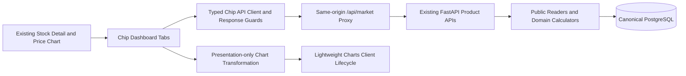

# Phase 2G-1 — Stock Chip Analysis Dashboard

## 範圍與架構

在既有 `apps/web/src/app/stocks/[id]/` 個股頁整合籌碼Dashboard，沿用Next.js App Router、TypeScript、Tailwind及既有CSS Modules、Lightweight Charts **5.2.1**。價格K線與technical指標Workspace保持掛載，籌碼使用獨立Tabs與日期區間。沒有改寫任何Domain公式、Backend API、Schema或匯入Worker；沒有新套件、Migration、排程或供應商下載。



`chip-api.ts`負責六個typed讀取方法；`chip-types.ts`對正式API回應進行Runtime驗證；`chip-display.ts`只做日期區間、狀態與缺值呈現；`chip-chart.ts`只做安全的繪圖轉換。React Components不計算法人累計、大戶比例、百分點變化或餘額差。

同源Proxy僅允許已知GET路由與參數，沿用既有timeout、錯誤遮蔽與伺服器`BACKEND_URL`，不接受任意URL、不公開DSN或供應商HTML。瀏覽器不直接呼叫官方來源，GET不下載資料。

## 畫面與資料契約

| Tab | 已實作 | 既有後端路由（`/api/v1/stocks/{id}`之後） |
| --- | --- | --- |
| 三大法人 | 外資／投信／自營商每日淨買賣超；分類切換；5/10/20/60交易日累計；連買連賣；相同區間收盤價對照 | `/institutional`、`/institutional/metrics`、`/bars` |
| 集保持股 | 真正週日期的比例及百分點變化；400001/1000001股門檻；可選已收錄週日期的官方級距表、Regular/Adjustment/Total區分與所選Revision | `/ownership`、`/ownership/metrics` |
| 融資融券 | 融資、融券各自餘額圖；每日餘額差；來源單位、兩個Ledger獨立 | `/margin` |
| 借券賣出 | `lending_short_sales`／`borrowed_positions`選擇；餘額、每日新增與還券分圖；Source/Channel/Scope說明 | `/lending` |

原生產品API提供所需Canonical觀察與Calculator結果；本畫面沒有自行拼接另一套跨來源公式，也不需要修改Phase 2F-2通用`chip-metrics`API。它呈現查詢時已保存的報表，不提供歷史Point-in-Time回測模式。

每份資料顯示統計日期、官方發布時刻或日期、首次觀察與匯入時間、Source名稱與代碼、Revision、Raw、Run及來源契約版本。未知發布時刻保持未知，不用下載／匯入時間替代。多Channel借券回應要求選擇單一Channel，不隱式加總。

## 金融語意與缺資料

- 所有正式值使用API精確Decimal／整數字串。數字卡片、表格、Tooltip不經JavaScript `Number`四捨五入；只在圖形邊界轉有限number，明示圖形為顯示近似值。超出安全整數、轉換溢位、不同精確值轉成相同number等情況拒絕繪圖，摘要仍保留精確值。
- 只有後端`complete`的衍生值繪圖；其他狀態保留Unavailable／資料不足等原因，不用partial數值冒充完整統計。明確的0正常顯示，null是空白，線段不跨明示缺值連接。
- 法人自營商合計直接使用後端值，不將subtotal再次加總。連續次數不完整時只顯示已確認下限，不宣稱完整連買連賣。單位沿用已核實的`shares`或`units`。
- 週資料僅使用實際`as_of_date`，沒有人工建立每日持股點。大戶門檻使用官方可精確表示的**400,001股起／1,000,001股起**，不誤標為包含400,000股／1,000,000股。分母、比例與週差直接讀後端；週差是Percentage Points。
- Margin餘額是存量、餘額差不是成交量；借券未還、借券賣出餘額、每日量、Quota分開，不自行以一張1000股換算。
- 同一圖上的多序列用不同顏色線條，避免相同日期的多個Histogram互相遮蔽；週百分點差為單一Histogram。價格、股數、百分比與百分點使用不同圖與明確單位。
- Runtime Guards拒絕重複日期、錯誤日期範圍、非字串金融數字、非法負餘額、數量單位混合、報表與查詢Scope不一致。法人連接序列也要求Source／Taxonomy／Contract／Scope相容；無法安全顯示時明確回報資料格式錯誤，不靜默合併。

## 時間區間、狀態與互動

以後端提供的市場本地日期初始化最近90個日曆日；30／90／365日按鈕與自訂起訖日期只影響籌碼。每次最多366個inclusive日曆日；不接受無效、反向或未來日期。各history要求`limit=1000,order=asc`，若API回`next_cursor`／`truncated`，明示截斷、請縮短日期，不隱藏未載入資料。

法人價量比較對齊同區間**實際觀察日期聯集**，缺值留白，不以日期差推論交易日。價格與法人圖為獨立座標／視窗，不宣稱游標已跨圖同步；使用者仍可持續查看上方原有價格K線與指標。

| 狀態 | 行為 |
| --- | --- |
| Loading | 載入提示；若保留前次成功結果，明示它不是本次新結果 |
| Error / API unavailable | 安全錯誤文字與重試，既有價格／其他Tab仍可用 |
| Empty / Unavailable | 無Canonical或來源不支援時顯示空狀態，不產生零線或示範圖 |
| Partial | 顯示來源欄位不完整；報表原始值可顯示，受阻衍生值不冒充complete |
| Not verified | 顯示來源／完整度／時效未核實，保留原因與Source/Scope |
| Stale | 僅API明確回傳`stale`或`delayed`時標示；不依舊日期自行猜發布SLA |

目前後端主要回`no_data`／`not_verified`，所以正式資料尚不會自動產生Stale判定。前端已測試明確Stale狀態，沒有把這項UI測試說成來源SLA已核實。

Tabs初次造訪才載入；曾造訪面板保持掛載，切回同參數不重送；Abort過時請求。切換法人分類／大戶門檻時，不得把上一組參數的結果改標為新參數。新範圍載入可保留前次成功畫面，但舊日期與載入提示仍清楚可見。

ChipChart在Client Component中動態載入，ResizeObserver忽略隱藏Tab的零尺寸，卸載時清理Chart／Observer／訂閱。相同資料更新保留Pan／Zoom；視窗以Chart ID、頻率、日期範圍存於sessionStorage，Storage不可用時仍可操作。不同股票、Channel或門檻不共用錯誤視窗。預設桌面雙欄、窄螢幕單欄，級距表在區域內橫向捲動；Tabs支援方向鍵／Home／End及ARIA語意。

## 驗證方式

```bash
npm test
npm run typecheck
# 先啟動本機後端；另開終端
BACKEND_URL=http://localhost:8000 npm run dev --workspace @stockapp/web -- --port 3100
# Chromium第一次需安裝；E2E攔截同源API，不抓官方資料
npm exec --workspace @stockapp/web -- playwright install chromium
BROWSER_BASE_URL=http://localhost:3100 npm run test:browser --workspace @stockapp/web -- chip-dashboard.spec.ts
# 停止dev後進行Production Build
npm run build
# 既有後端的離線非整合Regression，使用已裝好依賴的專案venv
.tools/api-venv/bin/python -m pytest apps/api/tests -m 'not integration and not network' -q
```

若使用專案附帶Node／Chromium，於命令前設定`PATH="$PWD/.tools/node/bin:$PATH"`及`PLAYWRIGHT_BROWSERS_PATH="$PWD/.tools/playwright-browsers"`。測試截圖、trace與log在已忽略的`apps/web/test-results/`與`.tools/validation/phase-2g1/`。

所有Fixture明確標示SYNTHETIC、只用於測試；不寫正式資料庫，不當作真實覆蓋率。單元測試涵蓋API守衛與Proxy、缺值／Decimal繪圖轉換、週日期、圖表生命週期／尺寸／視窗、Tabs保留／鍵盤、日期驗證、Loading／Error／Empty／Partial／Stale與新參數不得顯示舊數值。Playwright涵蓋桌面／390px手機、全部Tabs、保留原價格Canvas與SMA選擇、同源請求、真實Lightweight Charts載入、日期切換與頁面不溢出。

## 實際驗證結果（2026-11-12，Asia/Taipei）

| 檢查 | 結果 |
| --- | --- |
| 完整Vitest | **352 passed／20 files**，含既有價格／指標回歸 |
| TypeScript | `npm run typecheck`通過 |
| Next.js Production Build | **通過**；Next.js 16.4.5／Webpack、TypeScript及頁面產生均成功 |
| 完整Playwright | **16 passed**，含8個Dashboard case、既有真實K線／2016日期／技術指標及SYNTHETIC數值驗收 |
| 新Dashboard最後驗收 | **8 passed**，額外核對籌碼Canvas跨Tab不重建、切換所選週報分布 |
| 後端離線非整合Regression | **2,512 passed、476 deselected**；1個既有Starlette TestClient deprecation warning |
| 真實Canonical瀏覽器唯讀驗證 | 通過，下表列出實際範圍；API皆為同源GET，沒有Page Error |

Production Build於所有瀏覽器檢查結束、停止暫時dev server後執行。沒有重跑DB寫入／Migration／供應商網路測試；本次沒有後端或資料庫變更。Pytest於受限沙盒執行時TestClient停滯，已中止並於核准的沙盒外重跑上列離線套件；沒有略過失敗測試。Next工具自動產生的web AGENTS及next-env變動已清理，沒有混入交付。

### 真實資料驗收

以下全部來自既有Canonical，透過本機Next Proxy實際開啟個股頁讀取；沒有本階段新匯入或SYNTHETIC代替正式資料。

| 股票／產品 | 真正統計日期 | 畫面核對 |
| --- | --- | --- |
| 2330／法人 | 尚無 | Unavailable，沒有零線或示範買賣超 |
| 2330／TDCC週報 | 2026-11-06 | 大戶門檻400001股，比例 **87.009580453709%**；官方集保存量 **25,932,370,067股**；持有人數 **3,259,221人**；17個來源級距；週差Unavailable |
| 6488／Margin | 2026-11-06 | 融資餘額 **10,285,000股**；融券餘額 **317,000股**；保留餘額差與報表來源時間 |
| 6488／Lending Short Sales | 2026-11-09 | 借券賣出餘額 **12,464,000股**；Channel／Scope未核實提示可見，沒有推估跨來源比例 |
| 6488／Borrowed Positions | 尚無 | Unavailable，未以借券賣出報表替代 |

本機現有覆蓋仍為法人0份、Ownership一檔一週、Margin一檔一日、Lending一檔一日；不能把E2E Fixture的日期與筆數列入真實覆蓋。官方發布時間未知時畫面保留未知，缺相鄰確認週無法計算完整週變化，法人缺確認session也不能顯示完整累計。

已檢視桌面1440px、手機390px及真實2330／6488截圖。Headless最初缺中文系統字型，驗收時僅以忽略目錄下的暫時Fontconfig讀取WSL既有Windows字型，重新截圖可正確顯示中文；沒有改產品字型／依賴或安裝套件。

測試記錄：`.tools/validation/phase-2g1/{vitest,pytest,typecheck,playwright-full,playwright-chip-final,real-browser}.log`；截圖在同目錄`screenshots/`及`real-*.png`。Artifacts不提交。既有technical Synthetic E2E攔截新增空法人路由，維持數值測試離線；沒有放寬正式API守衛。

## 正式資料限制與後續邊界

沒有觸發新匯入、Schema變更或Container重建，不影響既有History Worker。UI不能補足來源授權、歷史、交易日曆、週曆或Source Scope證據的不足。法人Canonical缺資料、集保缺相鄰週、Borrowed Positions來源未啟用、Lending Scope／Channel未核實等情況，保留Unavailable／Not verified。

本次止於Phase 2G-1，沒有Commit、Push、部署、自動交易或Phase 3開發。
