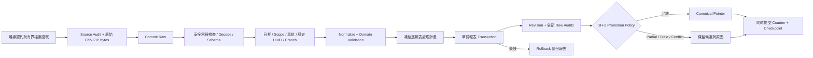

# Phase 2H-3 — Broker Flow Offline Ingestion

完成日期：2026-11-14，Asia/Taipei。沿用 [2H-1 來源查證](phase-2h-data-sources.md)、[指標語意](phase-2h-metric-definitions.md)及 [2H-2 Persistence](phase-2h-broker-persistence.md)。範圍只到離線資料管線與 CLI，不包含分析引擎、REST API、前端、排程或正式來源下載。

**這是平台的版本化交換格式，不是已核實的 TWSE／TPEx 原始報表 Parser。** 目前沒有取得合法實際分點報表或正式下載／展示契約；官方 Adapter 維持 disabled。固定 Fixture 全部標示 SYNTHETIC，不能算成真實資料覆蓋。

## 1. 邊界與來源能力

| 來源／模式 | 狀態 |
| --- | --- |
| 平台離線 CSV／ZIP | 已實作；需要明確使用證據、版本化契約與已核實身分 |
| TWSE 授權商品 Adapter | 預留 Port／Manifest，`fetch` 一律拒絕；交付與專案使用權未核實 |
| TPEx 授權商品 Adapter | 同上；不執行 EXE／自解壓程式 |
| 自動同步／公開資料展示／衍生展示 | 本次未啟用；離線使用證據不授予這些權利 |

`source_manifest.py` 的 Registry 與 Dataclass 不可變，沒有 CLI 旗標可以開啟官方下載。沒有登入、驗證碼、受限 Endpoint 探測、訂閱購買或背景服務。

`usage` 的四個旗標與 `evidence_ref` 是管理者提供的已審查離線使用證據，不是程式能自動驗證的法律授權。缺少任一必要權利即拒絕處理。授權到期／撤銷目前沒有外部自動查核機制；執行者仍須確保證據當下有效，不能由保存檔案推論有公開展示權。

## 2. CLI 與操作前提

```text
stockapp broker-flow import --file REPORT.csv --contract CONTRACT.json [--encoding utf-8|big5]
stockapp broker-flow replay --raw RAW_UUID
stockapp broker-flow replay --resume RUN_UUID
stockapp broker-flow status [--id RUN_UUID] [--limit 1..100]
```

`import`／`replay` 成功回 0；Partial、失敗或不合格資料回 2；資料庫等依賴錯誤回 1；人工中斷回 130。JSON 錯誤只提供固定代碼，不輸出 DSN、SQL 或原始 Exception 字串。`status` 僅查資料庫，不開啟來源檔、不建立 Provider、不下載。

執行前需要：

1. 已審查並套用 `0012_broker_ingestion`，包含既有 `0011_broker_flow`。
2. DataSource、Market、Instrument UUID 已存在；券商、分點與具日期／來源 Namespace 的 Mapping 已經核實並保存。
3. 合法離線檔案與契約；來源格式需先經已核實的轉換方式產生下述平台 CSV，不能只改副檔名。

本次不從 CSV 名稱或代碼前綴自動建立證券／分點，也不安裝虛構的正式券商名錄。已核實參考資料可由管理者透過既有 `market_data.public` 與 Broker Identity Repository 載入；未知或尚未建立的身分保留為 unresolved。

本機已安裝 editable API 套件時，Repository 根目錄可執行：

```bash
.tools/api-venv/bin/stockapp broker-flow import \
  --file /path/to/lawful/report.zip \
  --contract /path/to/reviewed/contract.json --encoding big5
.tools/api-venv/bin/stockapp broker-flow status --limit 10
.tools/api-venv/bin/stockapp broker-flow status --id RUN_UUID
.tools/api-venv/bin/stockapp broker-flow replay --raw RAW_UUID
.tools/api-venv/bin/stockapp broker-flow replay --resume RUN_UUID
```

WSL／Docker 操作方式如下。這些是手動操作指令，**本次未對正式 DB 執行 Migration 或匯入**：

```bash
# 在 Repository 根目錄；先審查 Migration 與備份
docker compose build backend
docker compose run --rm backend alembic current
docker compose run --rm backend alembic heads
docker compose run --rm backend alembic upgrade 0012_broker_ingestion
docker compose run --rm backend alembic check

# imports/ 由你放入合法報表與已審查契約；唯讀掛載，不執行解壓程式
docker compose run --rm -v "$PWD/imports:/imports:ro" backend \
  stockapp broker-flow import --file /imports/report.zip \
  --contract /imports/contract.json --encoding big5
docker compose run --rm backend stockapp broker-flow status --limit 10
docker compose run --rm backend stockapp broker-flow replay --raw RAW_UUID
docker compose run --rm backend stockapp broker-flow replay --resume RUN_UUID
```

單次 CLI 不會啟動長期 Worker。重新建置 backend 映像不等於重啟既有服務；本次沒有更動 daily／history Worker 的設定或來源 allowlist。

## 3. CSV Schema 與契約

Schema ID：`stockapp.broker-flow.offline.v1`。Parser Version：`broker-offline-parser-1.0.0`。CSV 必須含下列 19 個具名欄位，順序可變；重複、未知、缺少欄位或未知版本拒絕，不靠固定位置推測未知 Schema。

```csv
schema_version,report_id,market_code,instrument_symbol,trade_date,scope_code,scope_version,branch_code,quantity_unit,buy_quantity,sell_quantity,reported_net_quantity,price,buy_amount,sell_amount,currency,source_generated_at,source_published_at,row_id
```

| 欄位 | 規則 |
| --- | --- |
| `report_id` | 必須在契約 `reports` 中宣告；一份報表固定證券／日期／Scope |
| `market_code`、`instrument_symbol`、`branch_code` | 原樣字串，保留大小寫與前導零，不做名稱模糊比對 |
| `trade_date` | 來源本地交易日 `YYYY-MM-DD`，必須等於 Report Declaration；不使用檔名／下載日代替 |
| `scope_code`、`scope_version` | 必須等於契約，不能把一般與含一般的全部報表拼成同一序列 |
| `quantity_unit` | 與契約一致：`shares`／`units`／`lots`；Canonical 只保存前兩者 |
| `buy_quantity`、`sell_quantity`、`reported_net_quantity` | 精確數字文字，可有合法千分位逗號；空值與 0 不同；已知時驗證 Buy−Sell=Net |
| `price`、`buy_amount`、`sell_amount` | Decimal；拒絕 float、NaN、Infinity、負數及超精度，不從均價推估精確金額 |
| `currency` | 與契約及證券 Metadata 一致；未知金額幣別不能計算成交額 |
| `source_generated_at`、`source_published_at` | 可空；已知時須有時區，正規化至 UTC，兩者不相互代填 |
| `row_id` | 來源穩定原始行身分，每份報表不得重複；不能按當次排序重新編號 |

原始民國日期、特殊值、來源代碼或專屬欄位需由後續已核實供應商 Parser 處理；本版不宣稱能讀取所有官方歷史格式。

JSON Sidecar 的 `contract_version` 為 `stockapp.broker-flow.import-contract.v1`，拒絕未知／重複 Key、NaN、超過 1 MB 的檔案與不合法型別。完整鍵與型別以 `domain/ingestion.py` 為準：

- Source／Market UUID、Namespace、Contract／Schema／Parser／Identity Policy Version、真實市場時區。
- `record_kind=branch_totals|price_buckets`、原始單位、價格基礎與 Currency。
- `usage`：`offline_import`、`raw_retention`、`revision_retention`、`internal_processing` 必須明確為 true，並提供 `evidence_ref`。
- `scopes`：完整、來源限定的 2H-2 `BrokerTradeScope` 值物件，包含 UUID 與是否核實。
- `reports`：report_id、證券代碼、交易日、Scope、`expected_rows`、分點母體完整性及證據。
- `instruments`：來源代碼對既有 UUID 的有效期間證據，含市場、Canonical 單位及 Currency；目前主檔相同代碼不等於歷史身分證據。
- `unit_conversions`：每個 UUID／日期適用的原始／目標單位、正整數 Decimal multiplier 及證據；沒有全域 1,000 預設。

[完整的停用範本](../examples/broker-import-contract.disabled.example.json)包含全部 Key，但其 UUID、日期、Scope、筆數皆為待填佔位值；權利與核實旗標預設 false，不能直接當正式設定執行。`expected_rows` 必須按實際來源交付證據填寫，不把範本的 1 或當次讀到的筆數當完整性證明。

`valid_from`／`valid_through` 在 Instrument Binding 與換算證據為含端點日期；既有 Branch Mapping 的 `valid_to` 仍為半開區間，不混用兩者。

## 4. 正規化與報表完整度

`branch_totals` 每分點只能有一列；`price_buckets` 可以有不同價格或不同原始行識別的明細。以明確 `row_id` 去重，不因兩筆價格相同就臆測是同一筆交易，也不將不同價格列誤刪。

金融快照使用 `offline-row:<row_id>` 作穩定 Locator，實體檔名／行號另存逐列 Audit；重新排序或重新封裝 ZIP 不會因實體行號改變而產生假金融修訂。長 member path 以其 UTF-8 名稱 SHA-256 定位，可在原 ZIP 中重建對應關係。

價格級距只在已核實 `per_source_unit` 或 `per_canonical_unit` 下精確乘數量。數量 0 保留；價格 0／空價格不產生假零金額；任一級距金額未知，該分點整體金額保持 NULL。已知來源金額與可精確計算金額不符時拒絕。中間運算採獨立 50 位 Decimal Context 與 Inexact trap，存入 `NUMERIC(38,12)` 前驗證邊界。

未知 Instrument／Branch、單位證據不足、錯誤日期／Scope、重複 Row ID、壞列或不足 expected_rows 會留下明確原因。對已識別的報表，僅保存合法部分為 Partial Revision，**不晉升 Canonical**；壞列所屬分點也不會被保存成看似完整的部分加總。其他獨立有效報表可以繼續處理。

無法判定所屬報表的列會進入 `__unassigned__` Audit Group，並阻止同批宣告完整，避免把可能漏列的報表誤標完整。缺少宣告報表不建立零資料。不同來源代碼若解析成同 UUID／日期／Scope 的競爭報表，拒絕兩份快照；不同 Scope 仍保持獨立。

Complete 只表示該來源口徑與這份數量交付的完整性，不代表金額能力、全市場、所有管道或整段歷史完整。價格幣別未知且來源未提供可用金額時，保留有效數量，成交金額維持 NULL，不從證券目前的報價幣別推定來源價格幣別。原本已有的 Canonical 不會因 Partial／失敗而被覆寫。

## 5. Raw-first、Replay 與失敗回復



讀檔前拒絕非 CSV／ZIP 副檔名、不安全路徑、Symlink／非一般檔案、超過 20 MB 或讀取中變動的檔案；這類 I/O 前置失敗可能沒有 Raw，但有已開始工作的失敗狀態。其餘容器／編碼／Schema 檢查在 Raw 提交之後進行，錯誤原檔仍可追溯。

同來源／同 Source Contract／同 SHA-256 的重匯，沿用最早已保存的 Raw 觀察時間及 Replay 關聯，不使用檔案 mtime。這可防止「舊檔先解析失敗，後來重匯」變成今天的新版本。Replay 則複製原 Raw 並保留其 bytes、SHA、契約及 fetched_at。

Resume 固定 SourceAudit 契約、編碼與已保存的處理計畫，不重新解析或換用最新 Mapping；每份報表的 Revision、全部輸入列 Audit、Counters 與 Cursor 在同一 Transaction 提交。先完成的報表不重做，失敗報表不留下半份 Canonical。實際 `ingested_at` 在寫入時產生，不拿原先計畫的時間冒充新寫入時間。

有凍結計畫之後的可復原錯誤標為 `phase/status=interrupted`，原因保存在不可覆寫的失敗事件；中央 IngestionRun 保持未結束的 `running`，`finished_at=null`，`resume_supported=true`。這表示同一次工作仍未完成，並非把已結束的 Run 重開。CLI 的中斷狀態會明確呈現，不能當作成功。

已完成、Partial 或在計畫前終止失敗的 Run 保持不可變，Resume 只讀原結果；若之後有新的已核實參考身分或需重試解讀，可以對已保存 Raw 建立新的 Replay 工作。契約／編碼改動則需明確重新 import，不能暗改舊工作的 Metadata。若程序被直接終止、Run 仍開啟且 Raw 已提交但尚未選取，Resume 能恢復該 Archive；尚未取得檔案時則需重新提供檔案。

沒有自動背景重試或長期同步服務。可重試的 DB 連線／序列化失敗由明確 Resume 重試；人工中斷保留已提交 checkpoint。狀態查詢保留歷次失敗事件、處理列／報表數、Partial／Rejected／Unresolved、Revision／Promotion 統計及有界原因預覽。

## 6. ZIP／Encoding 安全

- UTF-8 可含 BOM；Big5 需明確選擇 `--encoding big5`，不以寬鬆解碼偷偷替換錯誤字元。
- 全程記憶體處理，不執行 `extractall`、EXE、Shell 或自解壓程式。
- 原檔與總解壓後大小上限均為 20 MB、最多 32 個 Entries、壓縮比上限 100:1；讀取時也檢查實際輸出大小與 CRC。
- 只接受 CSV Members，拒絕路徑穿越、絕對路徑、Windows Drive／Backslash、Symlink／特殊檔案、可執行屬性、巢狀 Archive、重複或大小寫衝突的名稱。
- 拒絕加密、不支援的壓縮法、ZIP64、多磁碟、EXE 前綴、串接／尾端隱藏資料、異常 Header／Directory；本版只接受受支援的普通 Stored／Deflated ZIP。
- 契約最多 5,000 份報表、100,000 筆 CSV Rows；凍結計畫總量上限 64 MB。來源格式不在允許範圍內時明確拒絕，不嘗試執行或猜測。

## 7. Persistence 與查詢成本

Migration：`0012_broker_ingestion`，新增：

| 表 | 內容 |
| --- | --- |
| `broker_flow_ingestion_jobs` | Source／Run／Raw FK、凍結契約與計畫摘要 Hash、Cursor、Phase、失敗事件 |
| `broker_flow_import_groups` | 不可變的逐報表計畫與 Hash、宣告 Row Count；Resume 每次只取一份 |
| `broker_flow_import_rows` | 每 Run／Row 唯一的原始列 Audit、實體 Locator、處理結果、H2 Report Observation FK |

另增加 `ix_broker_raw_content_first_seen`，支援同來源／契約／Payload Hash 的最早觀察查詢。沒有改寫 0011，也沒有更動 Phase 1 行情或其他籌碼的修訂規則。

採 PostgreSQL Session／Transaction Advisory Locks 與唯一鍵，不靠程序內記憶體鎖。計畫、分組及 Row Audit 具不可變／Lineage／Cursor Constraints；空資料可回退至 0011，有工作、計畫或 Audit 時拒絕 Downgrade。

計畫按報表分開保存，避免每次處理都複製整個檔案的計畫。報表寫入僅讀 Raw Metadata 與已由 DB CHECK 驗證的 SHA，不反覆載入 20 MB 原始 bytes；Normalizer 每批只計算一次 Raw Hash。Status 亦不讀 Raw Body、整份計畫或 SourceAudit 使用證據內容。這些是成本防護設計，**不是實測全市場 Benchmark**。

## 8. 實際驗證與已知限制

本次使用獨立臨時 PostgreSQL DB，每個寫入案例另使用私有隨機 Schema；測試結束由 runner 清理。不在正式資料庫匯入 Synthetic 資料。

| 檢查 | 實際結果 |
| --- | --- |
| 完整後端離線／PostgreSQL 回歸 | **3,601 passed、4 network deselected**，495.43 秒；包含既有 Phase 1／2、Migration 與 HTTP 測試 |
| 最後金融語意調整後全部離線 Unit | **3,036 passed、573 deselected**，7.02 秒 |
| 最後 Broker PostgreSQL／Migration | **75 passed**，60.91 秒；包括 UTF-8／BOM／Big5、實際 ZIP 檔案到 PostgreSQL、Source Revision、Replay、Resume、Rollback、並發、H2 舊功能與 Metadata Parity |
| Vitest | **352 passed／20 files** |
| Typecheck／Production Build | 通過；next-env 自動產生的變動已還原 |
| OpenAPI／Compose Config／Git Diff | 通過；沒有新增 HTTP 路由或修改 Compose |
| 既有服務 | Backend、Frontend、PostgreSQL、Redis、daily-worker 均 running／healthy；readiness 與網站 HTTP 200 |
| 正式 Schema 唯讀複查 | **0010_daily_sync**，`broker_flow_*` 表數仍為 **0**；未套用正式 Migration |

全套測試收集後，另外強化了既有來源修訂案例，並修正未知價格幣別時不應丟棄有效數量的邊界；最終重新執行全部離線 Unit 與上述 75 項 Broker PostgreSQL 測試。全套 3,601 是較早一次完整執行的實際數字，最後調整的驗證結果分開記錄。

實際 E2E 使用 SYNTHETIC 原始 CSV／ZIP，經 Adapter、Normalizer、Raw／Audit、不可變 Revision 與 Canonical 後，以 PostgreSQL 數值驗證。例如固定 100／50 股、淨額 50 股、精確金額差 540；修訂從買進 1,000 改為 2,000、淨額 1,900，保留舊 Revision 並確認舊 Raw Replay 不會回退。這些是測試預期值，並非市場資料。

另驗證了 ZIP 不產生解壓檔、錯誤 Schema 保留原始 bytes、未知分點保留所有列、不同 Scope 隔離、報表與 Audit 故障全體回滾、KeyboardInterrupt 可續跑、終止 Run 不可重開、兩個 Worker 不重複 Canonical、無資料時不補零。成本防護測試直接攔截 SQL，確認寫入不重讀 Raw Body，Status 不讀 `group_json`／`config_json`。

發現並修正的主要問題是既有中央 Run 不允許 failed→running；本次以 `interrupted` 工作 Phase 保留未結束的 Run 與 checkpoint，沒有放寬 Phase 1 終止 Run 的不可變規則。前期失敗不當作通過，上表只列實際完成的驗證。

測試 Log 位於已忽略的 `.tools/validation/phase-2h3/`：`full.log`、`unit-final.log`、`postgres-acceptance.log`、`revision.log`、`blob-boundary.log`、`vitest.log`、`typecheck.log`、`build.log`。臨時 DB 均已清理。4 項 Provider Network 明確略過，沒有執行正式下載／真實來源匯入或 Playwright；本階段沒有前端變更。

```bash
# Repository 根目錄：所有離線 Unit
RUN_INTEGRATION=0 RUN_NETWORK=0 .tools/api-venv/bin/python -m pytest \
  apps/api/tests -m 'not integration and not network' -q

# 獨立臨時 DB，H3 與 H2 PostgreSQL 回歸
cd apps/api
../../.tools/api-venv/bin/python scripts/run_institutional_validation.py \
  --output-dir ../../.tools/validation/phase-2h3 \
  -- tests/test_broker_flow_ingestion_postgres.py tests/test_broker_flow_postgres.py \
     tests/test_broker_flow_concurrency_postgres.py -q --tb=short

# 完整後端離線／整合回歸
../../.tools/api-venv/bin/python scripts/run_institutional_validation.py \
  --output-dir ../../.tools/validation/phase-2h3/full \
  -- tests -m 'not network' -q --tb=short
```

正式券商分點資料覆蓋仍是 **0 個交易日、0 檔證券、0 筆交易列**。沒有把 Fixture 或測試 Source 當正式來源，也沒有宣稱能直接讀取未核實官方格式、取得十年分點資料或具 Point-in-Time 回測保證。

每次匯入的契約快照不可變，但本版沒有向外部供應商版本 Registry 自動核對；來源粒度、換算規則或交易定義有改版時，管理者必須提供正確的新 `source_contract_version` 及證據，不能只沿用舊版標籤。未知來源與格式仍應維持停用。

## 9. 檔案與後續界線

```text
apps/api/src/stockapp/cli.py
apps/api/src/stockapp/modules/broker_flow/
  domain/ingestion.py                版本化契約、來源 Rows／Reports／Usage DTO
  domain/import_persistence.py       Job、Counters、Store Port
  application/normalization.py       日期／單位／身分與完整報表正規化
  application/ingestion.py           Raw-first／Replay／Resume 用例
  infrastructure/files.py           有界安全檔案／ZIP 讀取
  infrastructure/parsers.py         CSV Schema、Encoding、逐列問題
  infrastructure/providers.py       離線 Adapter／disabled licensed Port
  infrastructure/source_manifest.py 來源能力與停用原因
  infrastructure/operations.py       CLI 組裝與有界契約檔讀取
  infrastructure/ingestion_models.py 三張追蹤／計畫／Audit 表
  infrastructure/ingestion_store.py  PostgreSQL 原子工作與可續跑 Cursor
  infrastructure/models.py          額外 Raw Content Index，保留 0011 定義
  infrastructure/repositories.py     Metadata-only Raw Reader
apps/api/migrations/env.py
apps/api/migrations/versions/0012_broker_ingestion.py
apps/api/tests/test_broker_flow_files.py
apps/api/tests/test_broker_flow_adapters.py
apps/api/tests/test_broker_flow_normalization.py
apps/api/tests/test_broker_flow_ingestion.py
apps/api/tests/test_broker_flow_cli.py
apps/api/tests/test_broker_flow_ingestion_postgres.py
apps/api/tests/test_market_data_postgres.py     Head Schema 預期集合
apps/api/tests/fixtures/broker_flow/            明示 SYNTHETIC 的 Fixture
docs/examples/broker-import-contract.disabled.example.json
README.md
docs/specs/phase-2h-broker-ingestion.md
```

本次不開始 2H-4、不建立 API／前端、不加入 daily-worker、不 commit／push／部署。正式下載、供應商專屬 Parser、授權到期自動查核、公開展示及真正報表對照仍需另行核實。
