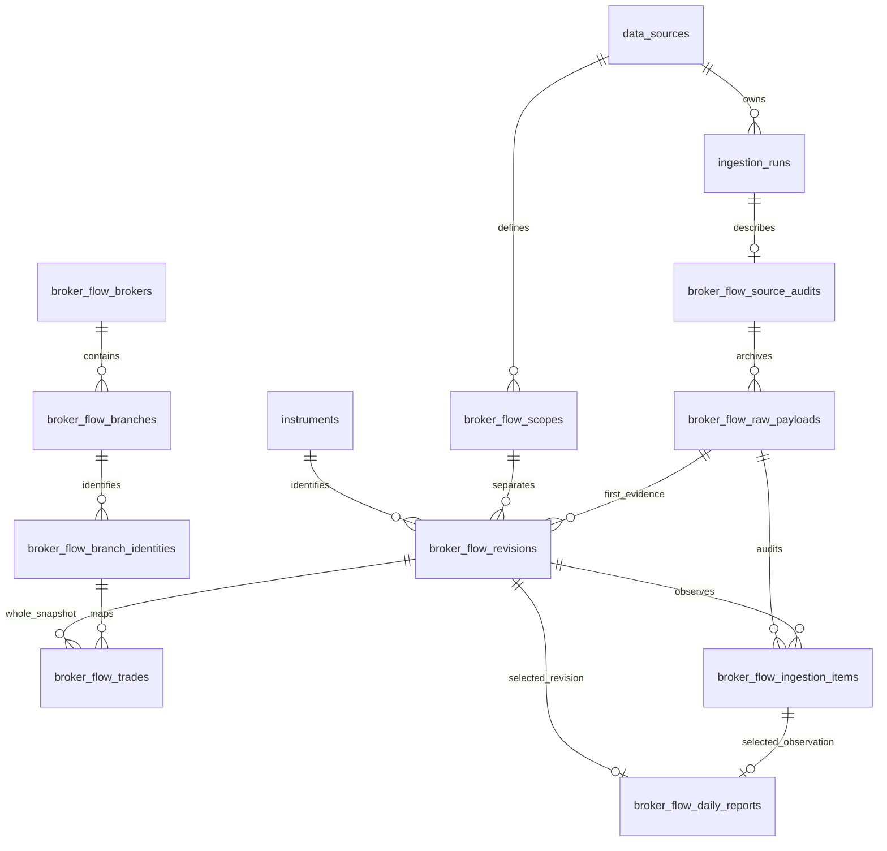
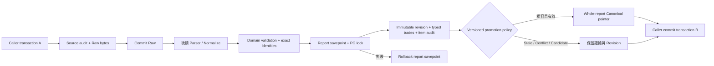

# Phase 2H-2 — Broker Flow Domain & Database

日期：2026-11-13，Asia/Taipei。設計依據為 [來源查證](phase-2h-data-sources.md)及[指標定義](phase-2h-metric-definitions.md)。本階段只建立 Domain、PostgreSQL Persistence、Migration 與測試；不建立 Adapter、匯入 CLI、分析引擎、HTTP API 或前端。

**正式分點資料仍為 Blocked：沒有已核准的來源、實際報表或正式匯入。** 測試資料全部明示 SYNTHETIC，不代表官方數值或資料覆蓋。Schema／Domain 的 `verified` 是待證據支持的契約狀態，不是下載、公開展示或衍生利用授權。

## 1. 邊界與設計決策

- 沿用 Modular Monolith；Domain 僅依賴 Python 標準庫。Infrastructure 實作 Repository Ports，不執行隱式建表或 commit。
- 重用既有 Instrument、Market、DataSource、IngestionRun UUID，不建立第二份證券主檔。跨模組的程式查詢經 `market_data.public`；Schema 的外鍵可參照既有表。
- 一份報表固定 instrument、市場、本地交易日、來源與版本化交易口徑。Canonical 保存**整份不可變 Revision 的選取指標**，不把不同修訂的分點明細拼接。
- `scope_id` 是來源與市場限定的版本化契約 UUID。Canonical 主鍵為 `(instrument_id, trade_date, scope_id)`；Revision 明細主鍵為 `(revision_id, branch_id)`。因此同一來源口徑不會重複產生分點 Canonical。不同來源或不同口徑是分開的序列，不能由相似的顯示名稱推定可加總。
- 相同 scope 下的 contract、schema、parser、identity policy、單位及價格口徑不相容時，不自動換綁 Canonical。新口徑必須明確建立另一個版本化 scope；不以改版本字串偷偷繞過舊資料重播政策。
- 不要求全報表買進總數必定等於賣出總數；來源可能排除特定參與者。也不以 DailyBar 成交量作為未核實的分母。

## 2. Domain

```text
apps/api/src/stockapp/modules/broker_flow/
  api/__init__.py                     保留邊界，沒有 Route
  application/__init__.py             保留邊界，沒有 Ingestion Service
  domain/models.py                    事實、身分、Closure、Scope、Lineage 與 Metadata
  domain/identities.py                精確且有有效日期的 Identity Book
  domain/ports.py                     公開身分／Closure Reader
  domain/persistence.py               Raw、Repository／UoW Ports、寫入結果
  infrastructure/models.py            11 張 SQLAlchemy mappings
  infrastructure/repositories.py      PostgreSQL 實作與明確交易
apps/api/migrations/versions/0011_broker_flow.py
apps/api/migrations/env.py             登記 Broker metadata
apps/api/tests/test_broker_flow_domain.py
apps/api/tests/test_broker_flow_persistence.py
apps/api/tests/test_broker_flow_postgres.py
apps/api/tests/test_broker_flow_concurrency_postgres.py
apps/api/tests/test_market_data_postgres.py   更新完整 Schema 預期集合
README.md
docs/specs/phase-2h-broker-persistence.md
```

| 模型 | 責任 |
| --- | --- |
| `Broker`、`BrokerBranch` | 穩定 UUID 與明確狀態；分點是交易中介，不是個別投資人或庫存 |
| `BrokerBranchIdentityHistory` | 來源 Namespace、市場、券商／分點代碼、當時名稱、半開有效期、版本及證據 |
| `BrokerIdentityClosure` | 後續確認的更名、換碼、合併或停業事件，不覆寫原始 Mapping 事件 |
| `BrokerTradeScope` | 來源限定的 Session、零股／鉅額納入情形、參與者母體與更帳基礎 |
| `BrokerSourceLineage` | Raw、Run、Source、Hash、Contract／Schema／Parser／Identity 版本與各時間 |
| `BrokerBranchTrade` | 一個已解析分點的同日買／賣數量、可選精確金額與原始列 Locator |
| `BrokerTradingDailyReport` | 整份來源快照、單位、完整度、日期證據與 Revision UUID |
| `BrokerMetricDefinition` | 公式文字、版本及參數等 Metadata；本次沒有實作 TOP N 或 Proxy 引擎 |
| `BrokerIngestionAudit` | 接受、拒絕、未知身分或略過的結果與原因；不會把未知身分建立成假分點 |

### 2.1 身分沿革

代碼保留前導零及大小寫，不轉整數、不比對名稱、不用代碼前綴推定總分公司。身分預設 `verified=false`，必須有證據並明確核實後才可解析或引用。查詢必須提供來源、市場、Namespace、精確代碼及統計日。有效期使用本地日期 `[valid_from, valid_to)`；結束日當天不再屬於舊 Mapping。

已核實的更名／代碼變更可以保留同一 Branch UUID。代碼重用、合併與停業以明確沿革及承接關係記錄，不自動跨 UUID 串接交易。資料庫阻止相同來源／市場／Namespace／代碼的已核實 Mapping 有重疊日期，也防止同一分點在同一 Namespace 與日期被解析成兩個身分。

原本有效期無結束日的 Mapping 可經受控操作關閉，留下關閉證據；不能改寫原代碼、名稱、起始日或 Branch UUID，亦不能讓已保存報表所引用的日期變成無效。未核實 Mapping 不得進入正式分點明細；未知資料保留 Raw／Audit，交由後續 2H-3 處理。

關閉原因、承接分點、證據與觀察時間另存 Closure Metadata，不改寫原始身分事件；承接關係不等於兩個 UUID 的交易可以合併。券商／分點 registry 的 status 是建立時的觀察快照，歷史營運判斷應使用有日期與證據的身分／關閉事件，不能只看 registry status 推定過去狀態。

身分排他約束採 PostgreSQL 內建 range GiST，對來源限定的 Mapping Key 與日期區間建立排他規則，不安裝全域 `btree_gist` Extension。Key 使用 64 位 Hash；極少數碰撞會保守地拒絕不相關 Mapping，不會允許重疊或錯配。精確鍵比對另提供可理解的衝突原因。

每次報表引用 Mapping，觸發器會鎖定身分列並單調推進 `protected_through` 日期；關閉日必須晚於此保護日期。這能防止「同時關閉身分與新增報表」的競態，並讓舊 Repeatable Read Snapshot 的寫入產生序列化衝突，而不是悄悄破壞新報表。呼叫端應在新交易重試 PostgreSQL 可重試的衝突；本階段未建立長期 Worker 或重試服務。

### 2.2 數量、金額與缺值

- 基礎數量為有界整數，明示 `shares` 或 `units`。不提供未核實的張數轉換。
- `net_quantity = buy_quantity - sell_quantity`。缺任一邊時 Net 為 NULL；來源有提供 Net 時必須核對，不能改來源值補平。
- 金額為 Decimal／`NUMERIC(38,12)`，不經 float；Domain 拒絕無法精確表示的精度與 NaN／Infinity。幣別與價格計量基礎未知時，不接受聲稱精確的金額。
- Partial 可以保存缺欄，但 Complete 必須有核實 Scope、完整分點母體及已知買／賣欄位。完整只描述該 Source／Scope，並非全市場或完整歷史。
- 多個價格級距可以對應同一分點的多個原始列 Locator；本階段接受已正規化的分點總量，Parser／價格級距聚合留給 2H-3。報表內不得有重複分點或跨分點重用同一 Locator。

## 3. PostgreSQL Schema

| 表 | 內容與主要保護 |
| --- | --- |
| `broker_flow_brokers` | 券商穩定 UUID |
| `broker_flow_branches` | 分點 UUID、券商關係與狀態 |
| `broker_flow_branch_identities` | 有效日期、原樣代碼／名稱、身分證據；時間區間排他約束與受控關閉 |
| `broker_flow_scopes` | Source／Market／Code／Version 唯一的不可變 Scope 定義 |
| `broker_flow_source_audits` | 與既有 Run／Source 複合 FK 關聯，保存匯入或 Replay 證據 |
| `broker_flow_raw_payloads` | 原始 bytes、SHA-256、觀察時間、來源契約與 Replay 關聯 |
| `broker_flow_revisions` | 不可變整份快照、內容與相容 Profile Hash、第一份 Raw／Run |
| `broker_flow_trades` | 每 Revision／Branch 唯一的 typed 買賣欄位、Mapping FK、原始列 Locator |
| `broker_flow_ingestion_items` | 每 Raw／Row 唯一的處理結果、原因、Revision 與 Promotion Decision |
| `broker_flow_daily_reports` | 每 instrument／date／scope 唯一的 Canonical Revision／Observation 指標 |
| `broker_flow_metric_definitions` | 不可變的演算法定義 Metadata；沒有預先產生金融指標結果 |

所有 lineage FK 使用 RESTRICT，沒有刪除主檔後連鎖刪除行情或 Audit。索引支援 instrument／date、source／date、branch／revision、身分解析及 run／disposition。



圖省略複合 FK 與 CHECK；完整 DDL 以 Models 和凍結的 `0011_broker_flow` Migration 為準。Migration 不從可變的 Runtime Models 取得建表定義，也不修改既有 DailyBar／其他籌碼表的資料與晉升規則。

## 4. Transaction、Revision 與 Promotion

呼叫端擁有外層 Transaction。Raw 歸檔與報表寫入可使用兩個明確交易：先提交 Raw，後續報表失敗時仍保留證據；若呼叫端將兩者放在同一交易，整體 rollback 也會移除 Raw，不能宣稱它已持久化。

每份報表使用 Savepoint 與 PostgreSQL Transaction Advisory Lock。跨程序的初次插入、相同內容重送及修訂晉升皆由資料庫協調，不依賴 Python 記憶體鎖。唯一鍵、外鍵與觸發器也限制直接 SQL；整份 Revision 必須與子明細及 Audit 一致，不能先晉升半份快照再逐列補齊。



沒有已核實的供應商修訂序號，不宣稱具備供應商版本先後或 Point-in-Time 回測保證。官方發布時間未知保持 NULL，不能拿 `first_seen_at` 或下載時間補上。舊 Raw Replay 維持原始觀察時間，不能因今天重播而變成較新版本。

Promotion Policy 為 `broker-promotion-1.0.0`，每筆 Item Audit 的 `promotion_policy_version` 為不可變的 typed 欄位：

1. 完整、已核實且相容的第一份報表可晉升；Partial 或不相容 Profile 保留為 Candidate。
2. 相同內容重送重用 Revision。相同 Raw／Row 也重用原 Audit，不重複建立 Canonical。
3. 不同內容必須有較新的原始觀察時間，且不可變 Revision 建立時記錄的 `first_seen_at`、實際 Item Audit 的最早觀察時間，兩者都必須嚴格增加。不能因較早的 Raw 證據晚到而重新晉升曾被取代的舊 Revision。已知發布時間時還必須嚴格晚於舊發布時間。一方有發布時間、另一方未知時不自動比較。兩方發布時間都未知但有來源產生時間時，產生時間也必須嚴格增加；產生時間一方未知時保留 Candidate。兩者皆未知時僅提供明示的觀察順序政策，不宣稱已知官方修訂順序。
4. 相同發布／觀察時刻卻有不同內容列為 Conflict；較舊觀察／發布列為 Stale。曾被取代的舊內容重新出現，不會因重新下載而倒退 Canonical。
5. 只調整明細順序、Locator 順序或精確 Decimal 的尾端零不產生新的金融修訂；正規化只改表示，不改數值或執行捨入。

資料庫亦限制 Canonical 直接 SQL 更新，不能只靠 Repository 的程序邏輯保護。每次 Observation 仍保留原 Raw／Run 來源；金融快照與原始 bytes 的 Hash 分開保存。

整份快照在 Revision 的 deferred constraint trigger 驗證一次，避免對每一個分點重掃全報表。固定 JSON、每列精確比對、明細 PK 與整份筆數檢查共同保證明細集合一致；提交後追加不存在的分點無法通過快照比對，追加既有分點則違反 PK。Revision、Raw、Audit 及定義拒絕 UPDATE／DELETE，本模組 11 張表另拒絕 TRUNCATE。

## 5. Migration 操作

本次在隔離臨時資料庫驗證空 Schema 升級、回退及既有資料保護。正式資料庫仍為 `0010_daily_sync`；沒有執行正式 Upgrade／Downgrade、重啟 Worker 或啟用分點來源。

需要安裝本階段 Schema 時，先審查 Migration 與備份，再在含新程式碼的環境明確執行：

```bash
# Repository 根目錄；只列出正式升級方式，本次沒有代為執行
docker compose exec backend alembic current
docker compose exec backend alembic heads
docker compose exec backend alembic upgrade 0011_broker_flow
docker compose exec backend alembic check
```

執行前須確認 Backend 映像包含 `0011_broker_flow`；舊容器的 `heads` 看不到本地新檔案。執行本地 Alembic 則可先依 README 安裝 API 依賴，在 `apps/api` 下檢查其 `DATABASE_URL` 指向正確資料庫。這些命令不會新增畫面、下載或匯入報表。

Downgrade 只允許本模組所有表為空時回到 `0010_daily_sync`；有任何 Broker 資料時拒絕，並保留 Schema。這是防誤刪機制，不提供自動刪除 Raw／Revision 的捷徑。

```bash
# 只在已確認為空的隔離環境執行
alembic downgrade 0010_daily_sync
```

## 6. 驗證

測試環境使用既有 PostgreSQL 17 服務，但寫入僅發生於 runner 建立的獨立臨時資料庫與私有 Schema。所有 Broker 測試列都是 SYNTHETIC；沒有把筆數視為真實覆蓋。

| 檢查 | 實際結果 |
| --- | --- |
| 最終純 Domain／Persistence 契約 | **167 passed**，含預設未核實身分、精確 Decimal、Raw Metadata 與序列化 |
| 最終後端離線 Unit | **2,801 passed、549 deselected**；1 個既有 Starlette TestClient deprecation warning |
| 最終 Broker PostgreSQL | **50 passed**，38.79 秒；42 個 Persistence／Migration 案例、8 個 RC／RR 並發案例 |
| 完整後端回歸 | **3,345 passed、4 network deselected**，467.71 秒；包含既有 Phase 1／2 與 Migration／PostgreSQL 測試 |
| Vitest | **352 passed／20 files** |
| Typecheck／Production Build | 通過；Build 產生的 next-env 檔案變動已還原 |
| OpenAPI Snapshot／Compose Config | 通過；本階段沒有新增 HTTP 路由或修改 Compose |
| 既有 Runtime | Backend、Frontend、PostgreSQL、Redis、daily-worker 均 running／healthy；`/health/ready` 與網站回 HTTP 200 |
| 正式 Schema 複查 | 仍為 **0010_daily_sync**；正式 `broker_flow_*` 表數為 **0**，沒有執行正式 Migration |

PostgreSQL 案例實際涵蓋空 Schema Upgrade／Downgrade／Re-upgrade、Metadata Parity、非空 Downgrade 拒絕、既有 Phase 1 Bar 升級前後相同、typed 數值／FK／Hash、冪等匯入、不同來源／Scope 隔離、Partial、Revision、舊 Raw Replay、Raw 先提交後報表 Rollback，以及直接 SQL 不能繞過 Canonical 保護。

全套測試收集後，最後追加了 1 項「身分預設未核實」防護案例，並將 Synthetic Fixture 改為明確核實。該調整已重跑全部 **2,801** 項離線 Unit 與本模組 **50** 項 PostgreSQL 測試；上列全套 **3,345** 的計數不包含這個追加案例，最終調整的驗證結果分開記錄。

並發測試透過 Events 與 `pg_blocking_pids` 確認真正的資料庫鎖等待：報表先寫入與身分先關閉兩種順序，均在 READ COMMITTED／REPEATABLE READ 驗證；另驗證相同代碼或同分點的重疊 Mapping 不會並發成功。沒有使用程序內鎖冒充跨 Worker 協調。

初期驗證修正了共用 Trigger 存取不同 NEW Record 欄位的錯誤、Mapping 關閉競態、明細順序與 Hash／JSON 不一致，以及較早 Raw 證據晚到後的舊版本重新晉升風險。先前載入舊版 Models 的測試程序不算最終結果，已停止並由 runner 清理臨時 DB；最後依定稿程式重跑。

沒有執行 Provider Network／正式來源匯入／Playwright。4 個既有 Network 案例明確 deselected；本次沒有前端變更。新 Broker 正式資料為 **0 個交易日、0 檔證券、0 筆交易**，TWSE、TPEx 及其他候選來源的專案授權／實際交付驗證仍依 2H-1 保持 Blocked。沒有修改既有行情、籌碼資料或 Worker。

測試 Log 位於已忽略的 `.tools/validation/phase-2h2/`，包括 `acceptance.log`、`unit-final.log`、`broker-acceptance.log`、`vitest.log`、`typecheck.log`、`build.log`。所有本次臨時測試 DB 由 runner 於結束後移除。

重跑指令（Repository 根目錄，API 依賴已安裝）：

```bash
# 不連資料庫或來源
.tools/api-venv/bin/python -m pytest \
  apps/api/tests/test_broker_flow_domain.py \
  apps/api/tests/test_broker_flow_persistence.py -q

# 可刪除的獨立 DB；每個整合案例另用隨機私有 Schema
cd apps/api
../../.tools/api-venv/bin/python scripts/run_institutional_validation.py \
  --output-dir ../../.tools/validation/phase-2h2 \
  -- tests/test_broker_flow_postgres.py tests/test_broker_flow_concurrency_postgres.py -q --tb=short

# 同一安全 runner 執行所有後端離線／整合回歸
../../.tools/api-venv/bin/python scripts/run_institutional_validation.py \
  --output-dir ../../.tools/validation/phase-2h2/full \
  -- tests -m 'not network' -q --tb=short
```

Runner 需要可建立臨時資料庫的本機測試角色，會在 finally 清理該 DB；不會將測試 Schema 套用至設定中的正式 DB。測試失敗或人工停止的初期迭代不算通過，以下以最終測試版本為準。

## 7. 下一子階段條件

2H-3 需另行授權，並確認合法離線 CSV／安全 ZIP、來源使用權、Literal Schema、日期／單位／口徑、分點歷史 Mapping 與修訂證據。本階段沒有下載、執行 EXE、建立 CLI、修改每日同步 allowlist 或將分點加入排程。

已被報表引用的身分證據不能自動覆寫；若後續證據證明過去已核實的 Mapping 錯誤，需另行設計、審查隔離與修正流程，不透過更換版本字串建立重疊 Mapping，也不偷偷改綁舊報表。這與合法的未來更名／換碼／關閉事件不同。

TOP N、家數差、集中度、連續交易日與 Major Flow Proxy 屬 2H-4；API 與 UI 屬後續階段。交易日曆未核實時不能把最近 N 筆報表當 N 交易日。公開展示與衍生利用權仍須依 2H-1 的獨立 Gate 確認。
